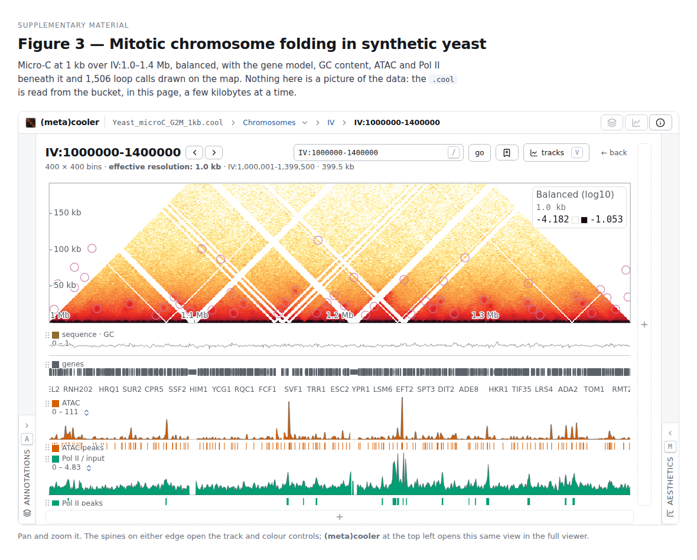

# metacooler-viewer

A browser-based viewer for [`.metacool`](https://github.com/js2264/metacooler) multi-genome
(metagenomic) Hi-C contact maps — and for `.cool`, `.mcool` and `.hic`, which open the same way and
behave the same once open.

Drop a file on the page and you get a sortable table of every MAG in it, the intra-genome contact
map of any one of them, and — the part no other browser does — the rectangular off-diagonal block
between *two* MAGs, which is where phage–host, plasmid–host and HGT signal lives.

Several files at once, as tabs. Two coolers in one square, split on the diagonal, when the question
is how they differ. And a plain 1D genome browser for when there is no contact map at all — a
`chrom.sizes`, a bigWig, a FASTA, a VCF or an indexed BAM is enough to start one, and dropping a `.cool` on it turns the
same tab into its map. Tick a few chromosomes and the axis becomes those chromosomes; open a FASTA
and the sequence is a lane of its own, GC content zoomed out and the bases themselves zoomed in. A VCF draws
the variants somebody called — each over the reference bases its record is about,
with structural ones at their real size, and a substitution in the colour of the
base it substitutes to, so it lines up with the sequence and the reads under it.
An
indexed BAM opens as **two** lanes: its depth, which is a coverage track like any other, and the
reads themselves in packed rows — coloured by strand, pair, insert size, mate or mapping quality,
with mates joined, split reads outlined, and a click on any read opening its flags, its CIGAR, its
clips, where its mate went and how far away. Close either one and keep the other; the filters that
decide which reads count are kept in step across both. Open a FASTA beside them
and the positions where the reads disagree with the reference are coloured in
the pile and marked on the depth, at the share of the depth that differs.

And then the analysis. An **Analysis** panel — the fourth panel, outermost on the right, `j` — lists fifteen tasks:
P(s), coverage, diamond insulation, virtual 4C, compartments with their saddle, **pattern detection**
— loops, borders, hairpins, centromeres and stripes, by template matching, as a faithful port of
[chromosight](https://github.com/koszullab/chromosight) that is goldened against that package's own
output — metaplots and APA with bootstrap confidence bands, loop ranking, track correlation, interval
overlap, and four that only a metagenome has — per-MAG contact QC, contig-level contamination calls,
chimera detection and the inter-MAG network. Each runs in a worker of its own, so the map stays live and pannable while a
whole-file scan is running. Results land in a resizable drawer, and every one of them exports:
bigWig for a signal, bedGraph, BED, TSV, PNG, and true vector PDF. The bigWig is written here, byte
by byte — no `bedGraphToBigWig` step, because a bigWig is what you actually wanted.

Files come in one at a time or by the folder. **Connect** — beside the add button — attaches a
directory on your machine or an S3 prefix, and a **Files** panel (`f`) browses it: crumbs, a filter,
and a `→` on every row that loads it into the tab you are in, or drag the row onto a map's edge to
say which stack a track belongs in. A directory and a bucket are the same thing to everything above
the byte layer, so it is one tree over both. A public bucket needs nothing but its link; a private
one takes a read-only key. In Chrome, Edge and the desktop app a connected directory is still there
after a reload — the browser keeps permission to list it and read what is in it, and nothing is
uploaded or copied — and in Firefox and Safari it is a snapshot for that visit, which the panel says
on the row rather than leaving you to discover.

`.hic` is read here too, at versions 7, 8 and 9 — which is most of the published mammalian Hi-C on
4DN, ENCODE and GEO. It costs no constraint: the format is block-indexed, so a region is a bounded
range read through the same byte layer as everything else, and a block is an *index* unit rather than
a tile — nothing is composited, and a read still hands up one whole bounded matrix. Its resolution
ladder becomes the same entry list an `.mcool`'s is, so the picker, the hash, the zoom ladder and the
deck all work on one with no code of their own.

There is no server. There is no upload. There is no preprocessing step. A file straight out of
`metacooler create` opens and works.

---

## The three constraints, and why they are the whole design

Everything below follows from these. They are stated first because most of what this project does
*not* do is a direct consequence of them.

**No backend of any kind.** No tile server, no metacooler process on a host, no accounts. The
viewer is static files; the data are objects on a bucket, or a file on your disk. This is what makes
the app free to run, free to archive, and impossible to take offline.

**Nothing is uploaded.** A local file is handed to a worker by reference and read in place through
the Emscripten filesystem. Nothing crosses the network, which is why there is no account system, no
storage, no hosting cost and nothing to review for GDPR. You can open unpublished patient-derived
metagenomes on a laptop with the network cable out.

**No preprocessing, and no companion file is ever required.** Two optimisations exist — a `zoomify`
resolution ladder and a genome-level edge list from `metacooler network` — and both are strictly
opportunistic. A plain `.metacool` behaves identically, minus the extra speed.

The architectural bet that makes all three affordable is that **MAGs are small**. A bacterial genome
is 2–6 Mb, so at 1–5 kb bins a single MAG's matrix is at most a few million cells and its non-zero
pixels are a bounded, contiguous slice of `/pixels`. One genome is therefore *one bounded read*,
held whole in memory, after which pan and zoom are pure canvas transforms with **zero** further I/O.
That is the central difference from HiGlass, which has to stream a 3 Gb genome and needs a tile
server, a tile cache and a tile compositor to do it. None of that is built here, because none of it
is warranted.

**Zooming does sharpen the picture, though** — the one thing on that list that turned out to be
worth having. A whole chromosome, or a whole genome of a cooler, is larger than any screen and
arrives already coarsened; zooming into it and having nothing happen is not the interaction anybody
has in their hands. So a zoom that settles past what the block in hand can show reads that window
again, at the grid the picture could show. It is still one bounded read drawn whole — no tiles, no
compositing — and it stops at the file's own bins, which for a MAG means it never starts. Two or
three blocks are kept so that zooming back out is a swap rather than a request. **Off by default** —
a zoom that reads is a zoom that can wait, and §2's promise is that it does not — and one press away
on the map's own controls, beside the 45° turn and the O/E baseline.

Two things break the small-MAG assumption, and both are handled as exceptions rather than as the
general case: `__unbinned__` (never displayable) and non-metagenomic coolers (region level only).
Both are covered under [Scope](#scope-what-this-is-not) below.

---

## Running it

### Node on this machine

Node is not on the system `PATH` here. Put it there first:

```bash
export PATH=/pasteur/helix/users/jaseriza/opt/node-v24.18.1-linux-x64/bin:$PATH
node --version   # v24.18.1, npm 11.16
```

`node_modules/` is already installed — **do not run `npm install`**.

> **Known limitation of this host.** `vite` and `vitest` both load `rollup`, whose native binary
> (`@rollup/rollup-linux-x64-gnu`) requires `GLIBC_2.29`; this machine has glibc 2.28, so
> `npm run dev` and `npm test` cannot start here. `npm run typecheck` and `npm run fixtures` are
> unaffected. Everything runs normally on any host with glibc ≥ 2.29.

### Commands

```bash
npm run dev        # vite dev server; open the printed URL and drop a file on the page
npm run build      # tsc --noEmit && vite build  →  dist/
npm run build:cli  # the analysis CLI            →  dist-cli/metacooler-run.mjs
npm run build:standalone   # one self-contained page  →  dist-standalone/index.html
npm run preview    # serve the built dist/ locally
npm run typecheck  # tsc --noEmit
npm test           # vitest run
npm run fixtures   # regenerate test/fixtures/ and test/golden/
```

### One HTML file

`npm run build:standalone` produces a single `index.html` — the whole viewer,
h5wasm included, with every script, stylesheet, worker and icon inlined. It has
no server and no install: put it on a USB stick, email it, open it by
double-clicking, drop a file on it.

It is also attached to every [release](https://github.com/js2264/metacooler.js/releases)
as `metacooler-viewer-<tag>.html`, so nobody has to build it.

What it is for is the machine the hosted app cannot reach: an air-gapped
cluster, a reviewer who will not install anything, a laptop holding unpublished
patient data whose owner would rather not take anybody's word about what gets
uploaded. Nothing is uploaded from any build of this app, but this is the one
where that is *visible* — there is no origin to upload to.

The cost is the honest one. A page opened from a disk has an opaque origin, so
**local files only**: remote URLs, the example datasets and the version picker
are all absent, not broken. It is about 11 MB, four fifths of it the HDF5
runtime, parsed on every open with no HTTP cache behind it — roughly a second
before the page paints. Verified in Chromium; Firefox and Safari are untested.
Every browser profile on a machine shares one `file://` origin, so its saved
sessions are shared with any other `file://` page — which matters only if you
open somebody else's.

### In somebody else's page

`?embed=1` mounts the same viewer with **no window around it** — one bar, one view — so it can be
the figure inside a portal, a lab page, a course page or a paper's supplementary material. Nothing
is installed at either end: it is an `<iframe>` and a URL. There is no package to depend on and no
header for the host page to set, which is the usual reason a wasm application cannot be embedded —
this one needs no cross-origin isolation, because it is single-threaded and carries its HDF5 runtime
inside its own bundle.

Here it is, in somebody else's page. **GitHub strips `<iframe>` out of a README**, so what follows is
a photograph of one — [click it and the live embed opens](https://js2264.github.io/metacooler.js/?embed=1#uri=https://rsglab-data.s3.eu-west-3.amazonaws.com/demo/yeast/Yeast_microC_G2M_1kb.cool&view=region&region=IV:1000000-1400000&transform=log10&balance=true), which is the same thing with the
data actually being read:

[](https://js2264.github.io/metacooler.js/?embed=1#uri=https://rsglab-data.s3.eu-west-3.amazonaws.com/demo/yeast/Yeast_microC_G2M_1kb.cool&view=region&region=IV:1000000-1400000&transform=log10&balance=true)

The bar across the top is the whole of the chrome: the mark and the name (a link that opens this same
view in the full viewer, in a new tab), the file and where you are in it, and on the right the two
panel toggles and **About** — which says what the viewer is, that nothing is uploaded, and which
build is in the frame. The two spines on the edges are the Annotations and Aesthetics columns,
folded; click either and it opens over the map.

And this is the markup. Paste it into a page and it works:

```html
<iframe
  src="https://js2264.github.io/metacooler.js/?embed=1#uri=https://rsglab-data.s3.eu-west-3.amazonaws.com/demo/yeast/Yeast_microC_G2M_1kb.cool&view=region&region=IV:1000000-1400000&transform=log10&balance=true"
  width="100%"
  height="640"
  loading="lazy"
  style="border: 0"
  title="Mitotic micro-C of synthetic yeast, IV:1.0–1.4 Mb"
></iframe>
```

**Three ways to say what it should show**, in the order they override one another:

| | what it carries | when to use it |
| --- | --- | --- |
| `#uri=…&view=…` | one file at one view | a map or a browser at a place, as above |
| `?config=<url>` | a published `.metacooler.json` | a composed figure — tracks, colours, marks |
| `#s=…` | a whole session, deflated into the link | what **Share** produces; no bucket needed |

`?config=` is the one to reach for. **Save** writes the file, it goes on a bucket beside the data it
names, and the names inside it stay relative — resolved against the file's own URL — so the folder
can be copied anywhere and every embed of it still opens:

```html
<iframe src="https://js2264.github.io/metacooler.js/?embed=1&config=https://your-bucket/figures/mitotic-arrest.metacooler.json"></iframe>
```

`#s=` says the same thing without a bucket, at the cost of length: the yeast figure above with its
eight files — sequence, gene model, ATAC and its peaks, Pol II over input and its peaks, 1,506 loop
calls — is about 1.2 kB of URL. Nothing truncates that in an `src=`; it is chat clients that wrap
long links, not browsers.

**For a paper, pin the build.** Every push is archived, so
`…/metacooler.js/v/<commit>/?embed=1#…` renders the same picture in five years, whatever the site
does next. `versions.json` lists what is published.

#### Where the viewer itself comes from

The `src=` above points at this project's GitHub Pages site, which is one answer and not the only
one. **The viewer is published to npm**, as a built directory rather than as something to import, so
a page can frame a copy that does not depend on anybody's domain staying up:

```html
<!-- from a registry CDN, immutable at that version -->
<iframe src="https://cdn.jsdelivr.net/npm/metacooler-viewer@0.11.0/dist/index.html?embed=1&config=…"></iframe>
```

```bash
# or vendored into your own site, which depends on nothing at all
npm pack metacooler-viewer@0.11.0
tar xf metacooler-viewer-0.11.0.tgz
cp -r package/dist /var/www/viewer/     # then src="/viewer/?embed=1&config=…"
```

That works because the published build uses a **relative base**: one tarball runs from `/viewer/`, from
`/npm/metacooler-viewer@0.11.0/dist/`, or from any other path, with no rebuild
(`vite.package.config.ts`). It is ~6 MB unpacked — the site build's 20 MB of source maps are not in
it — and it registers no service worker and asks for no version manifest, because a copy that does
not know where it is mounted has no scope to claim and no site to ask.

Two things to know. **End the URL in a slash, or name `index.html`**: a relative base resolves against
the document, so `…/viewer` without the trailing slash looks for the assets one directory too high.
And **check that your CDN serves the page as `text/html`** before relying on it — registry CDNs are
built for library assets, and one that answers `text/plain` will show you the markup instead of
running it:

```bash
curl -sI https://cdn.jsdelivr.net/npm/metacooler-viewer@0.11.0/dist/index.html | grep -i content-type
```

Vendoring has no such question, and same-origin hosting is worth it for two more reasons: your data
needs no CORS entry at all, and the File System Access pickers keep working inside the frame, since
they are only unavailable *cross-origin*.

**Or one file, with no directory and no CDN.** Every release attaches
`metacooler-viewer-<tag>.html` — the whole viewer inlined (`npm run build:standalone`). Served over
http(s) it embeds like any other copy and reads remote data normally:

```html
<iframe src="./metacooler-viewer-0.11.0.html?embed=1&config=./figure.metacooler.json"></iframe>
```

It costs ~12 MB parsed on every frame load with no cache split, which is fine for one figure on a page
and wasteful for six. Opened from a **disk** it is a different thing — a `file://` page has an opaque
origin, so local files only (§19).

#### Driving it from the page

Four messages, and the frame speaks only to the window that framed it, only after that window has
spoken to it:

```html
<iframe id="map" src="https://js2264.github.io/metacooler.js/?embed=1&config=https://your-bucket/figures/one.metacooler.json"></iframe>
<p id="where"></p>

<script>
  const VIEWER = 'https://js2264.github.io'
  const frame = document.getElementById('map')
  const tell = (message) => frame.contentWindow.postMessage(message, VIEWER)

  addEventListener('message', (event) => {
    if (event.origin !== VIEWER || event.source !== frame.contentWindow) return
    // `ready` is the frame saying it is listening; answering subscribes to the rest.
    if (event.data.type === 'metacooler:ready') tell({ type: 'metacooler:where' })
    // …and then one of these on every move the reader makes, and after every navigate.
    if (event.data.type === 'metacooler:state') {
      document.getElementById('where').textContent = event.data.state?.region ?? 'the whole file'
    }
  })

  // A table of loci beside the figure: one line each.
  for (const row of document.querySelectorAll('[data-locus]')) {
    row.onclick = () =>
      tell({ type: 'metacooler:navigate', state: { view: 'region', region: row.dataset.locus } })
  }
</script>
```

`navigate` takes a **patch** over what is on screen, so `{ locus: 'IV:400,000-460,000' }` moves a
browser without the page having to know what else is in the state; a key sent as `null` is removed,
and `state: null` goes back to the picker. It is validated by the same reader that validates a
pasted link, so what comes back in `state` is where the view actually went rather than an echo of
what was asked for.

#### What an embed has, and what it does not

**Two of the five columns**: Annotations and Aesthetics, because they are controls over the *picture*
— which lanes are drawn, how they are coloured, scaled and clipped — and a reader looking at somebody
else's figure has every reason to reach for them. The other three are about the window and the work
around it: Files is the places this window has been connected to, General is a reference card about
the file, Analysis starts jobs. Both arrive **folded**, standing as named spines on either edge
whatever anything else says, because an embed is a picture first: a column is open until somebody
folds it, so a frame that honoured that came up behind five open columns with about thirty pixels of
map between them.

Gone with the window: the header, the tab strip and the status bar. Three things come with that. It
writes **no history entries** — a frame's `pushState` spends the reader's Back button, so the address
bar is kept in step by replacing rather than pushing. It **remembers nothing**: no tab strip, no
restore offer, and the columns neither read nor write the fold and width kept for the full app, so a
reader who opens a panel inside your figure does not find the application rearranged next time they
go to it. And it registers **no service worker** and offers no version bar, since an embed is not an
app to install.

Dropping a file on it works exactly as it does anywhere else. What a cross-origin frame cannot do is
the *File System Access* pickers — they are present and reject when called — so an embed falls back
to an ordinary file input, which is the same path Firefox and Safari take everywhere.

The whole contract is [SPECS.md §21](SPECS.md).

### The analysis from a shell

The fifteen tasks are reachable without the panel, over as many files as you
like, through the same kernels and the same writers:

```bash
npm run build:cli
node dist-cli/metacooler-run.mjs tasks
node dist-cli/metacooler-run.mjs insulation *.mcool --window chrII --out results/
node dist-cli/metacooler-run.mjs chromosight sample.cool --pattern borders --balance --out results/
node dist-cli/metacooler-run.mjs apa sample.cool --pairs loops.bedpe --norm chromosight --balance
node dist-cli/metacooler-run.mjs replay workspace.metacooler.json --over 'data/*.hic'
```

`replay` takes the workspace file **Save** produces — every open tab in one
file — and re-runs the analyses recorded in it, with the parameters in it, over
other files: parameters chosen by looking at a picture, applied to the other
hundred and ninety-nine without retyping. It replays the tab that was in front
unless `--tab <n>` names another. Local files only: the reader's range requests
are synchronous and exist in a worker rather than in Node.

### Goldens from the reference tools

`scripts/make_goldens.sh` builds a set of oracles from the published tools' own
command lines — no Python of ours in the path — over two maps on the demo bucket:

```bash
./scripts/make_goldens.sh
```

`chromosight detect` calls loops on the yeast micro-C map and borders on a
chicken G2 map, written out as BEDPE and BED; `cooltools` writes coverage, E1,
insulation and a virtual 4C off the chicken map as bigWig; and `cooltools
pileup` piles up both call sets. Every line runs every time — nothing is
cached, nothing is conditional — into `goldens/`, with a `sha256sum` of the lot
at the end. Delete the directory to start over.

It needs `pandas<3` (bioframe still passes `verbose=` to `read_table`) and
`bedGraphToBigWig` on `PATH` (cooltools' `--bigwig` shells out to it); the
header of the script says so.

`npm run fixtures` shells out to Python and needs an interpreter with `metacooler` installed:

```bash
METACOOLER_PYTHON=/pasteur/helix/users/jaseriza/repos/metacooler/.venv/bin/python npm run fixtures
```

It uses **only** the public `metacooler` and `cooler` CLIs — no hand-written HDF5 — and then exports
one golden JSON per fixture straight out of the Python API. `test/fixtures/` is generated and
gitignored; `test/golden/` is committed, so a `metacooler` upgrade that changes the format fails at
the golden boundary rather than somewhere in the middle of the app.

Large real-world files live in `data/` and are gitignored. Tests that need them
(`test/unit/real-file.test.ts`) skip with a named message when they are absent.

---

## Repository layout

```
src/
  types.ts constants.ts errors.ts format.ts uri.ts   # the shared contract
  embed.ts       how this page was mounted: ?embed=1, ?config=, and the frame check
  sources/       ByteSource implementations: LocalFileSource, RemoteRangeSource
  h5/            the only code that imports h5wasm or touches raw HDF5 bytes
  metacooler/    the reader: detect, MetaCooler, coords, range, matrix, aggregate,
                 and store.ts — the PixelStore seam the two containers meet at
  hic/           the only code that knows what a .hic looks like on disk: the
                 header and footer, the block index and its two numbering
                 schemes, and the cooler-shaped handle that hides all of it
  genome/        an assembly with no matrix behind it, and its one axis
  browse/        a place read as a tree: one interface, a directory backend and a
                 bucket one, and the name-routing both of them show rows by
  s3/            SigV4, the bucket scopes, and ListObjectsV2 as a folder listing
  worker/        message protocol; the worker owns all I/O
  render/        canvas heatmap, matplotlib LUTs, colour scale, colourbar, the
                 diagonal blend for two files, the 1D browser's ruler and arcs
  state/         ViewState and its URL-hash serialisation
  ui/            file picker, genomes/contigs tables, genome/pair/region views,
                 the 1D browser, its vector-PDF page, errors
  annotations/   the tracks and annotations layer: parsers, store, and their own worker
  analysis/      the fifteen tasks (§18): descriptors, pure kernels, a worker of its
                 own, the run/ adapters that walk pixels, and write/ — TSV, bedGraph
                 and a bigWig writer with no dependency behind it
  app/           App (the window, the tabs, the address bar), Session (one file),
                 and EmbedChannel — four postMessage messages for a host page
  main.ts        three lines of bootstrap
scripts/
  make_fixtures.py  make_golden.py  make_analysis_golden.py  gen_luts.py
test/
  fixtures/ (generated)   golden/ (committed)   unit/
docs/
  hosting.md     bucket configuration for published files
  deploy.md      publishing the app itself to GitHub Pages
vite.package.config.ts   the sixth build: the copy that goes to npm, relative base
SPECS.md         the specification — section numbers are cited throughout the source
IMPLEMENTATION.md  the build plan, and nine corrections where the docs were wrong
TASKS_PLAN.md    the build plan for §18, the Analysis panel
```

Three layering rules are enforced rather than encouraged, because breaking any of them is silent:

- **`h5wasm` is imported only under `src/h5/`.** That is what makes the local and remote paths
  identical everywhere downstream.
- **`@gmod/bbi` is imported only by the annotations worker.** Same rule, same reason: no file parser
  belongs in the main-thread bundle, and the demo GTF alone is ~310 ms of parsing.
- **No coordinate ever comes from `/bins`.** With fixed bins the entire coordinate model is
  arithmetic over `indexes/chrom_offset` and `contigs/length`, so one of the four large tables in the
  file is never touched — not on open, not per view, not over the network.
  `test/unit/real-file.test.ts` records every dataset path the reader touches while loading a MAG and
  fails if `/bins` appears. There is exactly one read of it in the whole reader: two bounded slices of
  `/bins/weight`, for the bins on screen, and only when balancing was asked for (§6.4).
  `test/unit/bins-guard.test.ts` proves the rule for every other path.

---

## What is implemented today

Read against the milestones in `IMPLEMENTATION.md`. This section describes the code that is on disk,
not the plan.

| | Milestone | State |
|---|---|---|
| M0 | Fixtures and golden oracles | **done** — 13 fixtures, 13 goldens + manifest, regenerated by one command |
| M1 | Reader core, headless | **done** — URI parsing, detection and acceptance gates, `MetaCooler`, fixed-bin coordinates, extents, range parsing |
| M2 | Matrix queries | **done** — bounded reads, dense-size guard, COO → dense, transpose handling, contig/genome roll-up |
| M3 | Render and first visible app | **done** — canvas heatmap with matplotlib's own LUTs, `metacooler show` defaults, genomes table, genome/pair/region views, breadcrumb, URL-hash state |
| M4 | Interaction | **done** — pan, zoom, level toggle and cross-navigation; a gesture still costs nothing, and a *settled* zoom past the block's own grid reads the window again (`src/ui/refine.ts`). The mmetacool and mcool resolution ladders are wired to it: a coarse read comes from the coarsest rung whose bins still fill a cell, which is fewer pixels for the same picture and the only honest way to draw a balanced map at a coarse grid |
| M5 | Remote sources | **done** — `RemoteRangeSource` (range probe, LRU chunk cache, the two distinct §10 refusals), `docs/hosting.md`, and the §12 request-budget regression tests in `test/budgets/` |
| M6 | bigWig tracks | **done, and wider than the milestone** — `src/annotations/` reads bigWig (`@gmod/bbi` v10), bedGraph/wig, GTF/GFF, BED/narrowPeak/broadPeak/BED12, BEDPE, FASTA and BAM in a worker of their own; `src/render/` draws them as lanes on any of the map’s four edges and as overlays on it; three sidebar cards drive them. Offered on every container (§8.5) |
| M7 | cool / mcool | **done** — opened natively, not as a synthesised one-genome metacool: a cooler's `/chroms` is the contig table, `genomes` is `null`, and its chromosomes are the landing view. Genome-wide is a first-class view whenever the size estimate says this machine can hold it (a yeast genome at 1 kb is 12,100 bins and opens in one read); balancing from `/bins/weight` is wired to a toggle. An `.mcool` root is refused by name and the app opens its finest resolution |
| M8 | Catalog, deploy, benchmarks | **partly** — a GitHub Pages workflow builds and publishes the app (`docs/deploy.md`); no `scripts/make_catalog.py` and no benchmarks |
| — | Sessions, comparison, 1D browser | **done** — tabs with a worker each (§5.6); a second cooler in the lower-left triangle, split on the matrix diagonal (§5.7); and a genome browser that needs no map at all, entered from a `chrom.sizes`, a bigWig, a bigBed, a FASTA, a BAM or a feature file (§5.8) |
| — | Metadata annotations (§8.12) | **done** — the columns a file already carries about its own genomes, sequences and bins, discovered from its `/genomes`, `/contigs` and `/bins` tables and drawn as lanes beside the map: bars for a measurement, runs of colour for a set of labels. Indexed by the map's own cells rather than by base pairs, so a MAG's completeness draws on a genome × genome overview where no other lane can — and offered only where its own table is no finer than the axis. The one annotation that never needed the §8.5 gate lifted, since a column of a file's own tables *is* the map's axis and has nothing to be matched against |
| — | Embedding (§21) | **done** — `?embed=1` mounts the same build chrome-less, `?config=<url>` opens a published `.metacooler.json` named in the address, and `postMessage` carries *go here* / *tell me where you are*. No backend and no header for the host page to set. A frame never writes history entries and remembers nothing, so an embedded figure neither spends the reader's Back button nor comes back showing where somebody else left it |
| — | The package (§22) | **done** — the viewer is published to npm as a built directory with a *relative* base, so one tarball runs from a registry CDN, from a lab site's `/viewer/`, or from any other path, with no rebuild. What it buys is an embed that depends on nobody's hosting; `npx metacooler-run` comes with it |
| — | Analysis (§18) | **done** — every task in `TASKS_PLAN.md`'s catalogue, in a fourth worker so a whole-file scan never blocks the view; a resizable drawer; results that come back as synthetic tracks in the Annotations panel, indistinguishable from a loaded bigWig; and a bigWig writer of this repo's own. Goldened against cooltools, coolpuppy, pyBigWig and numpy on the demo micro-C map |

Other gaps worth naming rather than discovering:

- **The genome × genome overview does not refine.** Everything else does — a region, a genome, a
  pair, a whole file, and every panel of a deck — but the overview's axes are genomes or contigs
  rather than positions, so a cell there *is* a sequence and there is no finer grid under it. The
  entry picker also stays: a ladder is now driven by the zoom, and a reader who picks a rung by hand
  has still said something the zoom does not overrule.
- **The genome × genome overview** is implemented and correctly gated (explicit action, progress,
  cancellable; refused over HTTP above a size threshold; instant when a `metacooler network
  --level genome` edge list is advertised), but has not been exercised end-to-end on a large remote
  file.

Tests currently live in `test/unit/`: `reader-core`, `render`, `viewstate`, `real-file`,
`mmetacool`, and — for §8 — `annotation-parse`, `annotation-store`, `locus-axis` and `track-lanes`.
The annotation parsers are run against the *published demo files* rather than against three lines
written to pass: a real Ensembl GTF, two real MACS narrowPeaks and a real loop table. The §18
kernels have a file each (`analysis-insulation`, `analysis-apa`, `analysis-compartments`, …), and
`bigwig-write` reads every file it writes back with `@gmod/bbi` — the same library the app reads
other people's bigWigs with — then walks the B+ tree byte by byte, because no reader in existence
checks an internal node's keys and a wrong one is invisible until someone else's tool opens the file.

---

## Scope: what this is *not*

Every item here is a decision that removed code, not a feature that ran out of time.

**Fixed-bin files only.** `bin-type = "variable"` — fragment-level and contig-level metacools — is
refused at open, with a message naming the file's actual bin type and pointing at
`metacooler binnify`. Excluding variable bins is what makes the coordinate model pure arithmetic and
what deletes every read of `/bins`.

**`contig-ordering = genome-then-length` only.** Any other ordering is refused, naming the ordering
the file actually has. Only a genome-grouped layout puts each genome in one contiguous block of
bins, which is what makes a genome — or a genome *pair* — a single bounded read. The known cost is
real: files built from a cooler (`cool` ordering) or from a FASTA-ordered assembly are excluded.

**`__unbinned__` is never displayable.** The reserved genome holding every contig that binning
failed to assign is not a genome, and it breaks the small-MAG assumption outright. It is absent from
the genomes table with no toggle, not selectable as either axis of a pair, and refused as a range
label with its own message rather than a generic "unknown name". It is matched by **name**, never by
index, because `create --drop-unassigned` omits the row entirely and makes genome 0 an ordinary MAG
in exactly the files that were binned best.

Nothing is renumbered to make it disappear: `genome_id`, `genome_offset` and every bin index stay
exactly as written, and exclusion happens at selection and display time only. The single exception
is one read-only QC statistic in the file info panel — *"unassigned: 67,058 contigs / 23.8% of
bins"* — because that fraction is a direct diagnostic of binning quality that a metagenomics reader
will look for. It is a number, not a view: it opens nothing and selects nothing.

**Annotations are for one assembly at a time, and every container has one.** Gene models, tracks,
peak sets, loop calls and hand-drawn marks are offered on a cooler, on a `.metacool`, and on a genome
opened with no map at all. They used to be *absent* on a metacool, on the grounds that a metagenome's
axis is contigs from thousands of independently assembled organisms — but the premise was wrong about
the files people have: a metagenomic Hi-C dataset is *one* co-assembly, so `/contigs` is one
namespace and a bigWig over it is keyed on exactly those names. What a metagenome needed was not a
gate but an honest overlap report, in **MAGs** rather than in sequence counts, since `794 of 20,566`
is arithmetically true and reads exactly like a file that failed to match. See SPECS §8.5.

**Two files compared, not N.** The second map goes in the half of the square the first one was
mirroring, and there is no third half. It must be a cooler with the same chromosomes and the same bin
size, because every coordinate in the picture is an index into one list of sequences and one grid
cannot be two resolutions. Same chromosomes, not the same *spellings* — see below. SPECS §5.7.

**Nomenclature is not a compatibility problem.** `chr1`, `1`, `01`, `I` and `NC_000001.11` are the
same chromosome, and files that name it differently open side by side, navigate as one deck and take
each other's tracks. `chrM`, `MT` and `MtDNA` are one mitochondrion; `chrXII` is `12`;
`chrUn_GL000220v1` is `GL000220.1`. What it will not do is guess: `2L` is not `2`, a `NODE_1` out of
an assembler is nobody's chromosome one, and where the two files also disagree about a sequence's
*length* the match is reported rather than taken quietly — hg19's `chrM` and hg38's `chrM` are one
name and two sequences. There is no alias table to download and no assembly to declare; `X` is read
as the tenth chromosome or as the sex chromosome according to what else is in the file. SPECS §5.9.

**cool and mcool are whole-genome only where it fits, and this is not a HiGlass replacement.** The
entry point is the contigs table; a `chrom:start-end` selection loads through the same bounded-read
path as a MAG; and the whole matrix is a view of its own whenever a size estimate against
`navigator.deviceMemory` says this machine can hold it — a yeast genome at 1 kb is 12,100 bins and
opens in one read, human chr1 at 5 kb does not. Anything larger than the picture is coarsened in the
*read* rather than refused, and a zoom sharpens it back down to the file's own bins. What is still
not built is the thing that makes HiGlass HiGlass: no tile server, no tiles, no picture assembled
out of parts, and so no view of a 3 Gb genome. The claim is zero-install inspection of any cooler
that fits, **plus** a genome hierarchy HiGlass has no concept of — not a general Hi-C browser.

### Non-features

Stated as decisions so they are not mistaken for omissions: no tile server; no tiles and no picture
assembled out of parts; no user accounts; no file upload; no server-side computation of any kind; no
required companion files; no required preprocessing; no support for orderings other than
`genome-then-length`; no whole-genome view that does not fit in memory (the limit is measured, not a
category — see SPECS §9); **no write access of any kind** — the viewer never modifies a file it
opened.

That last one is worth spelling out now that the app writes bigWigs. It has always *produced* files
— a PNG, a PDF, a BED of hand-drawn marks, a saved workspace — and a bigWig is one more of them: new
bytes handed to the browser as a download, needing no server, touching nothing that was opened. The
line is between authoring an output and editing an input, and only the second is refused. Which is
also why there is **no writing of `.cool`, `.mcool` or `.metacool`**: h5wasm could create one, so
that is a decision and not a limitation. Three more arrive with the analysis panel, for the reasons
given in SPECS §18.9: no loop or dot calling, no contact-based contig reordering or scaffolding, and
no differential APA.

---

## Correctness

The reader is a mirror of the Python `MetaCooler`: same names, same semantics, same error text.
Where this repo and `metacooler/api.py` disagree, this repo is wrong.

That is enforced rather than asserted. `scripts/make_golden.py` exports, from Python, the `info`
block, both tables, all three index arrays, every genome extent, a battery of range strings
including the error cases, thirteen dense matrices at bin/contig/genome level, and
`pixels_for_genome_pair` records — and **exact integer equality is the bar** for anything derived
from counts. Two failure modes justify that on their own: the upper-triangular transpose (get it
wrong and every inter-genome panel is silently blank), and the aggregation fold (get it wrong and
every contig-level diagonal is silently doubled, which reads as "the diagonal is strong" rather
than as a bug).

`test/unit/real-file.test.ts` adds the check that fixtures cannot make: it opens a real 26 MB,
4,395-MAG MetaTOR output and asserts numbers that were read out of the file with `h5py` before any
of this code existed.

**The analysis has goldens of its own**, on the same principle and against different tools.
`scripts/make_analysis_golden.py` (`npm run fixtures:analysis`) builds eight of them from
`demo/yeast/Yeast_microC_G2M_1kb.cool` — a real 1 kb micro-C map, the one the app opens in the demo —
using **cooltools**, **coolpuppy**, **pyBigWig** and **numpy**, and `test/unit/analysis-golden.test.ts`
runs the kernels against them.

Each golden carries two oracles, and the split is the design rather than a convenience. `direct` is
this repo's own definition recomputed in numpy and is compared to **equality**: it is what catches a
transposed index or a doubled diagonal. `reference` is the other tool's number under *its* definition,
compared to whatever relation actually holds — and three of those relations are exact:

- **P(s)** is two curves off one accumulator and both are goldened. The **expected** value — the
  mean contact per pair of bins at a separation, which observed/expected and the pileups divide by —
  equals cooltools' `expected_cis` cell for cell, once cooltools is told not to mask the first two
  offsets; the mirrored dense block doubles both the sum and the count, and the mean is what
  survives. The curve the panel **plots** is the probability density, and it equals
  `HiContacts::distanceLaw()`'s `norm_p` — same break positions, same values — against that
  package's own pipeline run in R by `scripts/hicontacts_ps.R`.
- **Coverage** satisfies `cooltools_cis == ours + diagonal`, exactly. cooltools sums the pixel table
  by both ends so a diagonal pixel counts twice; this repo counts it once, deliberately, and the
  identity is the proof that the difference is the one intended and not an off-by-something.
- **APA** equals coolpuppy's pileup, once the loops whose window would cross the main diagonal are
  left out. With them in the two differ by about 1 %, and every differing cell is below the diagonal.

**Insulation is not one of them, and the golden says so in five clauses.** cooltools' diamond is
offset by a row, drops the first two diagonals, divides by a count of valid positions, normalises by
the region median rather than the contig mean, and masks positions near a dropped bin. Both are
published definitions of the same thing; what is left between them is a correlation of 0.61–0.85 on
this dataset, and the golden records the measured value per chromosome and window so the test can
assert the correspondence has not degraded rather than pretend to an equality that was never true.

---

## Documents

- `SPECS.md` — the specification. Source files cite its section numbers (§3.3, §7.4, …) at the
  points where a decision is not obvious from the code.
- `IMPLEMENTATION.md` — the build plan, plus nine corrections where the metacooler documentation
  disagreed with the metacooler source. Those corrections are load-bearing; the one most likely to
  be re-broken is that `bin-size` can be the *string* `"null"`, so it must go through a verbatim
  port of Python's `_int_attr` rather than `Number()`.
- `TASKS_PLAN.md` — the build plan for the Analysis panel and drawer (SPECS §18): the task model, the
  worker that keeps the map live while a job runs, the native bigWig writer with its byte layout
  written out, the catalogue of tasks, and the goldens each of them has to match. Its milestones
  carry a *Changed during the build* note wherever the code diverged from the plan, which is most of
  what a reader of both documents needs.
- `docs/hosting.md` — the bucket configuration a published `.metacool` needs, and why GEO and SRA
  cannot serve as hosts.
- `docs/deploy.md` — how the site is built and published, how it works offline, how past builds
  stay reachable, and how a release is cut.
- `CHANGELOG.md` — what changed between versions. The running build names itself in
  **About → version**: version, commit and commit date — and the dropdown under it runs any of the
  recent builds at `…/v/<commit>/`, or any tagged release, permanently, at `…/v/v0.5.1/`. Useful
  when a figure came out differently last month, and the release URL is the one to cite; not
  available in the desktop app, which is versioned by being installed.

## Licence

MIT.
