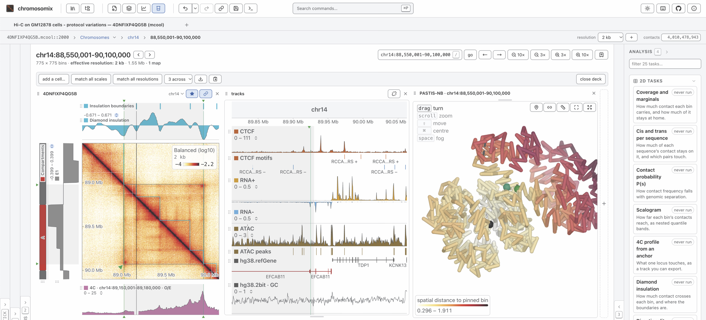

# chromosomix

[](https://chromosomix.app/)
[](https://github.com/js2264/chromosomix/actions/workflows/test.yml)
[](https://github.com/js2264/chromosomix/actions/workflows/deploy.yml)
[](https://www.npmjs.com/package/chromosomix)
[](https://github.com/js2264/chromosomix/releases)
[](https://chromosomix.app/validation/)
[](LICENSE)

**A unified genome browser for multi-dimensional genomic data.** Chromatin contact maps, genome tracks and 3D models, side by side, straight from your files.

chromosomix launches in about a second and reads your data where it lives, on your own disk or in the cloud. No server, no preprocessing, no installation, no account, and it works offline. Most formats open as they are: `.*cool`, `.hic`, HiC-Pro, `.pairs`, bigWig, BED, BAM, FASTA/`.2bit`, 3D structures and more.

<p align="center">
  
</p>

## Main features 

- Support for all genomic data types: 
  - Supports 1D genomic formats: bigWig, bigBed, BED, bedGraph, wig, GTF/GFF3, FASTA (+`.fai`), `.2bit`, BAM, VCF, barChart/bigBarChart, genePred/refFlat/bigGenePred, bedMethyl/bigMethyl, chrom.sizes, ...
  - Supports 2D genomic formats: `.*cool`, `.hic`, HiC-Pro, `pairs(.gz)`, ..., at every resolution the file stores. Also supports interaction formats: BEDPE, and UCSC's `interact`/`bigInteract` and `longrange`/longTabix — drawn as arcs over the contact map and as their own lane in the 1D browser.
  - Supports 3D genomic formats: WashU's g3d (text or binary), `.3dg`, and `bed3d`, drawn in 3D and synchronized with the maps and tracks view. Every model also leaves as a PDB for PyMOL, ChimeraX and the other molecular viewers, a chain per chromosome and bonds along the fibre, and reads back here. 

- Perform analyses directly in the browser:
  - 1D analysis tasks: peak calling from a coverage track (yapc, with IDR between replicates), motif search, base composition and GC skew, the origin and terminus of replication, metaplots, track correlation, FRiP over a feature set, signal by group, interval overlap with a shuffle null, ...
  - 2D analysis tasks: P(s) (and its four pair orientations), scalogram, diamond insulation, directionality index, HiC score, coverage, cis/trans per chromosome, virtual 4C, compartments annotation and saddle plot, the alignment of a bacterial chromosome's two arms, loops and borders detection, APA, loop ranking, ...
  - 3D analysis tasks: build a 3D model from the contact map (pastis-NB or ShRec3D), compare a 3D model with the contact map, and turn a 3D model into tracks.

- Serverless browser & CLI-based: there is no upload, no required preprocessing step and no backend of any kind — the viewer is static files that read standard genome-wide formats directly. Every analysis can be run **interactively**, in the browser, or **programmatically**, with the `chromosomix` command line in a script or a pipeline: the same tasks, with the same parameters, producing the same results. A bottom Console panel in the browser records every run and reports the `chromosomix` command that repeats it.

- Dedicated browser panels, four around the picture:
  - General panel: the file itself — its attributes, its chromosomes (or a metagenome's genomes and contigs), a minimap of the genome and the metadata it stores.
  - Aesthetics panel: to customize scales, color map, normalization, track layout, grouping, ...
  - Annotations panel, supporting linear tracks, 1D and 2D manual annotations, bookmarks and synthetic annotations.
  - Analysis panel: runs the analyses above on what is on screen, with exportable results.

- Virtual file system: The browser runs entirely in the client, with no server-side processing or data upload. It uses a virtual file system to access local files, remote files, and cloud storage: 
  - Cloud-based file access: Open files directly from any object store that serves byte ranges with CORS (e.g. S3, Cloudflare R2, Google Cloud Storage, or any HTTP server that supports range requests), from Dropbox and Google Drive share links, and private Google Drive folder or Dropbox.
  - Stores: several pre-configured remote data stores are available — the lab's own figures, IGV's genomes, 4DN open data, ENCODE, DNA Zoo and Roadmap — and so is any UCSC track hub with a `hub.txt` file. The user can also setup their own store by providing a structured JSON file describing the store and its data.

- Side by side: contact maps, 1D browsers and 3D models open as the cells of a deck, panned and zoomed together, and several sessions stay open at once, one tab each.

## Philosophy

1. **No backend or install of any kind.** No tile server, no specific process on a host, no accounts. The viewer is static files; the data are objects on a bucket, or a file on your disk. This is what makes the app free to run and free to archive.

2. **Nothing is uploaded.** A local file is handed to an air-gapped worker by reference and read in place through the Emscripten filesystem. Nothing crosses the network, which is why there is no account system, no storage, no hosting cost and nothing to review for GDPR. You can open unpublished patient-derived genomic data on a laptop with the network cable out.

3. **No pre-parsing of genomic files is required.** Contact maps and 1D genomic files are read in bounded reads, and the rest is pure canvas transforms with **zero** further I/O. That is the central difference from HiGlass, which needs a tile server, a tile cache and a tile compositor to stream contact maps. 

## Using chromosomix

### Use it from a web browser

Go to [`chromosomix.app`](https://chromosomix.app/) to open the viewer in a web browser. The app runs entirely in the browser, with no server-side processing or data upload.

### Install as a PWA (Progressive Web App)

Go to [`chromosomix.app`](https://chromosomix.app/) and: 

- On **Chrome** or **Edge**: click on the **Install** in the URL bar (far right button). 
- On **Safari**: click on **Share → Add to Dock**.
- On **Firefox**: support to be added soon. 

The app is then available offline as a desktop app as a PWA (Progressive Web App).

### Install as a desktop app

To install the app as a desktop app, you can fetch the latest release from [https://github.com/js2264/chromosomix/releases](https://github.com/js2264/chromosomix/releases). Builds are available for macOS (`.dmg`, Intel and Apple silicon) and Linux (`AppImage`, `.deb`); the Windows installer is temporarily not built, and on Windows the static HTML page below needs no installer at all. The app is then available offline as a desktop app.

### From a static HTML file

Every release produces a single `index.html` (about 14 MB). It has
no server and no install: put it on a USB stick, email it, open it by
double-clicking and you end up with a fully functional genome browser.

It is attached to every [release](https://github.com/js2264/chromosomix/releases)
as `chromosomix-<tag>.html`, and `npm run build:standalone` builds it from a clone.

## Embedding chromosomix in a page

A minimal version of the viewer can be added to any HTML page as an `<iframe>`. Nothing needs to be installed. There is no extra package dependency and no modifications to make to the page's header, just drop the `<iframe>` in. The `src` attribute is the URL of the viewer, with a query string that tells it what to show.

```html
<iframe
  src="https://chromosomix.app/?embed=1#uri=https://rsglab-data.s3.eu-west-3.amazonaws.com/demo/yeast/Yeast_microC_G2M_1kb.cool&view=region&region=IV:1000000-1400000&transform=log10&balance=true"
  width="100%"
  height="640"
  loading="lazy"
  style="border: 0"
  title="Mitotic micro-C of synthetic yeast, IV:1.0–1.4 Mb"
></iframe>
```

Paste it into a page and it works (not rendered here though because GitHub does not allow `<iframe>`). The `src` URL is the same as the one you would use to open the viewer in a browser, with the addition of `?embed=1` to tell it to hide the header and tab strip. 

## Using the chromosomix analysis CLI

Over thirty analysis tasks can be executed programatically through the CLI, with the same parameters and producing the same results as the Analysis panel interactively. This can be used in a pipeline or a script.

### Installing the CLI

The CLI is published to npm with every release. It needs Node 22.12 or later on the machine:

```bash
node --version
```

Then install the `chromosomix` command globally, at the latest release:

```bash
npm install -g chromosomix
```

To pin a release instead, which is what a pipeline or a methods section should do, name its version; `npx` runs a given version without installing anything:

```bash
npm install -g chromosomix@<version>
npx chromosomix@<version> insulation sample.cool --window 10 --out results/
```

`chromosomix --version` prints the version on its first line, then the Node it runs on and the versions of the two libraries that read every map and track, `h5wasm` and `@gmod/bbi`, as they are installed.

To run the CLI from a clone instead, for example to try a change before it is released:

```bash
git clone https://github.com/js2264/chromosomix
cd chromosomix
npm install
npm run build:cli && npm link
```

### Running tasks

Once it is installed, run the following command to see the available tasks and their parameters:

```bash
chromosomix tasks

## coverage
##     Coverage and marginals
##       --total (default true)  total coverage
##       --fraction (default false)  cis fraction
##       --cis (default false)  cis coverage
##       --trans (default false)  trans coverage
##       --balance (default false)  use balancing weights
## 
## cistrans
##     Cis and trans per sequence
##       --sequences  sequences
##       --bars (default "cis")  bars per sequence
##       --normalise (default "enrichment")  off-diagonal value
##       --minContacts (default 10)  least contact worth listing
##       --maxEdges (default 500)  pairs to list
##       --matrix (default true)  draw the square
##       --no-balance  read the raw counts (balanced by default where the file carries weights)
## 
## cellqc
##     Per-cell contact QC
##       --cells (default "all")  cells
##       --nearFrom (default 23000)  near band, from
##       --nearTo (default 2000000)  near band, to
##       --mitoticTo (default 12000000)  mitotic band, to
##       --no-balance  read the raw counts (balanced by default where the file carries weights)
## 
## expected
##     Contact probability P(s)
##       --scope (default "contig")  scope
##       --sequences  sequences
##       --quantity (default "density")  quantity
##       --factor (default 1.1)  log bins per step
##       --minSeparation (default 2)  minimum separation
##       --derivative (default true)  log-log slope
##       --stranded (default false)  four orientations
##       --pairsUri  .pairs file
##       --no-balance  read the raw counts (balanced by default where the file carries weights)
## 
## scalogram
##     Scalogram
##       --quantiles (default "standard")  quantiles
##       --reach (default 0)  look out to
##       --sequences  sequences
##       --ignoreDiags (default 1)  diagonals to ignore
##       --minValid (default 0.5)  minimum coverage of the distribution
##       --no-balance  read the raw counts (balanced by default where the file carries weights)
## 
## fourc
##     4C profile from an anchor
##       --anchor  anchor
##       --normalise (default "none")  normalisation
##       --cis (default true)  cis only
##       --excludeAnchor (default false)  exclude anchor region
##       --no-balance  read the raw counts (balanced by default where the file carries weights)
## 
## insulation
##     Diamond insulation
##       --window (default 10)  window
##       --scales (default 1)  scales
##       --sequences  sequences
##       --ignoreDiags (default 2)  diagonals to ignore
##       --no-balance  read the raw counts (balanced by default where the file carries weights)
##       --call (default true)  call boundaries
##       --prominence (default 0.2)  minimum prominence
##       --minValid (default 0.5)  diamond coverage to call
##       --spacing (default 0)  minimum spacing
##       --domains (default true)  domains between them
## 
## di
##     Directionality index
##       --window (default 50)  window
##       --sequences  sequences
##       --ignoreDiags (default 0)  diagonals to ignore
##       --minValid (default 0.5)  minimum coverage of each side
##       --no-balance  read the raw counts (balanced by default where the file carries weights)
##       --call (default true)  call borders
##       --prominence (default 10)  minimum prominence
##       --spacing (default 0)  minimum spacing
##       --domains (default true)  domains between them
## 
## hicscore
##     HiC score
##       --diagonals (default 3)  diagonals
##       --sequences  sequences
##       --ignoreDiags (default 0)  diagonals to ignore
##       --minValid (default 0.5)  minimum coverage of the line
##       --no-balance  read the raw counts (balanced by default where the file carries weights)
## 
## compartments
##     Compartments
##       --sequences  sequences
##       --contacts (default "cis")  contacts
##       --ignoreDiags (default 2)  diagonals to ignore
##       --expected (default "distance")  expected
##       --armWindow (default 50)  window along the arms
##       --method (default "cooltools")  method
##       --components (default 1)  components
##       --phaseFeatures  phase by gene density
##       --phaseTrack  phase by a track
##       --phaseSequence  phase by GC content
##       --minR (default 0.1)  least convincing correlation
##       --saddle (default true)  draw the saddle
##       --quantiles (default 50)  quantile groups
##       --no-balance  read the raw counts (balanced by default where the file carries weights)
## 
## interarm
##     Inter-arm alignment
##       --sequences  sequences
##       --band (default 2)  band
##       --armWindow (default 50)  window along the arms
##       --no-balance  read the raw counts (balanced by default where the file carries weights)
## 
## loops
##     Loop calling
##       --sequences  sequences
##       --outer (default 5)  outer half-width
##       --inner (default 2)  inner half-width
##       --maxSeparation (default 1000)  furthest from the diagonal
##       --fdr (default 0.1)  false discovery rate
##       --lambdaBins (default 40)  λ-chunks
##       --clusteringRadius (default 2)  clustering radius
##       --filter (default true)  enrichment filter
##       --no-balance  read the raw counts (balanced by default where the file carries weights)
## 
## chromosight
##     Pattern detection
##       --pattern (default "loops")  pattern
##       --sequences  sequences
##       --thresholds (default "preset")  thresholds
##       --pearson (default 0.3)  score threshold
##       --minDist (default 10)  nearest to the diagonal
##       --maxDist (default 1000)  furthest from the diagonal
##       --minSeparation (default 3)  nearest two calls may be
##       --iterations (default 1)  refinement passes
##       --maxPercUndetected (default 50)  most undetectable pixels a window may hold
##       --maxPercZero (default 10)  most empty pixels a window may hold
##       --nMads (default 5)  detectability cut
##       --maxQvalue (default 1)  report down to a q-value of
##       --no-balance  read the raw counts (balanced by default where the file carries weights)
## 
## hicrep
##     Reproducibility
##       --against <file>  The other maps to compare with; repeat per map
##       --sequences  sequences
##       --maxDistance (default 500)  furthest separation compared
##       --smooth (default 1)  smoothing half-width
##       --no-balance  read the raw counts (balanced by default where the file carries weights)
## 
## apa
##     Aggregate peak analysis
##       --anchors (default "pairs")  anchors
##       --pairs  pairs
##       --features  features
##       --at (default "centre")  anchor on
##       --mode (default "fixed")  mode
##       --window (default 21)  half-width
##       --grid (default 51)  grid
##       --flankFraction (default 0.5)  flank
##       --minDiag (default 2)  diagonals left out
##       --norm (default "oe")  normalisation
##       --csPattern (default "loops")  template
##       --controls (default 5)  controls per pair
##       --minShift (default 50)  smallest shift
##       --maxShift (default 500)  largest shift
##       --minShiftScale (default 1)  smallest shift
##       --maxShiftScale (default 3)  largest shift
##       --seed (default 1)  seed
##       --minDist (default 5)  nearest loop
##       --minSep (default 2)  nearest two features may be
##       --maxSep (default 200)  furthest two features may be
##       --byDistance (default 0)  split by separation into
##       --rankBy  rank by
##       --subset (default "all")  then
##       --count (default 500)  N
##       --groups (default 4)  groups
##       --tracks  track aggregates
##       --symmetric (default true)  same profile both sides
##       --no-balance  read the raw counts (balanced by default where the file carries weights)
## 
## reconstruct3d
##     Model from the map
##       --method (default "nb")  method
##       --region  sequences
##       --alpha (default 3)  exponent α
##       --weights (default "contacts")  weight pairs by
##       --iterations (default 150)  refinement steps
##       --no-balance  read the raw counts (balanced by default where the file carries weights)
## 
## structuremap
##     Model versus map
##       --structure  structure
##       --region  sequences
##       --alpha (default 3)  exponent α
##       --no-balance  read the raw counts (balanced by default where the file carries weights)
## 
## spatialtracks
##     Spatial tracks
##       --structure  structure
##       --locus  distance to
##       --window (default 5)  compaction window
## 
## motif
##     Find a motif
##       --sequence  reference
##       --sequences  sequences
##       --pattern  motif
##       --bothStrands (default true)  both strands
##       --mismatches (default 0)  mismatches
##       --limit (default 500000)  most sites
## 
## peaks
##     Peak calling
##       --signal  track
##       --replicate  replicate
##       --idr (default "0.05")  IDR threshold
##       --sequences  sequences
##       --perPeak (default false)  list every peak
##       --width (default 150)  smoothing window
##       --times (default 3)  smoothing passes
##       --minWidth (default 75)  narrowest peak
##       --halfWidth (default 0)  fixed half-width
##       --truncate (default 100000)  keep the strongest
## 
## composition
##     Base composition
##       --sequence  reference
##       --resolution (default 10000)  bin size
##       --window (default 0)  window
##       --gc (default true)  GC content
##       --gcSkew (default true)  GC skew
##       --atSkew (default true)  AT skew
##       --cumulative (default true)  cumulative GC skew
## 
## oriter
##     Origin and terminus
##       --sequence  reference
##       --sequences  sequences
##       --coverage  coverage
##       --window (default 5000)  skew window
##       --step (default 1000)  skew step
##       --parS (default "TGTTNCACGTGNAACA")  parS motif
##       --parSMismatches (default 1)  parS mismatches
##       --matS (default "GTGACRNYGTCAC")  matS motif
##       --matSMismatches (default 0)  matS mismatches
##       --knots (default 10)  spline knots
## 
## metaplot
##     Metaplot over a feature set
##       --tracks  tracks
##       --features  features
##       --mode (default "reference")  mode
##       --at (default "start")  anchor on
##       --flank (default 2000)  flank
##       --step (default 50)  resolution
##       --body (default 100)  body columns
##       --stranded (default true)  respect strand
##       --rankBy  rank by
##       --subset (default "all")  then
##       --count (default 500)  N
##       --groups (default 4)  groups
##       --zscore (default false)  z-score tracks first
##       --average (default "mean")  average
##       --band (default "bootstrap")  band
##       --iterations (default 200)  bootstrap draws
##       --seed (default 1)  seed
##       --heatmap (default true)  per-feature heatmap
## 
## trackcorr
##     Track correlation
##       --tracks  tracks
##       --over (default "bins")  compare over
##       --binsize (default 100)  window
##       --features  features
##       --method (default "spearman")  method
## 
## frip
##     Fraction of signal in features
##       --tracks  tracks
##       --features  features
##       --resolution (default 0)  read features at
##       --perFeature (default false)  score every feature
## 
## groupsignal
##     Signal by group
##       --tracks  tracks
##       --groupBy (default "features")  groups from
##       --features  features
##       --split (default "name")  split the set by
##       --outside (default true)  the rest as a group
##       --groupTrack  grouping track
##       --cut (default "sign")  cut it by
##       --quantiles (default 4)  quantiles
##       --resolution (default 10000)  bin size
##       --perFeature (default false)  score every feature
## 
## overlap
##     Interval set overlap
##       --a  first set
##       --b  second set
##       --minFraction (default 0.000001)  least of a feature covered
##       --shuffle (default false)  shuffled null
##       --shuffleWhich (default "a")  set that moves
##       --iterations (default 1000)  shuffles
##       --seed (default 1)  seed
## 
## dotplot
##     Two sequences against each other
##       --x  along x
##       --y  along y
##       --streaks (default "one to one")  streaks
##       --cells (default 400)  cells
## 
## magqc
##     MAG contact QC
##       --no-balance  read the raw counts (balanced by default where the file carries weights)
##       --network (default true)  inter-MAG matrix
## 
## magnetwork
##     Inter-MAG network
##       --normalise (default "coverage")  edge weight
##       --minWeight (default 0)  least edge worth listing
##       --maxEdges (default 500)  edges to list
## 
## magpurity
##     MAG purity and contamination
##       --no-balance  read the raw counts (balanced by default where the file carries weights)
##       --minContacts (default 10)  least contact before judging a contig
##       --flagAbove (default 0.5)  flag above this outside fraction
## 
## magsplit
##     Split-MAG detection
##       --no-balance  read the raw counts (balanced by default where the file carries weights)
##       --minContigs (default 4)  least contigs before judging a MAG
##       --flagBelow (default 0.1)  flag below this cross-block ratio
```

Each analysis is held to the package it reproduces — cooltools, coolpuppy, chromosight, deepTools,
bedtools and a dozen others — on public data, command for command, in a notebook rendered with every
release: <https://chromosomix.app/validation/>, with every number its figures draw in one table beside
it, <https://chromosomix.app/validation/validation.txt>; and how long each command takes beside its
reference, <https://chromosomix.app/timings/>. A third notebook holds the app to this command: ten
tasks run in the app, in a headless browser, then from the line its console wrote for each, and every
file the two wrote compared, <https://chromosomix.app/parity/>. And what the commands cost on a machine
like yours — the time and the peak memory of 23 analyses run genome-wide, up to a 1.08-billion-contact
human map — is <https://chromosomix.app/laptop/>, rendered on a laptop and committed as
`notebooks/laptop.html`; render `notebooks/laptop.qmd` with Quarto from a clone to measure your own: it
downloads the data, runs each analysis once and tabulates them. The app lists all four in
**About → Notebooks**, each with the one line of what it found.

Every task writes its results where `--out` points, each named after the file it came from up to
its first dot — `sample.coverage.coverage-total.tsv`. Two files of one command that would share a
name keep more of theirs (`HCT116.rep1`, `HCT116.rep2`), then their directories (`dirA_sample`,
`dirB_sample`), and nothing one command writes is written over by it. A map is read balanced
wherever the file carries balancing weights, as the app reads it; `--no-balance` reads the raw
counts. A locus — `--window`, or a task's own, such as 4C's `--anchor` — is written as the app
writes one: 1-based and inclusive, digits grouped or not. A parameter that is on or off takes no
value after it: `--stranded` turns it on, `--stranded=false` or `--no-stranded` off. A choice that
is none of its values is refused before any file is opened, with exit 2 and the values there are,
and so is a number that is not one.

Files are read from disk. A file named by an http or https address — the map, or what `--against`,
`--sequence`, `--tracks`, `--features` or `--pairs` names — is downloaded first, whole, because the
reader's range requests are synchronous, which a browser worker has and Node does not: it goes into
`$TMPDIR`, with its progress on stderr, and is removed when the command ends. For several commands
over one large remote file, download it once yourself and name the copy.

```bash
chromosomix insulation *.mcool --sequences II --out results/
chromosomix chromosight sample.cool --pattern borders --out results/
chromosomix apa sample.cool --pairs loops.bedpe --norm chromosight

# A 4C profile from an anchor, written as the breadcrumb or IGV writes a locus:
# 1-based and inclusive, so the window you copied is the window that is read.
chromosomix fourc sample.cool --anchor IV:1,200,001-1,210,000 --out results/

# The domain pileup: a set of TADs — the span from one insulation boundary to
# the next — every one of them stretched to the same width, with half a domain
# of padding each side, over its distance-matched control rather than over the
# expected. The control is shifted by a multiple of the window, so it never
# overlaps the domain it is the denominator of.
chromosomix apa sample.cool --features domains.bed --anchors features \
  --mode scaled --grid 48 --flankFraction 0.5 --norm matched --out results/

# Two of the tasks that run beside the tracks rather than on the map. A motif
# search reads the reference `--sequence` names and writes both halves: the
# sites as a BED-shaped table, and their density on the open map's bin grid.
chromosomix motif sample.cool --sequence ref.fa.gz --pattern GGTCANNNTGACC --mismatches 1 --out results/
chromosomix overlap sample.cool --features peaks.bed --features boundaries.bed --a peaks.bed --b boundaries.bed

# The tasks that read tracks take them as --tracks: a bigWig, a bedGraph, a
# wig, or a FASTA read as GC content. Repeat the flag or separate with commas.
chromosomix metaplot sample.cool --tracks ATAC.bw --features peaks.narrowPeak --flank 2000 --out results/
chromosomix frip sample.cool --tracks ATAC.bw,MNase.bw --features peaks.narrowPeak
chromosomix trackcorr sample.cool --tracks ATAC.bw --tracks MNase.bw --over features --features peaks.bed

# ...and with no contact map at all, over the assembly the tracks declare —
# what a 1D browser session runs. Peak calling names its track --signal (and a
# second one --replicate, for IDR); base composition reads a reference.
chromosomix metaplot --tracks ATAC.bw --features peaks.narrowPeak --out results/
chromosomix peaks --signal ChIP.bw --out results/
chromosomix composition --sequence ref.fa.gz --out results/

# Compartments phased by GC content read the reference under --sequence.
chromosomix compartments sample.cool --sequence ref.fa.gz --phaseSequence ref.fa.gz

# Maps drawn to one number of contacts before the task reads them: an exact
# subsample below the file's own total, Boost-HiC above it, with the app's seed.
chromosomix insulation rep1.cool --contacts 10M --out results/
# The map that oversample draws each chromosome's new contacts from, written as
# Boost-HiC's own main.py writes it: one square TSV per sequence.
chromosomix boost rep1.mcool::/resolutions/100000 --sequences chr19 --out results/

# A resolution the file does not store, as the app reads one you added (3 kb*):
# the 1 kb bins summed three at a time, counts exactly, weights by their
# harmonic mean.
chromosomix insulation sample.mcool::resolutions/1000 --coarsen 3000 --out results/

# A bacterial chromosome: which sequences join their own ends (the test the app
# runs on a first open), then the alignment of its two arms about its origin.
chromosomix circular ecoli.mcool::/resolutions/5000
chromosomix interarm ecoli.mcool::/resolutions/5000 --circular NC_000913.3 \
  --origin NC_000913.3:3925744 --out results/

# A 3D model built from the map, written as a bed3d the viewer opens beside it,
# and as a PDB for PyMOL.
chromosomix reconstruct3d ecoli.mcool::/resolutions/20000 --out results/

# What the session set from the picture, as flags: the score column a
# .metacool is drawn from and the sequences declared circular. The console
# writes them whenever they differ from the defaults (count, none).
chromosomix insulation sample.metacool --value balanced_by_depth --circular pCEN,p2u

# A .pairs is binned first, at a resolution you name — the shell's answer to
# the browser's dialog. `--pairs` above is a BEDPE of features; the contact
# list is the positional argument.
chromosomix coverage Hum53.pairs.gz --bin-size 5000 --rungs 4

chromosomix replay workspace.chromosomix.json --over data/*.hic
```

### Recovering the commands you ran

You do not have to write those lines from memory. The browser app has a **console** and every analysis run lands in it as the `chromosomix` command that repeats it, written the moment the run happens rather than when you look at the result. 

The log is kept in your own browser for seven days or five hundred lines, whichever comes first. Nothing is uploaded; it is listed under *What this browser is remembering* (in the command palette, `Ctrl+P` → Help) with everything else this app keeps, and *forget everything* drops it.

## Licence

Copyright © 2026 Jacques Serizay.

chromosomix is free software: you can redistribute it and/or modify it under the terms of the GNU General Public License as published by the Free Software Foundation, either version 3 of the License, or (at your option) any later version. It is distributed in the hope that it will be useful, but WITHOUT ANY WARRANTY; without even the implied warranty of MERCHANTABILITY or FITNESS FOR A PARTICULAR PURPOSE. See the GNU General Public License, in [`LICENSE`](LICENSE), for more details.

It is under the GPL because its peak calling is ported from yapc (GPL-3.0) and the IDR test it runs across replicates from IDR (GPL-2.0 or later), and a translation of GPL code can only be distributed under the GPL.

Every build also carries the work of other projects, each under its own licence, and the app names them in **About → Licences**:

- **Libraries compiled into the bundles:** three.js (MIT); echarts (Apache-2.0) with zrender (BSD-3-Clause) and tslib (0BSD); h5wasm (NIST's notice, with the BSD-style licence of the HDF5 library inside it); and `@gmod/bbi` with its dependencies `generic-filehandle2`, `@gmod/abortable-promise-cache` and `@jbrowse/quick-lru` (all MIT).
- **Code ported from reference implementations**, where an analysis follows its reference function for function so that it gives the same numbers: yapc (GPL-3.0) and IDR (GPL-2.0 or later) for peak calling; cooltools (MIT) for loop calling and insulation's peak prominence; cooler (BSD-3-Clause) for region strings; chromosight (MIT) for pattern detection; SciPy (BSD-3-Clause) with the cephes functions its `xsf` carries for the Poisson tail and `fminbound`; NumPy (BSD-3-Clause, and NCSA or BSD-3-Clause for `numpy.random`) for its pairwise sums and its binomial and hypergeometric samplers; scikit-learn (BSD-3-Clause) for BIRCH; Boost-HiC (MIT); and fdlibm (Sun Microsystems' notice) for the error function.
- **Material copied into the source by a generator:** Lucide (ISC), Simple Icons (CC0), chromosight's kernels (MIT), matplotlib's colour tables (the Matplotlib licence) and ColorBrewer's schemes (Apache-2.0).

All of them are compatible with version 3 of the GPL. Each build lists what it carries and reproduces every one of those licences in full, after chromosomix's own, in `THIRD-PARTY-NOTICES.txt`, beside its `index.html`:

- the web app: <https://chromosomix.app/THIRD-PARTY-NOTICES.txt>;
- the npm package: `dist/` for the viewer, `dist-cli/` for the command;
- the desktop app: inside the application, beside the licences of Electron and Chromium that every installer ships;
- the standalone HTML page: in a comment at the end of the file.

The upstream texts that are not in an npm package are kept under [`licenses/`](licenses/), and so is the MIT licence `generic-filehandle2` declares but does not ship.

**Trademarks.** The logos on the data store tiles (IGV, 4DN, ENCODE, DNA Zoo, UCSC and Roadmap Epigenomics) are those projects' own published marks, and the GitHub, Google Drive and Dropbox marks in the interface are their owners' trademarks. Each is shown only to name the store or service it stands for. None of them is covered by chromosomix's licence or by the notices above, and their use implies no endorsement of chromosomix by their owners.
