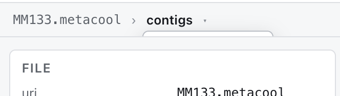
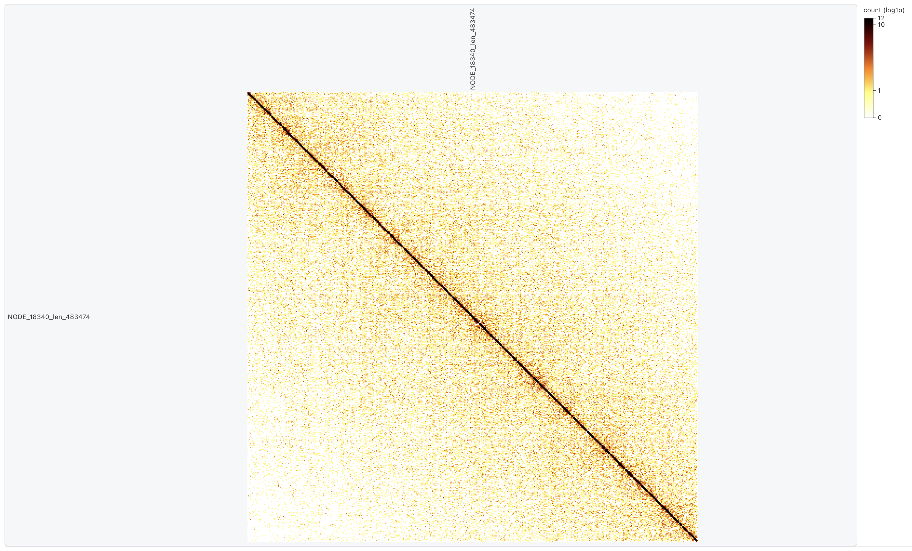
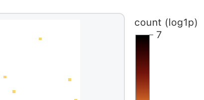
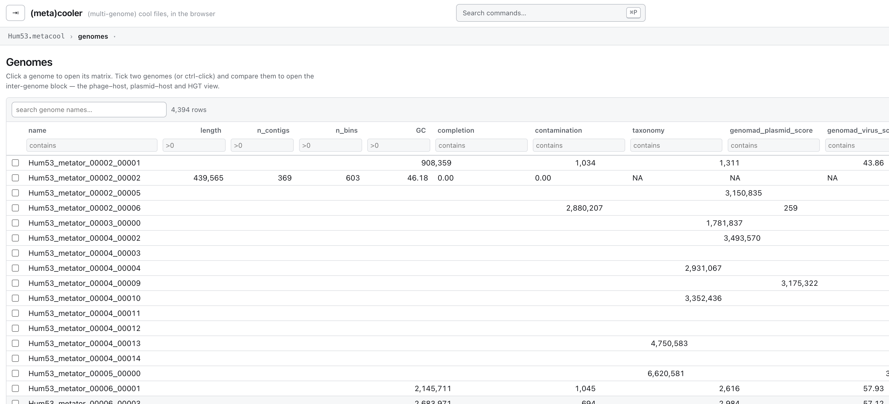
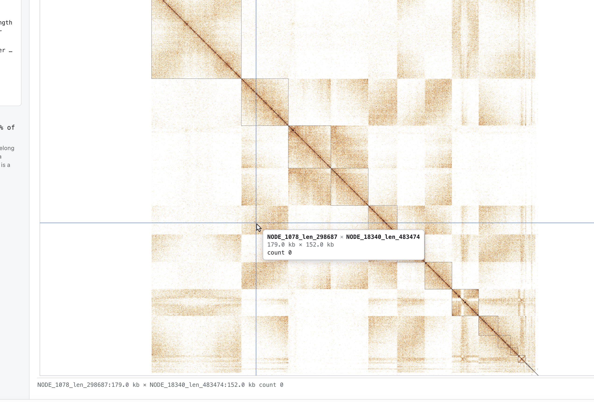
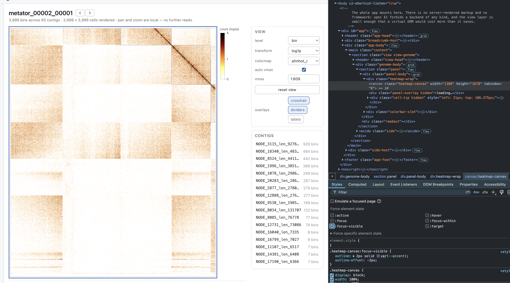
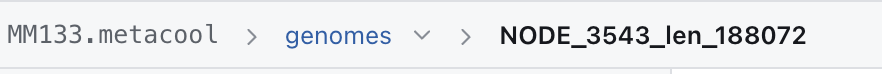

## DONE 

- [x] Only `genomes` table is visible and opened by default when opening a file. It would be nice to have a way to open the `contigs` table if wanted. It could be done by using a dropdown menu to select which table to open here: 

- [x] Same thing with a mmetacooler, it could have a dropdown menu to select wich nested metacool it would open (inserted before the "> genomes"). 

- [x] I'd rather have the file info sidebar on the left side

- [x] When in contig or genome heatmap view, the bottom line that indicates coordinates of contigs/genomes is partially hidden, I need to scroll down to see it full. 

- [x] In the file info sidebar:  I like the layout of the BINNING QC div, but it's too prominent for the QC information, make it look like the READS and VALIDATION divs. Use the current BINNING QC style to wrap the FILE header+file info div (uri, layout, ...). Also, the READS and VALIDATION should look like the QC div, but stacked from the bottom of the sidebar, not from the top.

- [x] In the heatmap canvas, the names of the contigs/genomes are not displayed well (they appearh truncated on the left side, and not at all visible on the top side). Also, there is some leftover empty space at the bottom of the heatmap canvas. Also, I want to color bar to be displayed immediately the right side of the heatmap canvas, and not as tall!! just a small color bar, not necessarily the full height of the heatmap canvas.

- [x] Also, dropdown settings for viewing (scale, vmax, colormap, etc) could be displayed in a pretty div in a column style within the `aside` on top, and the CONTIGS would be underneath (and not visible when in contig view).

- [x] In the genome table, when we scroll horizontally to see the last columns, the headings don't scroll with the table, so we can't see what the columns are. 

- [x] The "Nothing you drop here leaves your browser" message should be closable 

- [x] Every field changed by the user should be remembered and restored when the user reopens the file. for ex, if i run a filtering on the genome table, then select a genome, then go back to the genome table, the filtering should be restored. 

- [x] when looking at a genome and clicking on the intersection of 2 contigs, the contig view currently opens a symmetric square map corresponding 1 of the two contigs. It should instead opens an assymetric, rectangular map of the intersection of the two contigs!

> NOTES ON THE BATCH ABOVE

- **Table state** is remembered per file and per table (genomes / contigs) in
  `sessionStorage` via `src/state/UiMemory.ts`: filters, free-text search, sort
  column and direction. Deliberately *not* in the URL — a shared link silently
  carrying "only rows where completeness > 90" would mislead whoever opened it —
  while genome, region, level and colour scale stay in the hash, because those
  *are* the shareable view (spec 5.5).
- **Heatmap gutters** are now measured from the labels that will actually be
  drawn (`HeatmapOptions.autoMargin`), capped at a third of the canvas. An axis
  with more contigs than `MAX_CATEGORICAL_TICKS` draws no labels and reserves no
  gutter, which is what removed the dead band under the plot. Pinned by
  `test/unit/heatmap-margins.test.ts`.
- **Contig x contig** is `view=region` with a second axis, `region2`. The two
  ranges resolve independently and the reader already handles the transpose when
  the column range precedes the row range in bin space (5.3), so this needed no
  new query path.
- **Heads-up on the batch below:** moving READS and VALIDATION into a status bar
  supersedes part of the sidebar item above, which just stacked them at the foot
  of the sidebar. The card styling and the File block stay; those two sections
  would simply move out.

- [x] Populate a bottom status bar with a bit of information about the data read, and display all the information currently in READS in the left sidebar when hovering over it. Remove READS from left sidebar. 

- [x] When hovering over cells in the heatmap, display the contig/genome pair names of the cell in a tooltip, and the values of the cell. 

- [x] Validation should also be in the status bar with only "Validation" followed by a green tick (if ok), and clicking on it should trigger deep validation. Remove VALIDATION from left sidebar.

- [x] in genome x genome view (should be "whole metagenome", instead), there is only the option to view it as genome x genome OR contigs x contigs. 
- [x] Also, when in this 'whole metagenome' view, when in genome x genome view, clicking on a cell redirects to a pairwise genome view (nice!) but only when the cell is on the diagonal. The same thing should happen when clicking on a cell in the diagonal and redirect to the single genome view.

- [x] The fact that the "genomes" breadcrumb now is a dropdown picker makes it imposible to return to the genome table view when in a single genome view, in a single click. This should be fixed, either by making the "genomes" NOT a dropdown, but with a small arrow to the right of it to open the dropdown. Same for "contigs" in the breadcrumb. 

- [x] When opening a mmetacool file, it should always open the genome table of the first metacool entry (and the dropdown entries would allow to switch to other metacool entries). 

- [x] Add a dark/light/system mode toggle button in the top right corner of the app (after info). Info button should be an icon.

- [x] The title of the app should be "(meta)cooler – (multi-genome) cool files, in the browser". 

- [x] Single Contigs and Single Genome views are different for the location of settings of the heatmap (vmax, colormap, etc). The layout should stay the same, with just the "Contigs" card being hidden when in single contig view.

- [x] Both in contigs and genome view, there is an unnecessary line (eg "metator_00001_00000 — bin/contig level"). Same for contigs view, where "NODE_8641_len_139153" should go up and replace "Region", the region search box spanning NEXT TO it, and the "matched contig NODE_8641_len_139153 · 35 bins · bins 13,432–13,466" below (like in Genome view).

> NOTES ON THE BATCH ABOVE

- **Status bar.** Reads and Validation left the sidebar for a one-line footer
  that expands on hover; validation is per-file, so the tick resets on open
  rather than vouching for a file that was never checked.
- **Whole metagenome.** The level is chosen *before* the scan, because genome
  and contig axes are two different accumulations of the same pass and neither
  can be derived from the other without re-reading the pixels. Contig-level
  picks its axis set from one read of `bin1_offset` rather than two reads per
  contig — right for 4 k genomes, wrong for 154 k contigs. `__unbinned__` is
  excluded at both levels: at contig level that means excluding *its* contigs,
  the same rule one level down.
- **Breadcrumb.** The root crumb is a link again, with a separate `▾` opening the
  table picker. Going up is the common action and stays one click; switching
  table is the rare one.
- **mmetacool.** Opening one at its root still raises `mmetacool-root` in the
  reader, mirroring Python's `KeyError` — the redirect is an app-layer decision,
  so the reader keeps matching the spec. A ladder lands on the *smallest* entry:
  HDF5 group order is alphabetical, which puts `1000` before `500`, so a string
  sort would open a coarsened view of the user's own data. Pinned in
  `test/unit/mmetacool.test.ts`.
- **Theme.** "System" is the absence of an override, not a third palette:
  `data-theme` on `<html>` wins in both directions over the media query, so a
  user on a dark OS who picks light gets light.

- [x] Cursor as arrow over the heatmap. 
- [x] Buttons in the view card for plot options, eg crosshair, dividers, others? 
- [x] Serve on github pages
- [x] When the file listing is shown, the left sidebar should be hidden. 
- [x] A button icon next to the app title to fold the left sidebar. 
- [x] The files in `public/demo/` offered as examples on the picker. 

> NOTES ON THE BATCH ABOVE

- **Sidebar.** The fold control moved to the left of the title, where it points
  at the panel it folds; the old (i) button in the right-hand actions did the
  same job from the far end of the header and is gone rather than duplicated.
  Folding is a preference, so it is in `localStorage` beside the theme, not in
  the per-session `state/UiMemory`. With no file open the sidebar has nothing
  to describe, so it and its button leave the layout — without touching the
  stored choice, so folding is not something the picker can silently undo.
- **Overlays.** `crosshair`, `dividers` and `labels` are pure paint over a
  matrix already in memory, so each is one repaint and no I/O. `labels` also
  gives its gutters back: the margin exists *for* the labels, and a 150 px band
  beside a plot with no names in it is the dead space `measureMargin` was
  written to remove. The crosshair is the only overlay that redraws on pointer
  movement, so hover repaints are gated on it being on — a user who never turns
  it on pays nothing. Pinned in `test/unit/plot-options.test.ts`.
- **Cursor.** `default`, not `grab`: the canvas is a figure to read first and a
  surface to drag second. `:active` still turns it into `grabbing` once a drag
  actually starts, so the affordance survives where it is true.
- **Examples.** Built from `BASE_URL` and made absolute against the page, for
  two reasons: the base is `/` in dev and `/<repo>/` on Pages, and a *relative*
  URI in a shared link would not re-open — `inferSource` follows a link only
  when its path is `http(s)://`. Same-origin, so only the CORS half of
  `docs/hosting.md` falls away; the range requirement is unchanged, and the
  reader takes the identical remote path it takes for a bucket.
- **Deploy.** The workflow, the remote and the push are done; enabling *Settings
  -> Pages -> Source: GitHub Actions* is the one step that is not code.

- [x] "open another file" button does not work (when trying a file that fails). 
- [x] Put the "Nothing you drop here leaves your browser" at the bottom after dropping area and remote file and example files. 
- [x] Make the "Public examples" files a dropdown menu
- [x] Public examples return "error - name not defined!"
- [x] In the top bar, next to dark/light/system, have more buttons for general app settings, like info, go to github repo, load new file, shortcut modals, any other? 
- By default: Crosshair should be on, dividers off, and labels off. Do you see any other toggles to add? 
- The pointer in the heatmap should really be something like a arrowhead, not a standard pointer. 
- [x] The tooltip over the heatmap has redundant contig names. 

- [x] Implement shortcuts and a command palette (cmd+P), with a action bar in the center in the top bar (where title and side buttons are)
- [x] The title "(meta)cooler" should redirect to the initial file selection page 
- [x] Spanning next to the contig name (same in genome view!!), I could have < and > buttons to go to the previous and next contig/genome, instead of having to go back to the table view.

## DONE 

- [x] For any icon-like thing (eg dropdown, info icon, buttons in top right bar, previous/next, fold, ...): Use real modern clean ICONS, NEVER glyphs or text or characters. This 
- [x] For github button: use a github icon!
- [x] The contigs/genomes dropdown is shown BEHIND the FILE card. 



- [x] For the heatmap canvas: I would like it to be cleaner, with less obvious wrapping divs. In particular, when labels are hidden, I want the heatmap to be pan-drag (already the case), but the wrapping div should be invisible, only as a border directly sitting over the heatmap edges (no round corners, no grey background, no padding, as it currently shows). When labels are shown, I would like them to appear OUTSIDE of this border, with no background. 




- [x] Also, maybe more tricky: when dragging the heatmap, it should not be able to leave the heatmap area and "cut" the heatmap, but instead it should be able to pan-drag the heatmap, and when reaching the edge of the heatmap, it should be blocked and not be able to drag further.

- [x] Rather than vertical/horizontal lines, the dividers should be actual rectangles around each contig/genome, with a transparent background and a border.

- [x] I would like to be able to select a region in the heatmap by clicking and dragging, which should then directly zoom into that region. The selection rectangle should appear with a solid border and a semi-transparent fill color. The selection should be able to be done in any direction (eg from top-left to bottom-right, or bottom-right to top-left, etc). This should work for both contig and genome views. This should be by default, and the panning should be done by holding a modifier key (eg cmd/ctrl) and then click-dragging. This should make a pan hand cursor appear, and the user should be able to then pan-drag the heatmap. 

- [x] Genomes table fr Hum53 and Hum66 metacools does not display well. 




> NOTES ON THE BATCH ABOVE

- **Icons** are drawn now (`ui/icons.ts`), not typed: stroked 24x24 outlines on
  a 2px grid, one weight, `currentColor`, built with `createElementNS`. A glyph
  is whatever font the OS picks — a different shape, weight and baseline on
  every machine, and a box on an unlucky one — and it cannot take a stroke
  width that matches anything else on screen. Inline SVG also means no font to
  fetch and nothing for a CSP to block. The GitHub mark is filled rather than
  stroked because it is a logo (octicons, MIT).
- **The dropdown was not behind the FILE card**, it was clipped: `.breadcrumb`
  scrolls horizontally, and `overflow-x: auto` computes `overflow-y` to `auto`
  too, so a menu hanging below the crumb row was cut off by its own scroller and
  the card showed through. It is placed against the viewport from the arrow's
  rect now — which ancestor scrolls is not a popover's business.
- **The Hum53/Hum66 genomes table was a CSS bug, not bad data.** The file on
  disk is correct in every field; rows are positioned out of flow, and
  `min-width: max-content` let each one shrink-to-fit its own content, so a row
  with a long taxonomy string sized its `1fr` tracks differently from the header
  and from every other row. Hence a different wrong heading per row.
- **The panel's chrome is gone** — border, radius, grey fill, padding. The frame
  is drawn on the plot's own edges by the canvas, because the plot is inset by
  whatever the labels need and a border on the wrapper sits an arbitrary
  distance from the data. Labels fall outside that frame, on the page
  background, unhaloed. Their colour follows the theme now, which it could not
  while it was `#333333`: that was unreadable in dark mode the moment the
  wrapper stopped supplying a light fill of its own.
- **Dividers are boxes**, drawn for the blocks that appear on *both* axes — the
  diagonal. That is O(blocks); a full grid of boxes would be O(blocks^2), which
  a 20k-contig genome cannot pay. When the axes share no labels at all (a genome
  pair, a contig x contig block) the cross-product is used instead, but only
  while both axes are small enough to label. Selection boundaries stay lines:
  they mark where one query ends, which is a cut through the picture rather than
  a region of it.
- **Drag selects and zooms; ⌘/Ctrl+drag pans**, with the grab hand shown while
  the modifier is held so the cursor says what a drag would do before it starts.
  A press that does not travel is still a click in either mode. Leaving the
  canvas mid-drag abandons the drag rather than finishing it on a corner nobody
  chose.
- **Panning stops at the data.** The view used to allow half a viewport of empty
  space past every edge. Pinned, with the drag-zoom, in
  `test/unit/heatmap-navigation.test.ts` — asserted through `cellAt`, the same
  conversion the app uses to turn a pixel into a bin, so the tests fail if the
  transform and the hit testing ever disagree.

## DONE

- [x] Whole genome view should have the exact same layout as genome/region views, with the same settings and options, and the same heatmap layout.
- [x] Whole genome view should be in the dropdown menu of the "genomes" breadcrumb, NOT in the top right bar!
- [x] In genome view, the dividers could be lines, but they should not extend beyond the heatmap boundaries, even when zooming out. 
- [x] In the genome view and whole genome view and contig view, the area for heatmap should be exactly square and adapt to resizing of the window. It should center itself in the available space and the color scale should be sitting immediately to the right of the heatmap. Then VIEW and CONTIGS cards stay aligned to the right side of the screen. 
- [x] Icons should really be existing logos rather than sketched SVGs! For example, the github icon should be the official github logo, and not a sketched SVG.
- [x] Buttons in top right should be (from left to right): theme, shortcuts, github, info (no need for a "load new file" button, as the user can just click on the app title to go back to the file selection page).
- [x] The coordinates that are printed BELOW the heatmap canvas should be in thebottom status bar, left side. READ/VALIDATION should be aligned to right. No "Files are read in place. Nothing is uploaded, and there is no server." needed. 



- [x] When the heatmap-canvas is "focus-visible", there currently is a blue outline around the heatmap canvas. It should be removed and invisible. 
- [x] Actually, the default click should be to pan-drag, option+click should be to select a region and zoom into it, double-click should be to reset the zoom, and single-click to go to contigs/view. 



- [x] "genomes" should appear with cohoerent styling within the breadcrumb. It should be Uppercase (Genomes/Contigs/Whole Genome). 



- [x] The "opening MM133.mmetacool::1000…" loading message should be at the center, slightly more prominent and modern-looking, and modern-looking loading indicator. 
- [x] In Whole-genome view, dividers in the contig x contig heatmap should show GENOMES !
- [x] Whole-genome view should behave the same as genome/contig. Right now, "G" goes to genome view, "C" to contig view, "W" opens a whole-genome view but then "G" after that does not go back to genome view. I have to press again "W" to hide the whole genome view.

> NOTES ON THE BATCH ABOVE

- **The icons come from the packages that publish them** now: `npm run icons`
  copies Lucide (ISC) and Simple Icons (CC0) into a committed
  `src/ui/icons.generated.ts`. Both are devDependencies of the generator, so the
  app still ships with no icon dependency and nothing to fetch at runtime. The
  hand-drawn GitHub mark was the clearest case — a logo that is nearly right is
  visibly wrong — but the interface icons had the same problem one level down:
  corner radii and optical weight that did not match the set they imitated.
- **The whole-genome view** was three complaints with one cause: it did not
  look, sit or behave like the rest of the app. It has the standard layout now
  (heading, summary, plot, controls in the sidebar), it lives in the root
  crumb's menu beside Genomes and Contigs rather than in the corner of the
  window, and `G`/`C` leave it. That last one was a real bug: those keys set a
  view state the shell was already ignoring, so nothing happened until you
  pressed `W` again. Both go through `navigate`, which drops the overview and
  forces the render when the state being set is the one already there.
- **Dividers were kept as boxes**, not returned to lines — the batch above asked
  for boxes and this one said lines "could" be used. What was actually wrong is
  fixed: every piece of chrome now clips to `dataRect`, the part of the plot the
  data occupies, so nothing runs on past the last bin when you zoom out. Say the
  word if you want lines back; it is one branch in `drawSeparators`.
- **In the contig x contig overview the boundaries are genomes.** The reader
  sends the genome each selected contig belongs to, and consecutive runs of it
  become a second, coarser group set. The per-contig labels are untouched: the
  tooltip answers with the thing under the pointer, the lines answer with the
  thing you are looking for.
- **Pan is the default drag and Option selects.** A single click still opens what
  a cell refers to, but it waits out the double-click window first — otherwise
  the second click of a "reset the zoom" lands after the first has navigated
  away. 250 ms, which is what every toolkit guesses when the platform will not
  say. The cursor now reports what is happening rather than what could: the
  arrowhead at rest, a crosshair while Option is held, the closed hand mid-pan.
- **The plot is square** — sized from the height the window can spare, capped by
  the column, `aspect-ratio` keeping the two in step — and centred with its
  legend against its edge, which leaves the sidebar cards where they were.
- **The readout moved to the status bar** and took the standing privacy sentence
  out with it. The picker states that at the moment it matters; a footer note
  that never changes stops being read.
- **Each of the eight commits typechecks on its own**, checked before committing
  this time rather than after.

## DONE

- [x] But I DO want to have lines, not boxes, for the dividers in the heatmap. I need to see dividers between all contigs/genomes, not just the ones that are in the diagonal.
- [x] Whole genome view should have the exact same layout as genome/region views, with the same settings and options, and the same heatmap layout --> SAME COMMENT BUT FOR PAIRS OF GENOMES. 
- [x] Start implementing support for native cool/mcool files, without having to rely on a metacooler file with "single genome" trick. Below is suggestions I got for this (line numbers might not be accurate): 

```
-> Can .cool be supported natively?

Yes, and it's a seam extraction rather than a second reader. More of the codebase is already cool-native than the docs admit.

Already genome-agnostic, no changes needed:

Module	Why it already works
src/metacooler/coords.ts	Coords takes only binsize, chrom_offset, contig lengths. A plain cool has all three (/chroms/length, /indexes/chrom_offset, bin-size attr). Zero genome concepts.
src/metacooler/matrix.ts	MatrixSource is {handle, nBins, storageMode} — the seam is already cut. readPixelSpan/planRead/scatterDense are pure bin arithmetic.
src/metacooler/range.ts	parseRegion/parseHumanized/regionToExtent are ports of cooler's own functions. Only parseMetacoolerRange layers genomes on top.
src/metacooler/detect.ts	Already classifies cool/mcool correctly, and assertAcceptable already scopes the ordering and format-version gates to kind === 'metacool' (detect.ts:196).
normaliseInfo	Handles a real cooler's attrs (nchroms→ncontigs, genome-assembly). Verified against test/golden/plain_cool.json.
aggregate.ts at level: 'contig'	Needs only Coords. Contig = chromosome, which is exactly right for a cool.
render / scale / colormaps / ViewState hash / RemoteRangeSource / h5/	Nothing genomic anywhere.
The actual blockers — six, all in one file:

MetaCooler.ts:165 — hard unsupported throw for kind !== 'metacool'.
MetaCooler.ts:174 — requires indexes/genome_offset.
MetaCooler.ts:182 — reads readTable('genomes'); and reads contigs, where a cool has /chroms.
MetaCooler.ts:218 — contigs.numbers('genome_id').
MetaCooler.ts:684 — validateLight requires isSoftLink('chroms'). Note the irony: this check exists to prove a metacool is also openable by cooler.Cooler(), and it is the one check a genuine cooler fails (its /chroms is a real group).
worker/reader.worker.ts types the whole session as mc: MetaCooler, and parseMetacoolerRange is the only range entry point.
The shape I'd argue for: promote a ContactMap base holding uri/layout/info/binsize/storageMode/countKind/coords/chromnames/chromsizes/handle plus extent/offset/contigExtent/matrix/scanPixels/validateDeep. MetaCooler extends ContactMap adds the genome layer; Cooler extends ContactMap adds nothing and points the contig table name at chroms. validateLight splits into shared + metacool-only.

Why native beats the §9 synthesis, on its own terms: the synthesis has to fabricate n_bins/n_contigs columns, invent a genome name from the assembly, and bypass the softlink check anyway — the same work, done dishonestly, plus a fake row the UI then special-cases (main.ts:573 already carries const synthesised = ...). Going native deletes that flag instead of feeding it.

Two live bugs found on the way:

assertAcceptable runs before the kind !== 'metacool' refusal, so an .mcool opened at root hits the bin-size gate — its root carries only format and format-version (confirmed in plain_mcool.json) — and the user gets "The viewer supports fixed-bin files only… produce a fixed-bin file with metacooler binnify" instead of "pick a resolution". An mcool needs an refuseMcoolRoot sibling to refuseMMetacoolRoot.
checkDenseSize mirrors Python's 50,000-bins-per-axis limit. On a machine with RAM that's fine; in a tab, 50,000² × 4 B (Float32) is 10 GB and past Chrome's canvas area cap. The guard will happily wave through an allocation that kills the tab. See below.
mcool is nearly free. parseUri already handles file.mcool::resolutions/10000, and detect.test.ts:114 already asserts "an mcool resolution is an ordinary cooler". The resolutions are the zoom ladder — the same control the mmetacool ladder is waiting on. That's HiGlass's pyramid without the tile server, because the mcool already ships the pyramid.
```

> NOTES ON THE BATCH ABOVE

- **Dividers are lines again**, across every contig and genome rather than boxes
  on the diagonal only — and still clipped to the data, so nothing runs past the
  last bin when you zoom out.
- **cool and mcool are native now**, not the synthesised single-genome metacool
  the spec used to describe. A cooler is opened as itself: `/chroms` is the
  contig table, `MetaCooler.genomes` is `null`, and every genome accessor
  answers `0`, `[]` or `null`. Nothing downstream branches, because almost
  nothing downstream was ever genome-specific — coordinates, the matrix read,
  contig-level aggregation and the pixel scan are bin arithmetic over
  `indexes/chrom_offset` and contig lengths, which both formats carry. The
  `synthesised` flag the UI used to carry is gone rather than fed. SPECS §9,
  IMPLEMENTATION M7 and the README now say this instead of the opposite.
- **An `.mcool` root is refused by name** (`mcool-root`, listing its
  resolutions) and the app opens the finest, exactly as it does for a zoomify
  ladder. The resolutions are also the entry picker, so the ladder is navigable.
  Entry names are ordered numerically at the two places that produce them:
  HDF5 lists group members lexicographically, which puts `10000` before `5000`.
- **A second dense guard**, for the browser rather than the CLI. Python's
  `DENSE_MATRIX_BIN_LIMIT` allows 50,000 x 50,000 — 2.5e9 cells, ~40 GB of live
  bytes once the values, the colour mapping and the canvas are counted, with a
  raster nine times a canvas's area cap. The new one caps cells (1e8, about
  10,000 bins per axis) *and* each axis (32,767, the smaller of the two browser
  canvas side limits), because a 248,957-bin chromosome at 1 kb is only 7.5e7
  cells against 300 columns and still cannot be rasterised. It refuses with the
  same code, and the region view shows it inline above an intact region box
  rather than on an error screen.
- **An adversarial review of the above found thirteen real defects**, all fixed
  here. The two worth naming: `cooler zoomify` run on a metacool copies the
  chroms, the indexes and every root attribute into `/resolutions/<base>` and
  drops `/genomes` — that file used to be *refused*, and with a native cool path
  it would have opened silently as a contig-only view with its MAGs invisible,
  so a file claiming `metacooler-format` while missing a required group is now
  refused by name; and `normaliseInfo` resolved format, format-url and
  format-version independently, which stamped a metacool that omitted its
  version with cooler's version 3 — a value the `bad-format-version` gate exists
  to refuse. It is one decision now.
- **The request-budget suite had been broken since the range fix two batches
  ago** and nobody noticed, because it lives in `test/budgets/` and I had only
  been running `test/unit/`. Its fake XHR had no `getResponseHeader`, so every
  read in it took the "host ignored the range" path — the same failure the
  published demo files hit in dev. Fixed, and the whole suite runs now: 732
  tests.


## FOR FUTURE

- M5

- M6

- M7, with specifically an option to view the FULL whole-genome (not just a region). This is currently against what specs/implementation say, but it would be nice to have an option to view the full genome in a single heatmap, even if it is very large.

- [ ] Also, I want full, native support of cool/mcool files, WITHOUT HAVING TO RELY ON A METACOOLER FILE with "single genome" trick. enforce it!

