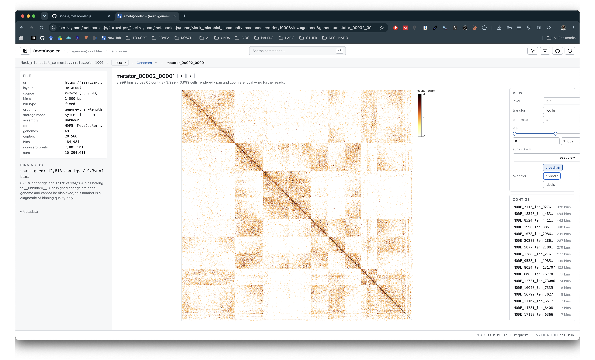
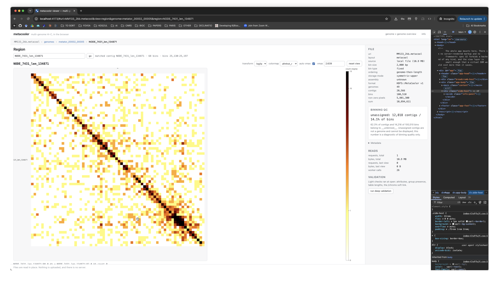
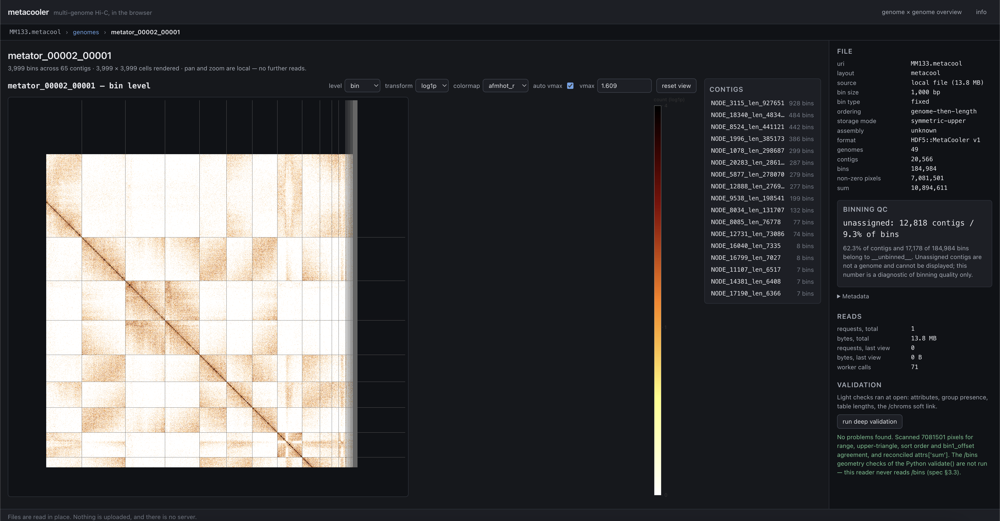
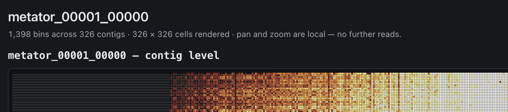
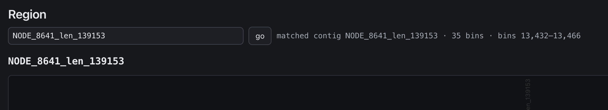

## FOR NOW

- [x] Only `genomes` table is visible and opened by default when opening a file. It would be nice to have a way to open the `contigs` table if wanted. It could be done by using a dropdown menu to select which table to open here: 

- [x] Same thing with a mmetacooler, it could have a dropdown menu to select wich nested metacool it would open (inserted before the "> genomes"). 

- [x] I'd rather have the file info sidebar on the left side

- [x] When in contig or genome heatmap view, the bottom line that indicates coordinates of contigs/genomes is partially hidden, I need to scroll down to see it full. 

- [x] In the file info sidebar:  I like the layout of the BINNING QC div, but it's too prominent for the QC information, make it look like the READS and VALIDATION divs. Use the current BINNING QC style to wrap the FILE header+file info div (uri, layout, ...). Also, the READS and VALIDATION should look like the QC div, but stacked from the bottom of the sidebar, not from the top.

- [x] In the heatmap canvas, the names of the contigs/genomes are not displayed well (they appearh truncated on the left side, and not at all visible on the top side). Also, there is some leftover empty space at the bottom of the heatmap canvas. Also, I want to color bar to be displayed immediately the right side of the heatmap canvas, and not as tall!! just a small color bar, not necessarily the full height of the heatmap canvas.

- [x] Also, dropdown settings for viewing (scale, vmax, colormap, etc) could be displayed in a pretty div in a column style within the `aside` on top, and the CONTIGS would be underneath (and not visible when in contig view).

- [x] In the genome table, when we scroll horizontally to see the last columns, the headings don't scroll with the table, so we can't see what the columns are. 

- [x] The "Nothing you drop here leaves your browser" message should be closable 

- [x] Every field changed by the user should be remembered and restored when the user reopens the file. for ex, if i run a filtering on the genome table, then select a genome, then go back to the genome table, the filtering should be restored. 

- [x] when looking at a genome and clicking on the intersection of 2 contigs, the contig view currently opens a symmetric square map corresponding 1 of the two contigs. It should instead opens an assymetric, rectangular map of the intersection of the two contigs!

## NOTES ON THE BATCH ABOVE

- **Table state** is remembered per file and per table (genomes / contigs) in
  `sessionStorage` via `src/state/UiMemory.ts`: filters, free-text search, sort
  column and direction. Deliberately *not* in the URL — a shared link silently
  carrying "only rows where completeness > 90" would mislead whoever opened it —
  while genome, region, level and colour scale stay in the hash, because those
  *are* the shareable view (spec 5.5).
- **Heatmap gutters** are now measured from the labels that will actually be
  drawn (`HeatmapOptions.autoMargin`), capped at a third of the canvas. An axis
  with more contigs than `MAX_CATEGORICAL_TICKS` draws no labels and reserves no
  gutter, which is what removed the dead band under the plot. Pinned by
  `test/unit/heatmap-margins.test.ts`.
- **Contig x contig** is `view=region` with a second axis, `region2`. The two
  ranges resolve independently and the reader already handles the transpose when
  the column range precedes the row range in bin space (5.3), so this needed no
  new query path.
- **Heads-up on the batch below:** moving READS and VALIDATION into a status bar
  supersedes part of the sidebar item above, which just stacked them at the foot
  of the sidebar. The card styling and the File block stay; those two sections
  would simply move out.

## FOR ONOW 

- [x] Populate a bottom status bar with a bit of information about the data read, and display all the information currently in READS in the left sidebar when hovering over it. Remove READS from left sidebar. 

- [x] When hovering over cells in the heatmap, display the contig/genome pair names of the cell in a tooltip, and the values of the cell. 

- [x] Validation should also be in the status bar with only "Validation" followed by a green tick (if ok), and clicking on it should trigger deep validation. Remove VALIDATION from left sidebar.

- [x] in genome x genome view (should be "whole metagenome", instead), there is only the option to view it as genome x genome OR contigs x contigs. 
- [x] Also, when in this 'whole metagenome' view, when in genome x genome view, clicking on a cell redirects to a pairwise genome view (nice!) but only when the cell is on the diagonal. The same thing should happen when clicking on a cell in the diagonal and redirect to the single genome view.

- [x] The fact that the "genomes" breadcrumb now is a dropdown picker makes it imposible to return to the genome table view when in a single genome view, in a single click. This should be fixed, either by making the "genomes" NOT a dropdown, but with a small arrow to the right of it to open the dropdown. Same for "contigs" in the breadcrumb. 

- [x] When opening a mmetacool file, it should always open the genome table of the first metacool entry (and the dropdown entries would allow to switch to other metacool entries). 

- [x] Add a dark/light/system mode toggle button in the top right corner of the app (after info). Info button should be an icon.

- [x] The title of the app should be "(meta)cooler – (multi-genome) cool files, in the browser". 

- [x] Single Contigs and Single Genome views are different for the location of settings of the heatmap (vmax, colormap, etc). The layout should stay the same, with just the "Contigs" card being hidden when in single contig view.

- [x] Both in contigs and genome view, there is an unnecessary line (eg "metator_00001_00000 — bin/contig level"). Same for contigs view, where "NODE_8641_len_139153" should go up and replace "Region", the region search box spanning NEXT TO it, and the "matched contig NODE_8641_len_139153 · 35 bins · bins 13,432–13,466" below (like in Genome view).

## NOTES ON THE BATCH ABOVE

- **Status bar.** Reads and Validation left the sidebar for a one-line footer
  that expands on hover; validation is per-file, so the tick resets on open
  rather than vouching for a file that was never checked.
- **Whole metagenome.** The level is chosen *before* the scan, because genome
  and contig axes are two different accumulations of the same pass and neither
  can be derived from the other without re-reading the pixels. Contig-level
  picks its axis set from one read of `bin1_offset` rather than two reads per
  contig — right for 4 k genomes, wrong for 154 k contigs. `__unbinned__` is
  excluded at both levels: at contig level that means excluding *its* contigs,
  the same rule one level down.
- **Breadcrumb.** The root crumb is a link again, with a separate `▾` opening the
  table picker. Going up is the common action and stays one click; switching
  table is the rare one.
- **mmetacool.** Opening one at its root still raises `mmetacool-root` in the
  reader, mirroring Python's `KeyError` — the redirect is an app-layer decision,
  so the reader keeps matching the spec. A ladder lands on the *smallest* entry:
  HDF5 group order is alphabetical, which puts `1000` before `500`, so a string
  sort would open a coarsened view of the user's own data. Pinned in
  `test/unit/mmetacool.test.ts`.
- **Theme.** "System" is the absence of an override, not a third palette:
  `data-theme` on `<html>` wins in both directions over the media query, so a
  user on a dark OS who picks light gets light.

## FOR NEXT

- [x] Cursor as arrow over the heatmap. 
- [x] Buttons in the view card for plot options, eg crosshair, dividers, others? 
- [x] Serve on github pages
- [x] When the file listing is shown, the left sidebar should be hidden. 
- [x] A button icon next to the app title to fold the left sidebar. 
- [x] The files in `public/demo/` offered as examples on the picker. 

## NOTES ON THE BATCH ABOVE

- **Sidebar.** The fold control moved to the left of the title, where it points
  at the panel it folds; the old (i) button in the right-hand actions did the
  same job from the far end of the header and is gone rather than duplicated.
  Folding is a preference, so it is in `localStorage` beside the theme, not in
  the per-session `state/UiMemory`. With no file open the sidebar has nothing
  to describe, so it and its button leave the layout — without touching the
  stored choice, so folding is not something the picker can silently undo.
- **Overlays.** `crosshair`, `dividers` and `labels` are pure paint over a
  matrix already in memory, so each is one repaint and no I/O. `labels` also
  gives its gutters back: the margin exists *for* the labels, and a 150 px band
  beside a plot with no names in it is the dead space `measureMargin` was
  written to remove. The crosshair is the only overlay that redraws on pointer
  movement, so hover repaints are gated on it being on — a user who never turns
  it on pays nothing. Pinned in `test/unit/plot-options.test.ts`.
- **Cursor.** `default`, not `grab`: the canvas is a figure to read first and a
  surface to drag second. `:active` still turns it into `grabbing` once a drag
  actually starts, so the affordance survives where it is true.
- **Examples.** Built from `BASE_URL` and made absolute against the page, for
  two reasons: the base is `/` in dev and `/<repo>/` on Pages, and a *relative*
  URI in a shared link would not re-open — `inferSource` follows a link only
  when its path is `http(s)://`. Same-origin, so only the CORS half of
  `docs/hosting.md` falls away; the range requirement is unchanged, and the
  reader takes the identical remote path it takes for a bucket.
- **Deploy.** The workflow, the remote and the push are done; enabling *Settings
  -> Pages -> Source: GitHub Actions* is the one step that is not code.

## IN FUTURE  

- M5

- M6

- M7, with specifically an option to view the FULL whole-genome (not just a region). This is currently against what specs/implementation say, but it would be nice to have an option to view the full genome in a single heatmap, even if it is very large.

- [ ] Also, I want full, native support of cool/mcool files, WITHOUT HAVING TO RELY ON A METACOOLER FILE with "single genome" trick. enforce it!

