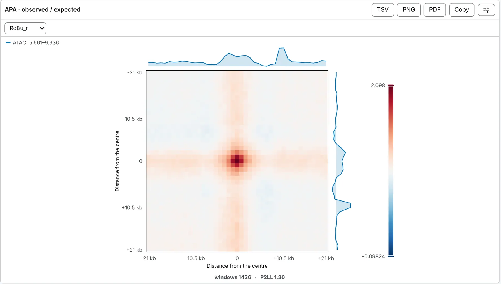

import TaskCommand from '@components/TaskCommand.astro'
import TaskOutputs from '@components/TaskOutputs.astro'
import TaskParameters from '@components/TaskParameters.astro'
import TaskSummary from '@components/TaskSummary.astro'

<TaskSummary id="apa" />

Aggregate peak analysis piles up the contact map at a set of places and averages the windows into one picture, so a pattern too faint to see at any single place stands out in the mean. Over a loop set the question is whether the loops are there: a dot at the centre of the pileup, standing above its background. Over every pair of a peak set it is whether those places contact each other more than places like them do; over a set of domains it is the domain pileup, whether contact stops at their edges. The pileups are coolpuppy's (Flyamer et al. 2020), cell for cell; under the **Chromosight** normalisation, every window is also scored as chromosight scores it.

## Running it

It needs a map and a set to pile up at: a loop set (BEDPE, interact or longrange) or a feature set (BED, narrowPeak, GTF and the rest), loaded on the **Annotations** panel — see [Interactions](/files/interactions/) and [Tracks and features](/files/tracks/) — or one a task called, such as the loops of [Loop calling](/analyses/loops/) or the domains of [diamond insulation](/analyses/insulation/). Until one is there the row is greyed and says *Load a loop set (BEDPE), or a feature set (BED, GTF).*

Open the **Analysis** panel (<kbd>4</kbd>), choose **Aggregate peak analysis** in the **2D tasks** card, choose the **anchors** and the set, and press **run**. What each choice of **anchors** piles up:

- **loop set**: a window at each pair. Loops nearer the diagonal than **nearest loop** are left out — measured between the two anchors' centres — and the drawer says how many.
- **feature set**: a window on the diagonal at each feature, cut about the point **anchor on** names; *start* and *end* follow the strand.
- **every pair of a feature set**: a window between every two features of one set within the separation range. Past 200,000 pairs a uniform sample is taken, the same one each time, and the drawer says so.
- **consecutive features**: each feature with the next along its sequence, piled up exactly as a loop set listing those pairs would be.

Every anchor is piled up and every window summed, each read as a small block at the file's own resolution — never from a coarsened view of the whole genome — and windows close together are read together; the price beside **run** says how many windows that is. Over the expected, each sequence the anchors sit on is also read along its diagonal, as far out as its farthest window, for the expected every window is divided by.

The drawer shows the pileup — **APA · observed / expected** at the defaults — with the number of windows and its P2LL under it; for anchors off the diagonal, the **Loop spectrum**; and **Per anchor**, a table of every window's own score. Each table and figure leaves as a TSV, and each figure as a PNG or a vector PDF.



The same run from a shell:

<TaskCommand id="apa" />

```sh
# A loop set, over the expected
chromosomix apa sample.mcool::/resolutions/10000 --pairs loops.bedpe --out results/

# Each CTCF peak with the next along its chromosome
chromosomix apa sample.mcool::/resolutions/10000 --anchors consecutive --features ctcf_peaks.bed --out results/

# A domain pileup: every domain stretched onto one grid, half its length either side
chromosomix apa sample.mcool::/resolutions/2000 --anchors features --features domains.bed --mode scaled --out results/
```

## Parameters

Three settings decide what the picture is of: the **anchors**, the **mode** and the **normalisation**. The cards under them — **Control**, **Separation**, **Ranking** and **Tracks** — belong to particular answers of those three, and a card none of whose controls apply is not drawn. Start from the defaults — a fixed window of 21 bins either side, over the expected — and change one setting at a time. For a loop set, **nearest loop** is the one to know (see below); over pairs that span a wide range of separations, **split by separation into** is the one to reach for.

<TaskParameters id="apa" />

## What it writes

<TaskOutputs id="apa" />

## Reading the result

### The picture

Under **observed / expected** each window is divided, cell by cell, by its own sequence's expected contact at that cell's separation, and the ratios are then averaged; under **distance-matched** the pileup is divided by the pileup of its shifted controls. Either way it is drawn on a diverging scale with 1 in the middle: above 1 is more contact than the expected or the control, below 1 less. A loop set of real loops gives a dot at the centre standing above its surroundings. Under **none** the pileup is the raw mean, on the map's own scale.

A fixed window's axes are distances from the anchor in base pairs — `-21 kb` to `+21 kb` for the default half-width on a 1 kb map — and a domain pileup's run along the feature, from 0 to 1, with its flanks either side.

### P2LL, and the per-anchor table

Under the picture are **windows**, how many anchors contributed, and **P2LL**: the mean of the centre, a fifth of the window across, over the mean of the lower-left corner of the same size — background at a comparable separation, with none of the loop in it. Above 1 is enrichment. The **Per anchor** table gives every window's own P2LL with its separation, strongest first.

### The loop spectrum

For anchors off the diagonal, each window's P2LL against its separation: a cloud of points with the median in log-spaced bands drawn through it. A set whose short-range pairs are loops and whose long-range pairs are noise averages into one plausible dot in the pileup; here they are apart.

### Domain pileups

Scaled, over a feature set on the diagonal, the pileup is the domain pileup: each domain the square in the middle and its two boundaries the cross through it. Here P2LL is the wrong number: the lower-left corner of a domain window is the upstream flank against the downstream one — two neighbours of the domain — and reads well above 1 for a set with no boundaries in it at all. A domain pileup reports **in / out** instead: the block just inside the domain at its widest separation, against the same block across each of its two boundaries. Above 1 means contact stops at the edge; 1 is a set of intervals with no boundaries at their edges. The **Per anchor** table then lists each domain's own in / out.

Over the expected, a domain pileup is drawn as coolpuppy draws its rescaled pileup: every window stretched evenly onto the grid, and every cell a missing value reaches left as a gap. Under the distance-matched control or none, each domain's two ends are pinned to the same two grid lines however long it is, which is the better picture of a set of boundaries. In the scaled mode the distance-matched controls are shifted by multiples of the window's own width, so that a control does not overlap its domain unless the smallest shift is set below 1.

Scaled windows over pairs are this task's own square between two anchors, of which coolpuppy draws none like it: they run under the distance-matched control or none, and observed / expected is refused for them in the form.

### Under the Chromosight normalisation

The map is detrended by its own distance law before any window is cut, every window is the size of the **template**, and the answer is chromosight's own: a pileup of the windows on chromosight's fixed scale, seismic from 0 to 2 with 1 in the middle, so it can be set beside a chromosight figure; a **score spectrum** of every anchor's correlation with the template, its title saying how many reach the template's own calling threshold; for a template that sits off the diagonal, such as loops, the **loop spectrum** of those scores against separation; and a **Per anchor** table of each anchor's score, p-value and q-value. Every anchor comes back, scored or not: one whose window holds too many undetectable or empty pixels is in the table with no score, adds nothing to the pileup, and the drawer counts them. Track aggregates are not drawn under this normalisation.

### Track aggregates

Each track ticked under **track aggregates** — a bigWig or a computed track — is averaged over the same windows the pileup is taken from (the real ones, never the controls) and drawn along its top and right edges, so the figure says what is bound where these places touch. Each profile is scaled to its own range, printed in the key, since two tracks in two units share no axis. Off the diagonal, **same profile both sides** pools the two anchors of every pair into one profile on both edges: which anchor a BEDPE writes first is only which lies further left. Untick it for a file where that order means something, such as a set whose first anchor is always the promoter. A track that could not be read when the run started is left out, and the drawer says so.

### Splitting and ranking

- **Split by separation into** cuts a set off the diagonal into up to six log-spaced bands of separation, each piled up with its own control. One pileup over pairs from 30 kb to 2 Mb averages a strong short-range contact and a weak long-range one into a picture of neither.
- **Rank by**, over a feature set on the diagonal, sorts it by one of its numeric columns; **then** takes the **top N**, or cuts it into **K groups** each piled up on its own. The strongest group beside the weakest is what makes a set of calls falsifiable rather than decorative.

### What to watch for

- **Loops near the diagonal.** Nothing is taken from below the diagonal, and **diagonals left out** removes the main diagonal and the one beside it from every window. A window that reaches the diagonal therefore has gaps there, and its cells near the diagonal — the lower-left corner P2LL divides by among them — are the mean of fewer loops. From twice the half-width and two bins, no window reaches the first two diagonals: that is coolpuppy's own default floor, where this task's **nearest loop** is 5 bins unless you set it.
- **Missing windows.** A window that runs off the end of its sequence is not piled up; a half-empty window adds what it has to each cell, and nothing more.
- **Random controls.** The distance-matched controls are drawn at random, and the same **seed** gives the same controls twice. Two seeds give two slightly different pileups; the spread between them is the scale to read a difference on.

## Compared with coolpuppy

Windows are cut as coolpuppy cuts them, from the upper triangle with `min_diag` diagonals left out, and observed / expected is coolpuppy's: each window over its sequence's expected, cooltools' `balanced.avg`, before the mean. In [§ 11 of the validation](https://chromosomix.app/validation/#aggregate-peak-analysis-coolpuppy), on a mouse Hi-C map at 10 kb over chromosight's loop calls, the raw and observed / expected pileups — at coolpuppy's defaults and with every loop, and on the diagonal at every anchor — leave the same cells as gaps as coolpuppy's, and agree in every other cell within float32 rounding. Over shifted controls, a run of each tool differs from the other's as two runs of coolpuppy differ from each other. § 12 holds the **Chromosight** normalisation to `chromosight quantify`, every loop's score and the pileup alike, and § 24 holds a pileup of consecutive CTCF peaks, raw and over the expected, and a domain pileup of insulation's domains over the expected, to coolpuppy.

To set a coolpuppy run beside one of these, give both the same settings — this task's own default for the nearest loop is not coolpuppy's:

| chromosomix | coolpuppy |
| --- | --- |
| `--window 5` (bins either side) | `flank=50_000` at 10 kb: the half-width times the bin size |
| `--minDiag 2` | `min_diag=2` |
| `--minDist 12`: twice the half-width and two | `mindist='auto'`, its default |
| `--minDist 0` | `mindist=0` |
| `--norm none` | `ooe=False` |
| `--norm oe` | `ooe=True`, with an expected |
| `--anchors features` | `local=True` |
| `--norm matched --controls 5 --minShift 50 --maxShift 500` | `nshifts=5`, with `minshift` and `maxshift` in base pairs |
| `--anchors features --mode scaled --grid 51 --flankFraction 0.5 --norm oe` | `local=True`, `rescale=True`, `rescale_size=51`, `rescale_flank=0.5`, with an expected |
