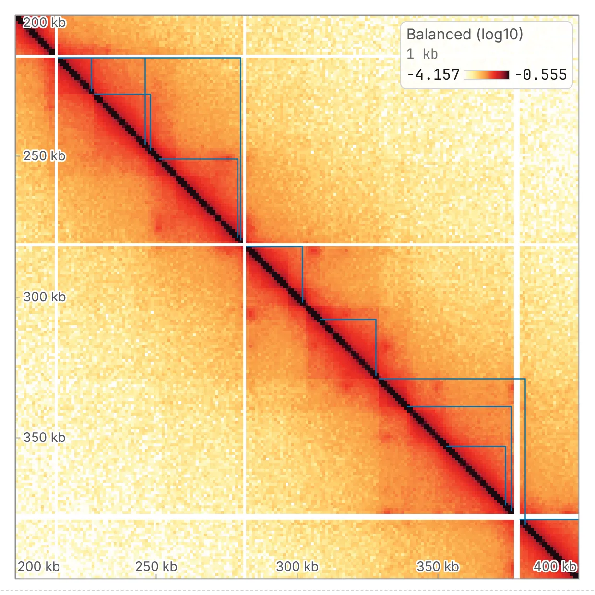

import TaskCommand from '@components/TaskCommand.astro'
import TaskOutputs from '@components/TaskOutputs.astro'
import TaskParameters from '@components/TaskParameters.astro'
import TaskSummary from '@components/TaskSummary.astro'

<TaskSummary id="arrowhead" />

**TAD annotation** calls contact domains as Juicer's Arrowhead does, from the corners of the squares they make on the map: a domain can sit inside another, two can share an edge, and a stretch with no structure has none. The domains of [diamond insulation](/analyses/insulation/) and the [directionality index](/analyses/di/) tile the sequence instead. Use it on a deep map, when nesting is the question, or for domains as `juicer_tools arrowhead` reports them.

## Running it

Open a contact map, choose **TAD annotation** in the **2D tasks** card of the **Analysis** panel (<kbd>4</kbd>), tick the sequences and press **run**.

The domains open on the map as **Arrowhead domains**, a row of the **Tracks** card in the **Annotations** panel, marked `*`, drawn as the corner of each domain's square along the diagonal, which shows the nesting; its **display** dropdown makes it a **1D track** of segments. In the drawer, **Arrowhead domains, as Juicer writes them** is a table of Juicer's columns, and a note says how many domains were called and how many sit inside another.

The same run from a shell:

<TaskCommand id="arrowhead" />

## Parameters

Every setting is one of Juicer's, at its default, so a run left alone is Juicer's run. **window** is Juicer's `-m`: a domain wider than it is not found, and 2,000 bins is 20 Mb at 10 kb.

Each candidate corner is scored from the upper and lower triangles of its square. The **strict pass** keeps a corner whose triangles' variances sum to at most **variance at most** and whose triangles each reach **sign agreement at least**. The **lenient pass** asks no variance, and a sign agreement from **sign agreement from**, lowered by **in steps of** as far as **down to**, until the sequence has a domain; a domain only it finds is added where it is wider than **smallest lenient domain** and crosses no edge of a strict one.

<TaskParameters id="arrowhead" />

## What it writes

<TaskOutputs id="arrowhead" />

## Reading the result

The table has one row per domain, in genomic order:

- **Start** and **End**: the starts of its two corner bins, as Juicer writes them, the end clamped to the sequence; and **Width (bins)**.
- **Corner score**: the triangles' difference in mean and in sign, less their variance, which ranks a domain's evidence; it is also the domain's score in the BED.
- **uVarScore** and **lVarScore**: the variances of the upper and the lower triangle.
- **upSign** and **loSign**: how consistently each triangle points the way a domain's does, from −1 to 1.

### What to watch for

- **Depth.** Arrowhead needs a deep map. When it calls nothing, the drawer gives Juicer's warning that a map with fewer than about 300 million contacts may give few domains.
- **Resolution.** Juicer picks 5 or 10 kb for itself; here it is the map you opened. A run outside 5 to 25 kb says what Arrowhead was tuned at and what its window came to. On a budding-yeast Micro-C map at 1 kb it finds the small domains such a map shows.
- **Balancing.** A map is read balanced where the file has weights, a `.hic` by its own normalisation vectors. `--no-balance` is Juicer's `-k NONE`, and the drawer says when a run read the raw counts.

## Compared with Juicer

A port of `juicer_tools arrowhead` as Juicer Tools 1.22.01 runs it, quirks and all, so on the same counts the scores are Juicer's to the last bit.
