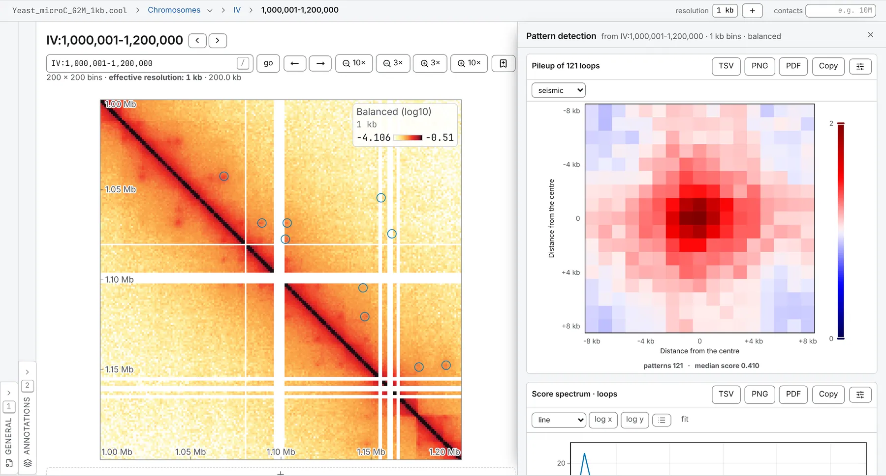

import TaskCommand from '@components/TaskCommand.astro'
import TaskOutputs from '@components/TaskOutputs.astro'
import TaskParameters from '@components/TaskParameters.astro'
import TaskSummary from '@components/TaskSummary.astro'

<TaskSummary id="chromosight" />

Pattern detection finds the shapes a contact map is made of by matching them to a template. The map is detrended by its own distance law, every pixel in the scan band is scored by its Pearson correlation with the pattern's template, neighbouring candidates are suppressed, and each call that is left gets a Benjamini-Hochberg q-value. It is chromosight (Matthey-Doret et al. 2020), ported, and on a balanced file its calls are the ones `chromosight detect` makes on the same file.

**Pattern** picks what to look for — loops, small loops, domain borders, hairpins, the depletion around a centromere, or a stripe running left or right from an anchor — and each pattern brings its own template and the thresholds chromosight tuned for it (below). For loops alone, [Loop calling](/analyses/loops/) answers the question another way, by testing each pixel against its local background.

## Running it

Open a contact map, then the **Analysis** panel (<kbd>4</kbd>), and choose **Pattern detection** in the **2D tasks** card. Pick a **pattern**, tick the sequences to scan, and press **run**. It is a scan: each sequence is read as a band along its diagonal, as wide as the pattern's scan distance, and the price beside **run** counts the multiply-accumulates the correlation will take, which is where its time goes.

The calls land on the map the moment the run finishes, as a set named for the pattern — **Detected loops**, **Detected borders** — a row of the **Tracks** card in the **Annotations** panel, marked `*`. For the off-diagonal patterns — loops and stripes — each call is a pair, drawn as a ring and leaving as a BEDPE; for the patterns that live on the diagonal — borders, hairpins and centromeres — each call is one bin, drawn as a short diagonal marker and leaving as a BED. In the drawer are the **pileup** of every called window, the **Score spectrum**, the **Loop spectrum** for the off-diagonal patterns, and a table of the strongest 200 calls; the set itself carries every one.



The same run from a shell:

<TaskCommand id="chromosight" />

```sh
chromosomix chromosight sample.cool --pattern borders --out results/
```

## Parameters

**Every threshold follows the pattern**, because chromosight tuned them together, per template: borders are called at a score of 0.15 and loops at 0.3. With **thresholds** at **from the pattern**, the default, the boxes under it stay hidden and each run uses its template's own numbers. **Set them myself** opens them, starting at the loops preset: check them against the pattern you picked. The three distances you can then set are counts of bins.

The presets are chromosight's own, in base pairs, and become bins of the file you opened:

| Pattern | Template | Score threshold | Furthest from the diagonal | Nearest to the diagonal | Nearest two calls may be |
| --- | --- | --- | --- | --- | --- |
| loops | 17 × 17 | 0.3 | 2 Mb | 20 kb | 5 kb |
| loops small | 7 × 7 | 0.5 | 2 Mb | 20 kb | 5 kb |
| borders | 17 × 17, three | 0.15 | on the diagonal | — | 5 kb |
| hairpins | 15 × 15 | 0.1 | on the diagonal | — | 5 kb |
| centromeres | 81 × 81 | 0.5 | on the diagonal | — | 100 kb |
| stripes left, stripes right | 31 × 31 | 0.17 | 2 Mb | 60 kb | 40 kb |

**Refinement passes**, one to five in all, re-scan with the pileup of what the last pass found as the template.

<TaskParameters id="chromosight" />

## What it writes

<TaskOutputs id="chromosight" />

## Reading the result

### Scores and q-values

A call's score is the Pearson correlation of its window with the template: the closer to 1, the more the window looks like the pattern. The pattern's **score threshold** is where candidates start, so every call is at or above it. Each call's p-value comes from its correlation, and its q-value from Benjamini-Hochberg over every call of the run; **report down to a q-value of** at 1, the default, keeps every call and still reports each one's q. Neighbour suppression and the correction are over the whole run, so a call's q-value depends on which sequences were ticked: the same call over two chromosomes and over sixteen has two different q-values.

### The pileup

The mean of every called window, drawn on chromosight's own fixed scale, seismic from 0 to 2 with 1 — as expected on the detrended map — in the middle. The scale does not move with the data, so a pileup can be set beside another run's or a published chromosight figure. Under it are the number of patterns that entered it and their median score. A good set shows its pattern plainly in the middle, on a background near 1.

### The score spectrum

How the scores are spread, from the threshold up. A peak clear of the threshold says the calls are a population of their own; a smooth shoulder running down to it says the calling stopped where the threshold was rather than where the pattern did.

### The loop spectrum

Off the diagonal only: each call's score against how far apart its anchors are, a cloud of points with the median in log-spaced bands drawn through it. A pileup and a histogram both average separation away, so a set whose 30 kb calls are loops and whose 2 Mb calls are noise looks fine in both. Here, scores that fall away with separation are the detector reporting the distance decay it failed to remove, and scores piled against the nearest distance to the diagonal are calls made on the diagonal's own shoulder.

### What to watch for

- **Balancing.** On a file with no balancing weights, which bins are detectable is decided from the raw coverage instead — **detectability cut** median absolute deviations below the median — and the drawer says the scores are then comparable with chromosight's in kind, not to the digit, since chromosight balances the file first.
- **Missing data.** A window holding more than the pattern's share of undetectable or empty pixels is not scored, and the drawer says how many candidates that dropped.
- **Band size.** A sequence whose band would not fit a scan is skipped and named: bring **furthest from the diagonal** down, or open the file at a coarser resolution.
- **Refinement.** A pass whose pileup has gaps in it cannot be a template, so refinement stops there, and the drawer says on which sequence.
- **Circular sequences.** The detrending uses a distance law along the line, so near the junction of a sequence ticked **circular** the expected is the far end of the curve: a seam, at the junction, rather than a wrong answer elsewhere.

To score a loop set you already have against a template, rather than detect one, use the **Chromosight** normalisation of [aggregate peak analysis](/analyses/apa/).

## Compared with chromosight

This is chromosight's detection, kept as chromosight has it — including the rules a first reading takes for oversights, since changing one would change what the score means. In [§ 6 of the validation](https://chromosomix.app/validation/#loops-chromosight), on a yeast Micro-C map at 800 bp with the loops preset, it calls the same loops at the same bin pairs as `chromosight detect` 1.6.3, with the same scores, and p- and q-values that agree to the digits printed.
