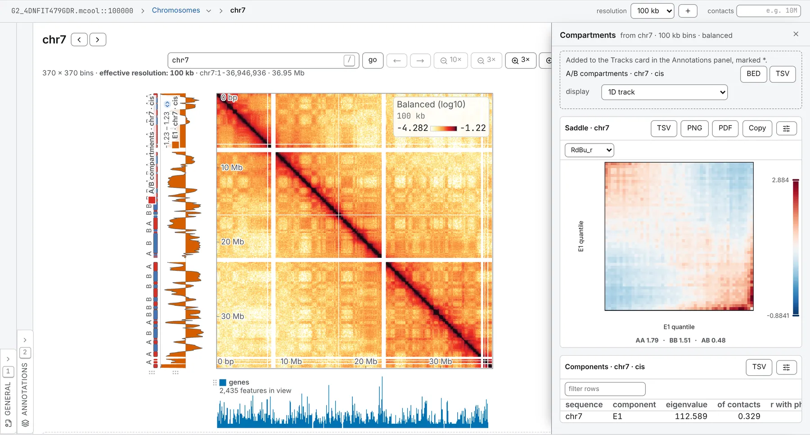

import TaskCommand from '@components/TaskCommand.astro'
import TaskOutputs from '@components/TaskOutputs.astro'
import TaskParameters from '@components/TaskParameters.astro'
import TaskSummary from '@components/TaskSummary.astro'

<TaskSummary id="compartments" />

Compartments finds the checkerboard of a chromosome's two kinds of chromatin, each touching its own kind more than the other. It divides the map by the contact expected at each separation, decomposes what is left, and gives the leading components as tracks: E1 is the compartment track. Once a gene model, a track or GC content has signed it — so that positive means the compartment that signal is high in — E1 is cut by its sign into A and B segments, and the saddle plot measures how strongly the two keep apart. It is the first eigenvector of Lieberman-Aiden et al. (2009), taken as cooltools' `eigs_cis` takes it today.

## Running it

Open a contact map at a resolution compartments suit: on a mammalian genome the usual bin is 250 kb, and 100 kb is the fine end of what is used. To phase the result, load what it should follow beside the map — a gene model such as a GTF, a track, or the genome's FASTA (see [Tracks and features](/files/tracks/) and [Reference sequences](/files/sequences/)). Then open the **Analysis** panel (<kbd>4</kbd>), choose **Compartments** in the **2D tasks** card, check what is chosen under **Phasing**, and press **run**.

What comes back:

- **E1** — and E2 and E3 with **components** at 2 or 3 — as tracks of the **Tracks** card in the **Annotations** panel, marked `*`;
- **A/B compartments**, the segments, as a 1D track directly beside E1, each segment named `A` or `B` and coloured by its name;
- in the drawer, a **Components** table, and with **draw the saddle** on, a saddle with AA, BB and AB under it — one per sequence under **cis only**, one for the run under the other two;
- notes saying what each sequence was phased against and how strongly, and which bins had too little data to take part.



The same run from a shell:

<TaskCommand id="compartments" />

Phased by GC content, which reads the reference under `--sequence` and names it again for the parameter:

```sh
chromosomix compartments sample.mcool::/resolutions/100000 --sequence ref.fa.gz --phaseSequence ref.fa.gz --out results/
```

A gene model is loaded with `--features` and named the same way, `--features genes.gtf --phaseFeatures genes.gtf`; a track is named alone, `--phaseTrack signal.bw`.

## Parameters

**Contacts** and **method** decide the run. **Cis only**, the default, is the per-chromosome compartment track, and the one that runs at a fine resolution. **Cis and trans** over every chromosome is a genome-wide answer the per-chromosome runs cannot give: two chromosomes in the same compartment touch each other in trans, and that is where a genome-wide eigenvector's signal comes from. **Trans only** leaves the distance decay out of the answer altogether. Under **cooltools**, the default method, every gap of the matrix is read as expected and each eigenvector is scaled by the square root of its eigenvalue, so a track is on cooltools' own scale; **Lieberman-Aiden 2009** is the original paper's correlation of rows. The two agree where a chromosome has compartments to find, and part where it has none. **Diagonals to ignore** keeps the near-diagonal — self-ligation and unligated fragments, the largest cells of the map and the least structural — out of the matrix. The phasing settings are explained under the result.

<TaskParameters id="compartments" />

## What it writes

<TaskOutputs id="compartments" />

## Reading the result

### Phasing: which way up

An eigenvector's sign is arbitrary until something gives it a meaning. The **Phasing** settings name what, used in this order:

1. **phase by gene density**: a gene model you loaded, positive where its features are dense;
2. else **phase by a track**: any loaded or computed track, positive where it is high;
3. else **phase by GC content**: a reference sequence, positive where it is GC-rich.

**Phase by gene density** starts on a feature set you loaded — the starred one, or else the first — and **phase by GC content** on a sequence you loaded, the same way; **phase by a track** starts on none, since the first bigWig loaded is a ChIP track as often as anything. Check the first before you run: any interval set counts as a gene model here and is used ahead of the other two, so if the one chosen is a set of peaks rather than genes, pick another or **Do not use a gene model**.

Each component is turned so that it correlates positively with the signal, once that correlation reaches **least convincing correlation**. Below it the sign is left as the solver gave it, and the drawer says the phasing was ambiguous and that E1's sign should not be compared with another run's. With nothing chosen at all, every component's sign is arbitrary, and the drawer says that too.

### E1, E2 and E3

The components are ranked by their eigenvalues and by nothing else: the phasing signs each one but never chooses among them, so E1 is always the component with the largest eigenvalue. That is deliberate — a component picked for following GC content would make any later comparison of GC content between its compartments a comparison of GC content with itself. E1 is the compartment track; E2 and E3 occasionally say something. If E1 does not follow the phasing signal, the table shows it, and E2 is worth a look.

The **Components** table has a row per sequence and component:

- **eigenvalue**;
- **of contacts**: the share of the map's departure from expected — observed/expected, clipped, less one — that this component's checkerboard carries. It is the same measure under either method, and the shares of several components add up;
- **r with phasing**: Pearson's r with the phasing signal, as drawn, so positive once the sign is fixed;
- under **Lieberman-Aiden 2009** only, **variance**: the correlation matrix's own share, which is how alike the rows are rather than how much of the map.

Bins with too little data to take part are gaps in the tracks, not zeros, and the drawer says how many.

### A and B

Each run of bins on one side of zero in E1 is a segment, `A` where E1 is positive and `B` where it is negative — so A is the compartment the phasing signal is high in, and means nothing more than the phasing did. A segment never runs from one sequence into the next. The segments leave as a BED, ready for [signal by group](/analyses/groupsignal/), which compares a track between the A and B of such a set, or [interval set overlap](/analyses/overlap/).

### The saddle

The saddle sorts a sequence's bins by E1, cuts them into **quantile groups** of equal size (50 by default), and draws the mean observed/expected between every two groups, from B to A along both axes, on a diverging scale with 1, as expected, in the middle. Under it are three numbers, each the mean of a corner over the fifth of the groups at that end: **AA**, the most A-like bins with each other; **BB**, the most B-like with each other; and **AB**, the two with each other. A map with compartments has AA and BB above 1 and AB below it: bright corners on the diagonal of the saddle, dark ones off it. The further apart they are, the more strongly the compartments keep apart.

AA and BB are named from the phasing. Under an ambiguous phasing the saddle also shows the phasing r, since AA and BB may then be the wrong way round. The saddle divides each cell by its own diagonal's mean under either method, as `cooltools.saddle` does.

### What to watch for

- **Size.** Every matrix decomposed is held whole, and one past 8,192 bins a side is refused. Under **cis only** a sequence that large is skipped and named; under the other two the run is refused, saying what to untick or how coarse to open the file. Under **Lieberman-Aiden 2009** the correlation grows as the cube of the bins, and past about 2,000 the price beside **run** says so and names a resolution of the file that fits.
- **A chromosome with no compartments.** Its E1 is still whatever carries most of its map, which may be nothing you would call a compartment; a small **of contacts** share and a weak **r with phasing** are where that shows.
- **Circular sequences.** A sequence ticked **circular** in the Chromosomes table is divided by its decay measured the short way round.

### Bacterial chromosomes

On a bacterial chromosome whose two arms are held together, the map has a second diagonal through the origin, and divided by the distance decay alone its leading component follows the arms rather than its compartments: on a *Pseudomonas aeruginosa* map E1 then follows the distance from the origin and nothing in the sequence. **Expected** at **decay along both arms**, under **cis only**, divides by an expectation that removes both diagonals, within **window along the arms** bins along them (0 is the whole chromosome); on the same map E1 then follows GC content instead. The arms are read from the sequence's origin in the Chromosomes table — its first base until one is set, which the drawer notes. [Inter-arm alignment](/analyses/interarm/) measures how strong that second diagonal is.

## Compared with cooltools

Under the default method all three components are `cooltools.eigs_cis`'s on the same balanced matrix, divided by the expectation `eigs_cis` takes from each chromosome's own square. In [§ 3 of the validation](https://chromosomix.app/validation/#compartments), on a mouse Hi-C map at 100 kb phased by GC content, E1 agrees with cooltools' to within 3·10⁻¹² in r on every chromosome compared and 5·10⁻⁶ in any bin — the six digits a track is written to — the eigenvalues agree, and the A/B call is the same in every bin.

The badge says *equivalent* rather than identical because of the sign: cooltools signs each component by its Spearman correlation with the phasing track, this task by Pearson's r, and it leaves the sign alone below **least convincing correlation**. So an E2 or E3 that barely follows GC content can come out the other way round from cooltools'; up to sign, they are the same components. The saddle is held to `cooltools.saddle` over the same E1 in [§ 21](https://chromosomix.app/validation/#saddle-cooltools): every cell within the six digits written, and AA, BB and AB within their two decimals. The **Lieberman-Aiden 2009** method is not in the validation.
