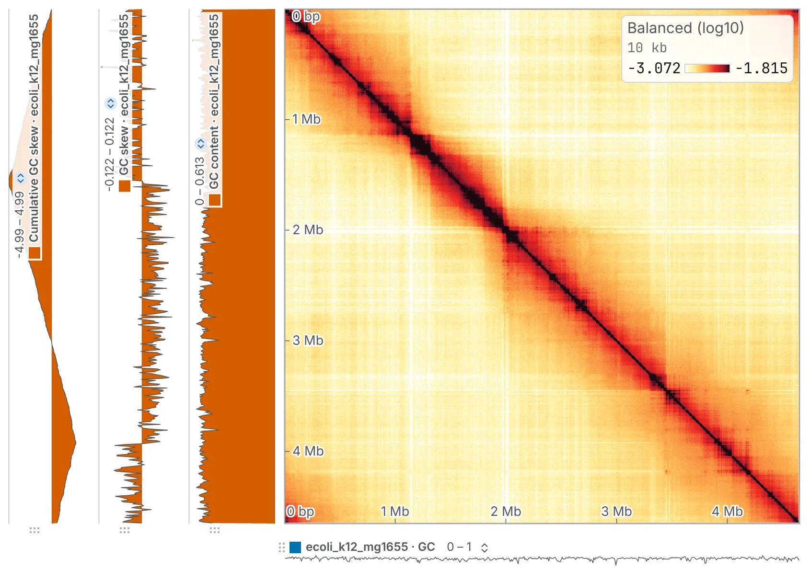

import TaskCommand from '@components/TaskCommand.astro'
import TaskOutputs from '@components/TaskOutputs.astro'
import TaskParameters from '@components/TaskParameters.astro'
import TaskSummary from '@components/TaskSummary.astro'

<TaskSummary id="composition" />

**Base composition** turns a reference into tracks on fixed bins, to set beside the map or give to any task that reads a track: GC content, GC skew, AT skew and the cumulative GC skew.

## Running it

Load the reference as a FASTA or a `.2bit` ([Reference sequences](/files/sequences/)), open **Base composition** on the **1D tasks** card of the **Analysis** panel, and choose it under **reference**. No map is needed: the bins are the open map's, or 10 kb with no map open.

Each track ticked is a row of the **Tracks** card, marked `*`, named after the reference and any window: `GC content · ref`, `GC skew · ref · 50,000 bp window`.

The same run from a shell:

<TaskCommand id="composition" />

## Parameters

**bin size** follows the open map's resolution until you type another. **window** smooths a noisy skew without changing its grid; it is rounded to an odd number of bins, and wraps round the junction of a circular sequence.

<TaskParameters id="composition" />

## What it writes

<TaskOutputs id="composition" />

## Reading the result

- **GC content** is the share of G and C among the A, C, G and T of the bin, from 0 to 1. Any other letter, such as `N`, is not counted, and a bin with none of the four is a gap.
- **GC skew** is `(G − C) / (G + C)`, and **AT skew** `(A − T) / (A + T)`, each from −1 to 1. On a bacterial chromosome the GC skew changes sign at the origin and again at the terminus.
- **Cumulative GC skew** is the running sum of each bin's own skew along the sequence. Its minimum is the origin and its maximum the terminus, wherever the assembly starts. It sums the bins' own skews even when a window is set, and a gap adds nothing to it.

[Origin and terminus](/analyses/oriter/) makes that call for you. To test whether A is richer in GC than B, give the GC content track to [Signal by group](/analyses/groupsignal/) with a [compartment](/analyses/compartments/) call as the groups.

A sequence of the map that the reference lacks is a gap on every track, and one whose length differs is read from its start; a note names both.

## Compared with bioframe and Biopython

In [the validation](https://chromosomix.app/validation/#base-composition), GC content agrees with bioframe's `frac_gc`, and the GC skew with Biopython's `GC_skew`, to float32, except in a bin with neither G nor C, where Biopython writes 0 and chromosomix no value.
