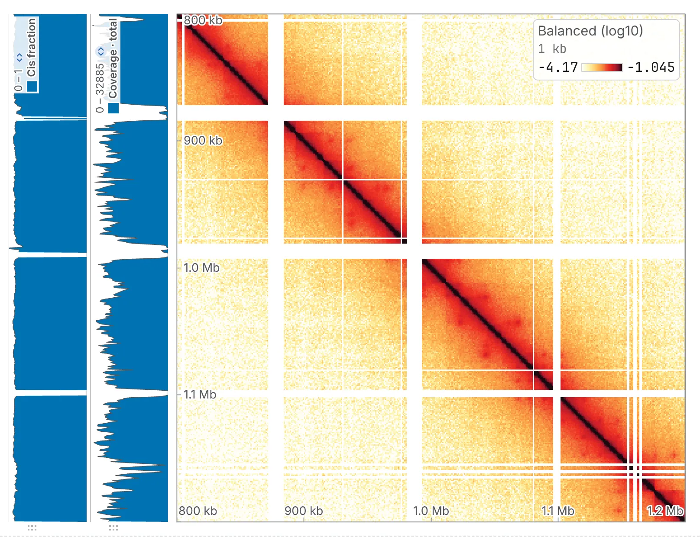

import TaskCommand from '@components/TaskCommand.astro'
import TaskOutputs from '@components/TaskOutputs.astro'
import TaskParameters from '@components/TaskParameters.astro'
import TaskSummary from '@components/TaskSummary.astro'

<TaskSummary id="coverage" />

A bin's coverage, or marginal, is every contact with an end in it: the track that tells a pale stretch
of the map caused by the bin from one caused by the fold, and the check on a balanced file. Split into
cis and trans, it says how much of each bin's contact stays on its own sequence.

## Running it

Open a contact map, choose **Coverage and marginals** in the **2D tasks** card of the **Analysis**
panel, turn on the tracks you want — **total coverage**, on by default, and **cis fraction**, **cis
coverage** and **trans coverage** — and press **run**.

Each track is a row of the **Tracks** card in the **Annotations** panel, marked `*`: *Coverage · total*,
*Coverage · cis*, *Coverage · trans* and *Cis fraction*, with its bigWig, bedGraph and TSV in the
row's settings.



The same run from a shell:

<TaskCommand id="coverage" />

All four tracks, from the balanced counts:

```sh
chromosomix coverage sample.mcool::/resolutions/10000 --cis --trans --fraction --balance --out results/
```

## Parameters

Unlike every other task, coverage reads the raw counts unless you turn on **use balancing weights**
(`--balance` on the command line). Raw, the tracks are coverage as depth, which tells an artefact from
structure; balanced, they check the balancing.

<TaskParameters id="coverage" />

## What it writes

<TaskOutputs id="coverage" />

## Reading the result

### Total coverage

Each bin's value is the number of contacts with an end in it, its contact with itself counted once. On
the raw counts a dip is a bin every contact misses, and a pale stripe on the map over a dip is a property
of the bin, not of the fold: look at the two together before calling a pale stretch a domain or a
compartment. A bin with no contact reads 0, since the file stores only pixels that hold contacts. With
**use balancing weights** on, a bin the balancer dropped is a gap, and the rest should be flat; a
balanced total that is not flat is a file whose weights do not fit its counts.

### Cis, trans and the cis fraction

Cis coverage counts the contacts whose other end is on the bin's own sequence, trans coverage those whose
other end is on another, and the two add up to the total. The cis fraction, `cis / (cis + trans)`, from 0
to 1, is the share of a bin's contacts that stays on its own sequence, and picks out stretches of the
assembly that behave unlike the rest. A bin with no contact has no cis fraction: a gap, not 0. One value
per sequence is [Cis and trans per sequence](/analyses/cistrans/).

### What to watch for

- **The diagonal is counted once.** cooltools' `coverage` counts a bin's contact with itself twice; take
  each bin's own diagonal pixel off cooltools' value and the two agree, raw and balanced.
- **The map report counts differently**: its contacts per bin count a contact within one bin twice, as
  Juicer does.
- **Counts, not another score.** On a map drawn from another score column, the marginals are of the
  counts, and the run's note says so.
