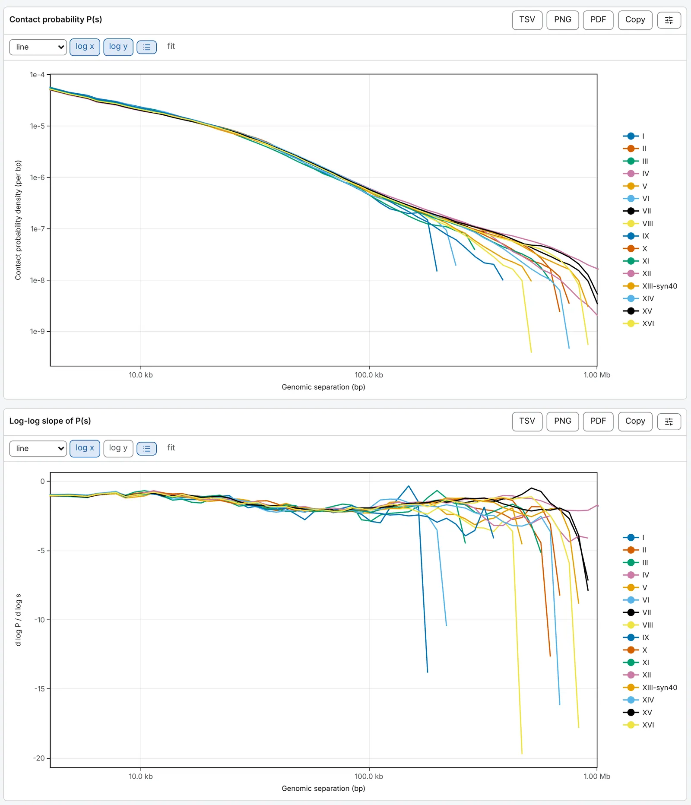

import TaskCommand from '@components/TaskCommand.astro'
import TaskOutputs from '@components/TaskOutputs.astro'
import TaskParameters from '@components/TaskParameters.astro'
import TaskSummary from '@components/TaskSummary.astro'

<TaskSummary id="expected" />

P(s), how contact falls with the distance between two loci along the sequence, is the first curve to
draw of any contact map; its log-log slope shows a shoulder or a plateau the curve hides. Use it to
compare libraries, conditions or organisms on one axis. The 4C profile, the compartments, the inter-arm
alignment and the pileups each compute their own expected, so this task's settings change none of them.

## Running it

Open a contact map, choose **Contact probability P(s)** in the **2D tasks** card of the **Analysis**
panel, and press **run**. With **scope** on **chromosome**, the default, there is one curve per ticked
sequence; **whole genome** pools every sequence into one.

The drawer shows **Contact probability P(s)**, a line per sequence, over **Log-log slope of P(s)**, on
logarithmic axes. Both open on 4 kb to 1 Mb, past the ligation artefacts and inside the shortest
chromosome; the curve runs further, and **fit** shows all of it.



The same run from a shell:

<TaskCommand id="expected" />

The expected, cooltools' quantity, pooled over the whole genome:

```sh
chromosomix expected sample.mcool::/resolutions/1000 --quantity expected --scope file --out results/
```

## Parameters

**quantity** matters, because two things are called P(s). **probability density**, the default, is the
share of all cis contacts at each separation, per base pair, as HiContacts' `distanceLaw` reports it.
**expected (cooltools)** is the mean contact per pair of bins that far apart, as `cooltools expected-cis`
reports it, and what most published scaling exponents use. **minimum separation** leaves out the
diagonal and the one beside it by default, as cooltools does: they hold self-ligation and unligated
fragments. **log bins per step** trades a smooth tail against a detailed shoulder.

<TaskParameters id="expected" />

## What it writes

<TaskOutputs id="expected" />

## Reading the result

The curve is straight on the log-log axes wherever contact falls as a power of the separation. The two
quantities agree at short separations and part near the length of the longest sequence: on the yeast
demo map they are within 1 % below 10 kb, 13 % apart at 100 kb and a factor of fifty apart at 1.2 Mb,
while on a mammalian map they agree over every separation anybody fits. Compare curves of one quantity,
and say which a figure shows.

The slope, `d log P / d log s`, is the local exponent of the decay. Towards the length of the longest
sequence each point rests on fewer pairs of bins, and both figures grow noisy.

### What to watch for

- **The density is not quite HiContacts' on a matrix.** HiContacts divides each logarithmic bin by its
  nominal width, which on a 1 kb map puts a sawtooth of a factor of two into the curve near 10 kb;
  chromosomix divides by the separation the bin actually covers. Past about 50 kb at 1 kb bins the two
  agree.
- **The four read orientations** are drawn by [Pairs QC](/analyses/pairsqc/), from a `.pairs`.
- **Counts, not another score.** On a map drawn from another score column, a pass over the whole pixel
  table reads the stored counts, and the run says so; a run over one sequence measures that column.
