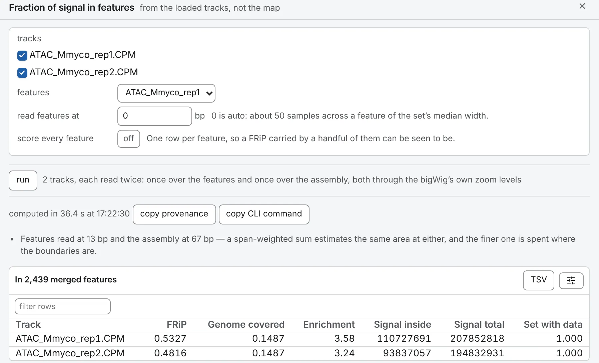

import TaskCommand from '@components/TaskCommand.astro'
import TaskOutputs from '@components/TaskOutputs.astro'
import TaskParameters from '@components/TaskParameters.astro'
import TaskSummary from '@components/TaskSummary.astro'

<TaskSummary id="frip" />

**Fraction of signal in features** is FRiP, the fraction of reads in peaks, taken of any loaded track: the share of its signal inside a set of intervals, beside the share of the genome the set covers. Their ratio, the enrichment, is the column to read. Use it to check a library against its peaks, or to rank tracks against a set.

## Running it

Load one or more tracks and a feature set ([Tracks and features](/files/tracks/)). Open **Fraction of signal in features** on the **1D tasks** card of the **Analysis** panel, tick the **tracks** and choose the **features**; no map is needed. The drawer shows a row per track, the strongest enrichment first.

The same run from a shell:

<TaskCommand id="frip" />

## Parameters

**read features at** 0, the default, reads about 50 samples across a feature of the set's median width. **score every feature** adds a table with each feature's signal, mean and share of the track's total, which shows whether the FRiP belongs to the set or to a handful of its features.

<TaskParameters id="frip" />

## What it writes

<TaskOutputs id="frip" />

## Reading the result

- **FRiP**: the signal inside the set over the signal everywhere. Signal is an area, value × bases, so a wide feature weighs by its width.
- **Genome covered**: the set's bases over the assembly's.
- **Enrichment**: FRiP over genome covered. 1 is a track with no preference for the set: 30 % of the signal in 30 % of the genome. The same 30 % in half a per cent of the genome is a sixtyfold enrichment.
- **Signal inside** and **Signal total**: the two areas.
- **Set with data**: the share of the set's bases the track has any value for. A low one means the FRiP is about a small part of the set.

The features are merged first, so a base two of them share, as transcripts of one gene do, counts once; the table's title gives the number of merged features. The whole track is read from a zoom level where the file has one fine enough, and the note gives both resolutions.

## Compared with ENCODE's FRiP

This is the ENCODE guidelines' FRiP, of a track's signal rather than of reads. In [the validation](https://chromosomix.app/validation/#fraction-of-signal-in-features-pybigwig), reading the whole track from a zoom level moves a FRiP by less than the last of its four decimals.
