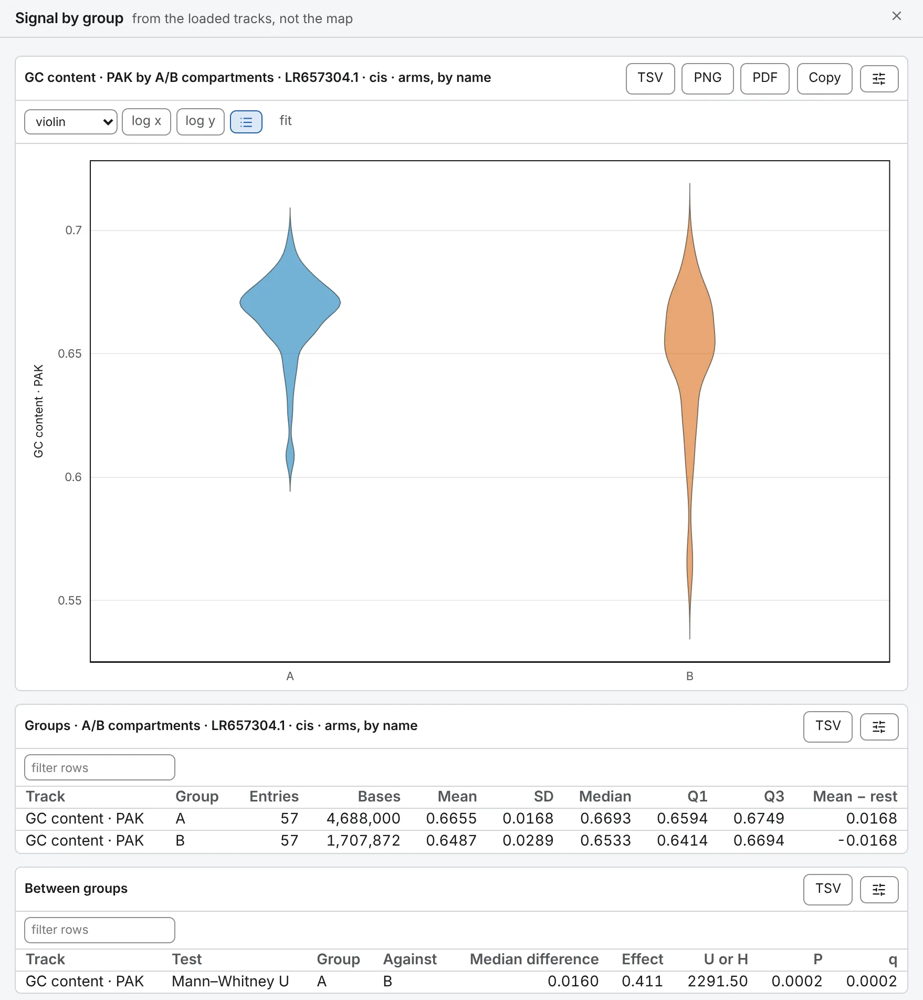

import TaskCommand from '@components/TaskCommand.astro'
import TaskOutputs from '@components/TaskOutputs.astro'
import TaskParameters from '@components/TaskParameters.astro'
import TaskSummary from '@components/TaskSummary.astro'

<TaskSummary id="groupsignal" />

Is compartment A richer in GC than B? Is B less accessible? Is the signal higher at one class of peaks than at another? **Signal by group** reads one or more tracks over groups of the genome — the names written on a feature set, such as A and B on a compartment call, or a track cut by its sign or into quantiles — summarises each group, draws it as a violin and tests the groups against one another by ranks.

## Running it

Load or make the track to compare: a bigWig, or a track another task made — GC content from [Base composition](/analyses/composition/), the eigenvector from [Compartments](/analyses/compartments/), a [spatial track](/analyses/spatialtracks/) of a model. Open **Signal by group** on the **1D tasks** card of the **Analysis** panel and tick the **tracks**. Then say where the groups come from, under **groups from**:

- **a feature set**: choose it under **features**, and how to split it under **split the set by** — by **name** (A and B on a compartment call, a class on a peak set), by **strand**, by **score, in quantiles**, or **nothing: one group**. Every base the set does not cover is one more group, *rest of the genome*, unless you turn off **the rest as a group**.
- **a track**: choose the **grouping track**, and cut its bins by **sign** — `above 0` and `below 0`, an eigenvector's two compartments without calling them — or into **quantiles**, equal numbers of bins from lowest to highest. The bins are **bin size** wide if you set one, and otherwise the open map's, or 10 kb with no map open.

No contact map is needed. The drawer shows a violin per group for each track, **Groups** with each group's summary, and **Between groups** with the tests. A grouping made from a track is also written out as intervals named by group, a track of the **Tracks** card that other tasks can read as a set.

The same run from a shell:

<TaskCommand id="groupsignal" />

## Parameters

**bin size** decides what one observation is, and with it what the P means. At 0, the default, each entry is one value: a run of a group's features, merged where they overlap or touch; each stretch of the rest between two of them; each run of bins in one group of a track. A 30 kb compartment is then one observation, as a 300 bp peak is. Any other size cuts each entry into stretches of at most that many bases, which describes the signal over a group's bases rather than over its entries. Leave it at 0 to test; set it to describe.

<TaskParameters id="groupsignal" />

## What it writes

<TaskOutputs id="groupsignal" />

## Reading the result

### The summaries

**Groups** gives, for each track and group, the number of entries (or stretches), the bases they cover, the mean, SD, median and quartiles, and **Mean − rest**: the group's mean less that of every other stretch. A value is always the track's exact mean over the bases it has a value for, read at the track's own resolution.

### The tests

**Between groups** tests every two groups with Mann–Whitney U, giving the **Median difference** and the rank-biserial **Effect** — +1 where every value of the group is above every value of the one it is set against, −1 where every one is below, 0 where they mix evenly — and, where there are three groups or more, all of them together with Kruskal–Wallis H. The tests are tie-corrected; **q** is Benjamini–Hochberg over every test of the run. A P or q too small for four decimals is written with an exponent, `6.5319e-22`, never as 0.

### Read the effect, not only the P

The tests count their observations as independent, and the bins of one compartment are not: they share their GC, their expression and their place in the nucleus. Cut into bins, a compartment multiplies the observations without adding to what is known, and the P follows the bin size rather than the data. On the chromosome of *P. aeruginosa*, 782 bins of 8 kb in 110 compartments, the difference in GC between A and B has an effect of 0.42, 0.39 and 0.43 at 8, 32 and 128 kb, and a P of 2·10⁻²⁰, 6·10⁻⁵ and 3·10⁻². The effect barely moves; the P moves by eighteen orders of magnitude. That is why one value per entry is the default.

### Things to watch for

- A group with nothing in it — the rest of the genome, beside a compartment call that covers every base — is left out and named in a note.
- Cut by sign, a bin with no reading, or one that reads exactly 0, is in no group; the note says how many.
- Features on sequences the assembly does not have are left out, and named.
- A violin of more than 20,000 values is drawn from 20,000 of them, evenly by rank. The tests use every value.

## Compared with SciPy

The tests are SciPy's asymptotic forms — `mannwhitneyu` with its continuity correction, and `kruskal` — with `false_discovery_control` for q. In [the validation](https://chromosomix.app/validation/#signal-by-group-pybigwig-and-scipy), mouse ATAC-seq on chr19 grouped by a compartment call makes the same groups as the reference both ways, by entry and in 10 kb stretches, with the same means rank for rank as pyBigWig's exact means, and every summary and test agrees with NumPy's and SciPy's to the places it is written.
