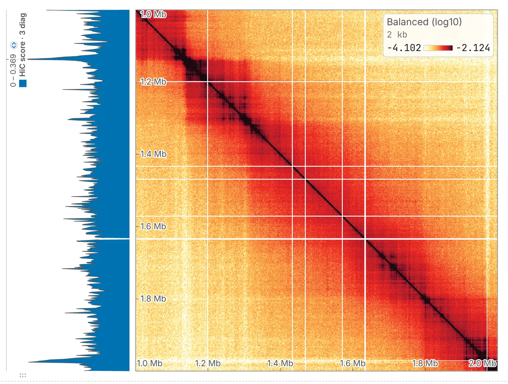

import TaskCommand from '@components/TaskCommand.astro'
import TaskOutputs from '@components/TaskOutputs.astro'
import TaskParameters from '@components/TaskParameters.astro'
import TaskSummary from '@components/TaskSummary.astro'

<TaskSummary id="hicscore" />

The HiC score is the mean contact a bin makes with its nearest neighbours along the chromosome: how tightly a stretch is folded against itself, as Bignaud et al. (2024) read bacterial maps at 2 kb, which the default is set for. Where [diamond insulation](/analyses/insulation/) and the [directionality index](/analyses/di/), ratios blind to depth, ask where a domain ends, this is a mean of the map's own values: a region that has lost its local structure has a smaller HiC score and an unremarkable insulation score.

## Running it

Open a contact map, choose **HiC score** in the **2D tasks** card of the **Analysis** panel (<kbd>4</kbd>), tick the sequences and press **run**.

One track joins the **Tracks** card of the **Annotations** panel, marked `*`: **HiC score · 3 diag**, in contacts. The drawer notes how far the line reaches on this file and how many cells each value averages.

The same run from a shell:

<TaskCommand id="hicscore" />

## Parameters

**diagonals** sets the reach: how many diagonals the bin's line crosses, counting the main one. At 3, five cells reaching two bins each way, it is the bacterial reading at 2 kb; a map with much larger domains wants more. It is the authors' R script's `num_diagonals` plus one. **diagonals to ignore** matters more than its default of 0 suggests (below).

<TaskParameters id="hicscore" />

## What it writes

<TaskOutputs id="hicscore" />

## Reading the result

Each bin's value is the mean of the cells on its own line through the diagonal, out to **diagonals** − 1 bins either way: every cell on it involves the bin.

The value is in the map's own units, counts on a raw map and balanced values on a balanced one, so it follows how deeply the map was sequenced. Read it against the rest of the same map: high where a stretch is folded tightly on itself, low where it has lost its local structure.

### Ends and gaps

The first and last **diagonals** − 1 bins of a linear sequence are gaps, not values fading towards zero, and the drawer says so; a sequence ticked **circular** in the Chromosomes table has no ends. A cell the balancer dropped counts as nothing, and the mean is never scaled up for it. A bin with less of its line usable than **minimum coverage of the line** asks has no value.

### The main diagonal

At three diagonals the main diagonal is the bulk of each line. It is where self-ligation and undigested fragments land, and on a balanced map the one place the weights were never fitted. A peak carried by that cell is carried by the protocol: run it again with **diagonals to ignore** at 1 and see whether what you read survives.

## Compared with the authors' script

The validation does not run it yet; at one locus of an *E. coli* map, the mean here times the number of cells is the authors' R script's sum to the last digit.
