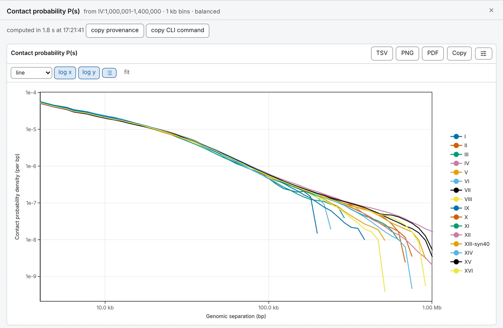

import TaskIndex from '@components/TaskIndex.astro'

Every analysis runs on your own machine, over the files you opened: in the **Analysis** panel, or in a
shell with the `chromosomix` command line, which runs the same code. Nothing is uploaded. This page covers
what every task has in common; each task's own page is listed [at the end](#every-task).

## Running a task

1. Open the **Analysis** panel, the right-most column. <kbd>4</kbd> shows and hides it.
2. Click a task's row. The drawer opens with its form, the price of the run and **run**.
3. Set the form, read the price, and press **run**. The results appear in the drawer, and beside the map
   when they are a track or a set of intervals.

The drawer floats over the map; drag its left edge to widen it. Its ✕, or <kbd>Esc</kbd> when the caret
is not in one of its boxes, puts it away. A run carries on, and opening the task again brings back its
form and figures.

## The Analysis panel

Tasks sit in three cards: **2D tasks** about the contact matrix, **3D tasks** about a model of beads in
space, and **1D tasks** about tracks and intervals along the sequence. Each row shows the task, a line on
what it does, and its state:

| The row says | Which means |
| --- | --- |
| never run | Not run on this file yet. |
| queued | Waiting: one job runs at a time. |
| a percentage, or *running*, with a turning ring | Running. The line under the title names the step, and the row has a stop button. Over a deck, *2 of 5* says which map. |
| done in … | Finished, in that long. |
| failed | Stopped on an error; the line under the title says why. |
| cancelled | You stopped it. |

**The box above the cards** filters the list. Every word must match a task's title, line, card or other
names: *TAD* finds the domain callers, *pileup* aggregate peak analysis, *A/B* the compartments, *decay*
P(s). <kbd>Enter</kbd> opens the first task that can run; <kbd>Esc</kbd> empties the box.

**A greyed row is waiting for a file** and says what to load, such as *Load a loop set (BEDPE), or a
feature set (BED, GTF).* A task that cannot apply to the open file is not listed: per-cell contact QC
appears only for an `.scool`. With no contact map open, only the 1D tasks run; on a deck with no map
starred, the map tasks wait until you star one.

**The `?`** after a task's state marks one that re-implements a published method. Point at it, or tap it,
for the method, the paper's DOI and how the task came out in [the validation](/analyses/validation/):
green if identical or equivalent, in the text's colour if not compared yet.

## What a task reads

- **The map**: the open one. On a [deck of maps side by side](/browse/deck/), the **starred** one, and
  the button reads **run on ★**. **run on all N maps** runs once per map and gives each map a tab; the
  **all maps** tab draws the curves on one figure and the tables as one, its first column naming the map.
- **The tracks**: a 1D task reads the loaded tracks, feature sets and sequences, never a map, and runs
  once, even on a deck.
- **The view, as it is when you press run**, for what changes the numbers: the resolution, the score the
  map is drawn from, the sequences declared circular, and the number of contacts typed in the
  breadcrumb's *contacts* box. The drawer's heading gives this framing (*will run on …*, then *from …*).
  The result does not follow a later pan or zoom: the heading adds *the view has moved since*, and
  **recompute here** runs it on the view as it is now.
- **What the form names**, not the window on screen: the sequences ticked (all, unless you untick some),
  an anchor, a feature set.
- **The resolution the row above the map names** ([Resolution](/browse/contact-maps/#resolution)): with
  *refine on zoom* unticked, the one you picked — one the file stores, or one you added (marked `*`,
  as in `3 kb*`); while *refine on zoom* picks, the one the map is drawn from at that moment, so a
  chromosome on screen at 250 kb is analysed at 250 kb, and at 25 kb once you have zoomed to it. Never
  the coarser cells of a zoomed-out picture. To run at another, untick *refine on zoom* and pick it.
  The map report is the exception: its ladder counts from the file's finest resolution.
- **Balanced counts**, wherever the file carries weights, however the map is drawn; `--no-balance` on the
  command line reads the raw counts. Coverage is the one task that asks, raw unless you turn its weights
  on; the map report reads its coverage and its cis and trans raw.

Settings about the matrix, such as a window or a trim near the diagonal, are in bins, so a number means
the same cells at every resolution; the run's notes give base pairs where it matters. Settings about a
track, such as a metaplot's flank, are in base pairs. The form keeps your settings for each task on each
file, and an exported session carries them: repeating an analysis is opening it and pressing **run**.

## What it costs, before you press run

Beside **run**, the drawer says what the run will read:

- **Nothing to read**: *Computed from the block already on screen. No reads.*
- **A few reads**: so many range requests, for one dense square.
- **A pass over the file**: *One pass over the whole pixel table*, or so many strips along the diagonals.

Nothing is read until you press **run**. Where reads can be merged, as in a pileup over thousands of loops,
the price is the most the run could need.

**A run that cannot happen says why, in red, and run is greyed**: *Tick at least one sequence.*, or a limit
and the ways round it. Compartments, for instance, refuse a matrix of more than 8,192 bins a side, and say
to untick some sequences, open a coarser resolution or read the cis contacts alone.

## While it runs

The map stays live: pan, zoom or switch tabs, and the job keeps running. One job runs at a time in a
session; a second waits, *queued*. Closing the session's tab cancels its job.

To stop a job, press the stop button on its row or **cancel** beside **run**. It stops at its next chunk
of work or read (a pass with no read in it runs to its end and its answer is dropped), the row says
*cancelled*, and nothing is added beside the map.

## What comes out

Under **run**, a finished run shows:

- **The record line**, *computed in 2.0 s at 20:49:46*, with **copy provenance** (the task, its version,
  every parameter, the framing, the file and the build) and **copy CLI command**.
- **The run's notes**: what it left out, what a setting came to on this file, why a figure is empty. Read
  them before the numbers.
- **Its results**, each with its exports.

A result takes one of three forms:

- **A value per bin is a track**: a row of the **Tracks** card in the **Annotations** panel, marked `*`,
  drawn beside the map and in the genome browser like a loaded bigWig. Its tooltip is its provenance and
  its settings hold its exports: bigWig, bedGraph and TSV. Running the task again replaces it.
- **A called set** (boundaries, domains, peaks, loops, sites) is one row whose **display** is a **1D
  track** or a **map overlay**. On the map a place is a point or a short diagonal marker (its **look**), an
  extent the corner of its square, a pair a ring. It saves as BED, or BEDPE for pairs, and TSV.
- **Curves, matrices and tables** are figures in the drawer. Zoom a curve with the wheel or a dragged
  rectangle; **log x**, **log y** and **fit** set its axes. A table sorts by a click on a column and
  filters by its box; it shows positions 1-based and saves them 0-based, as a BED holds them. A figure
  saves as **PNG** at 300 dpi or vector **PDF**, **Copy** puts it on the clipboard, **TSV** saves its
  numbers, and the sliders button opens its settings ([Figures and export](/browse/figures/)).

Every TSV, bedGraph and BED opens with `#` lines naming the build, the task and its version, the file, the
framing and every parameter. A bigWig cannot hold them, so a TSV is offered beside it.

**older**, **newer** and **latest** step through the last nine runs of each task on each map; the line
between them says which is shown and, in its tooltip, which parameter differs from the latest. The
heading, **recompute here**, the command line and every export follow the run on screen.

A reload keeps the recipe, not the values: the drawer's results are gone, and a computed track comes back
saying *values not kept over the reload*, with **recompute** beside it. The same file opened at another
resolution keeps its computed tracks; another file leaves them behind.

## The same run from a shell

Every run is written to the [console](/browse/console/), as it starts, as the `chromosomix` command that
repeats it: a line per job, failed and stopped runs included. **copy CLI command** copies it. Run it as it
stands, adding `--out` for the folder the files go to (the current one otherwise); what a shell cannot be
told is a `#` note above the line. See [From the app to a script](/cli/from-the-app/) and
[Installing it](/cli/install/).

## Every task

Each task's page gives what it reads and writes and every parameter; the badge says how it came out in
[the validation](/analyses/validation/).

<TaskIndex />
