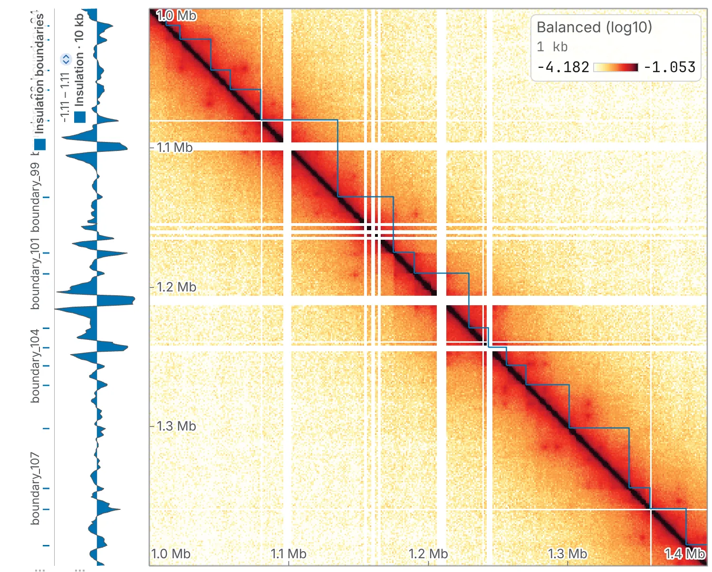

import TaskCommand from '@components/TaskCommand.astro'
import TaskOutputs from '@components/TaskOutputs.astro'
import TaskParameters from '@components/TaskParameters.astro'
import TaskSummary from '@components/TaskSummary.astro'

<TaskSummary id="insulation" />

Diamond insulation scores how much contact crosses each bin. A square window slides along the diagonal; where a domain boundary sits, little contact passes from one side to the other, and the score dips. You get the boundaries as a track, as calls and as the domains between them, at one scale or several. The [directionality index](/analyses/di/), the [HiC score](/analyses/hicscore/) and [TAD annotation](/analyses/arrowhead/) read domains in other ways.

## Running it

In the **Analysis** panel (<kbd>4</kbd>), choose **Diamond insulation**, tick the sequences (all are ticked to begin with), set the **window**, and press **run**. Three rows land in the **Tracks** card of the **Annotations** panel, marked `*`:

- the score, named after its window: **Insulation · 100 kb** for the default 10 bins on a 10 kb map;
- **Insulation boundaries**, one-bin segments beside it, level with their dips;
- **Insulation domains**, drawn on the map as the corner of each domain's square.

A called set's **display** moves it between a **1D track** and a **map overlay**; on the map, boundaries can be a **point** or a **short diagonal marker**.



The same run from a shell:

<TaskCommand id="insulation" />

For example, four scales from a 10-bin window on the 10 kb rung of an `.mcool`:

```sh
chromosomix insulation sample.mcool::/resolutions/10000 --window 10 --scales 4 --out results/
```

writes the scores `sample.insulation.insulation-w10` to `sample.insulation.insulation-w80` and the calls `sample.insulation.insulation-boundaries` and `sample.insulation.insulation-domains`.

## Parameters

The **window** is the scale the score is read at, in bins, so its length changes with the resolution. **Minimum prominence** is how deep a dip must be to count as a boundary. **Scales** adds wider windows, each twice the last; the calls are always made on the first.

<TaskParameters id="insulation" />

## What it writes

<TaskOutputs id="insulation" />

## Reading the result

### The score

A bin's diamond is the `window × window` square cornered on its pixel on the diagonal, less the diagonals **diagonals to ignore** leaves out. Its score is the diamond's mean over the median of those means along the sequence, in log2: 0 is a typical bin, a negative score means less contact crosses it than usual, and boundaries are the dips. Being relative to each sequence's median, the score does not grow with sequencing depth, and compares between chromosomes.

The diamond never crosses into the next sequence. At a sequence's ends and beside bins the balancer dropped, it averages the cells it has, so those bins are scored on fewer cells. A bin whose diamond holds no value, or only zeros, is a gap in the track, never a trough.

With several **scales**, the score is one lane of heatmaps, widest on top: 10, 20, 40 and 80 bins for a window of 10 and four scales. A boundary that survives every scale is a stripe through the stack. Break the lane up, or draw a row as a line, from its settings.

### The boundaries

A boundary is a local minimum whose prominence, how far the track climbs from it before falling lower, reaches **minimum prominence**, in log2 units. Minima count only where the diamond holds at least **diamond coverage to call** of the fullest diamond's cells, so sequence ends and unmappable stretches do not call boundaries from a handful of cells. **Minimum spacing** keeps the stronger of two calls closer than that many bins.

Boundaries are named `boundary_1`, `boundary_2`, … in genomic order and scored by their prominence, the column to rank or filter by. If none reaches the threshold, the drawer says so: lower the prominence, or widen the window.

### The domains

With **domains between them** on, each two consecutive boundaries on a sequence make a domain, `domain_1`, `domain_2`, …, scored by the weaker of the two. Nothing runs from a sequence's end to its first boundary. Pile the domains up with [aggregate peak analysis](/analyses/apa/) as a scaled feature set, or set them against loops and peaks in [interval set overlap](/analyses/overlap/).

### What to watch for

- **The near-diagonal.** The diamond's corner sits on the diagonal, where self-ligation and unligated fragments land, and at a small window it can dominate the mean. **Diagonals to ignore** at 2, cooltools' default, leaves it out; 0 counts every cell. Ignoring as many diagonals as the diamond spans leaves it empty, and the run refuses.
- **Circular sequences.** A sequence ticked **circular** in the Chromosomes table is read round its junction, so its end bins get whole diamonds, but the domain spanning the junction is never reported.
- **Comparing maps.** On a deck, **run on all N maps** gives a track per map, drawn on one axis under **all maps** ([Maps side by side](/browse/deck/)).

## Compared with cooltools

The score, the cells each diamond counts and the boundaries' score, cooltools' `boundary_strength`, are `cooltools.insulation`'s: in [§ 1 of the validation](https://chromosomix.app/validation/#diamond-insulation), on a mouse Hi-C map at 10 kb, every bin both tools score agrees within float32 rounding, and § 24 repeats it at four scales. **Minimum spacing** and the domains are this app's own, and do not change the score. To compare a cooltools run, give both the same four numbers:

| chromosomix | cooltools |
| --- | --- |
| `--window 10` (bins) | `window_bp=[100_000]` at 10 kb: the window times the bin size |
| `--ignoreDiags 2` | `ignore_diags=2` |
| `--minValid 0.5` | `min_frac_valid_pixels=0.5` |
| `--prominence 0.2` | `threshold=0.2` |
