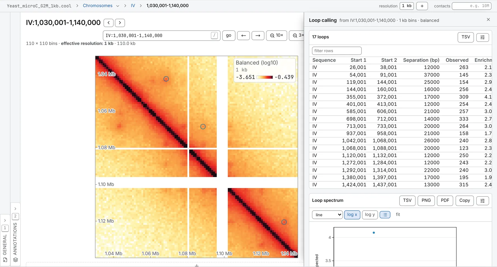

import TaskCommand from '@components/TaskCommand.astro'
import TaskOutputs from '@components/TaskOutputs.astro'
import TaskParameters from '@components/TaskParameters.astro'
import TaskSummary from '@components/TaskSummary.astro'

<TaskSummary id="loops" />

Loop calling answers *where are the loops* by testing every pixel of the map against four local backgrounds. [Pattern detection](/analyses/chromosight/) finds loops by template matching instead; run both when it matters which loops you trust.

## Running it

It needs a map that carries balancing weights; on a file with none the row waits, saying to run `cooler balance` on it. In the **Analysis** panel (<kbd>4</kbd>), choose **Loop calling**, tick the sequences, and press **run**. Each sequence is read as a band along its diagonal, out to **furthest from the diagonal**.

**Called loops** lands on the map as a ring round every loop: a row of the **Tracks** card in the **Annotations** panel, marked `*`, whose **display** can make it **arcs (1D track)**. The notes give the kernel, the scan's reach, and how many pixels and clusters passed. Pile the loops up with [aggregate peak analysis](/analyses/apa/) to see them on average.

The same run from a shell:

<TaskCommand id="loops" />

## Parameters

**The kernel is the one setting with no default.** cooltools has kernels for bins of 4 to 28 kb: **outer half-width** 7 and **inner half-width** 4 from 4 kb, 5 and 2 from 8 kb, 3 and 1 from 18 kb. The boxes are filled from that for your map; outside it, as on a 1 kb yeast map, they are empty and the run is refused until you fill them.

**Furthest from the diagonal** and **clustering radius** start at 10 Mb and 20 kb in the map's bins, and follow the resolution until you type your own.

<TaskParameters id="loops" />

## What it writes

<TaskOutputs id="loops" />

## Reading the result

### How a pixel is called

Each pixel is compared with four neighbourhoods out to the outer half-width, less the inner half-width's square about it: the donut around it, a vertical and a horizontal bar through it, and the square below and left of it. Each gives a *locally adjusted expected*, λ: the distance decay at the pixel, scaled by what the neighbourhood holds over what the decay predicts, in raw counts, so the pixel's raw count is tested against a Poisson tail.

Pixels are grouped into **λ-chunks** of like expected, and Benjamini–Hochberg runs within each, kernel by kernel, at the **false discovery rate**. A pixel that passes in all four neighbourhoods is enriched, and enriched pixels within the **clustering radius** of each other are one loop, at its brightest pixel. The **enrichment filter** then keeps a loop at 1.5 times its vertical and horizontal expecteds, 1.75 times its donut and lower-left ones and twice one of those two, and a single-pixel cluster only where its four q-values sum to 0.02 or less.

### The table and the loop set

A row per loop: **Start 1** and **Start 2**, the bins of its anchors, and their **Separation (bp)**; **Observed**, the raw contacts in the pixel; **Enrichment**, observed over the donut's λ; the four λ, in raw counts; the four q-values; and **Cluster**, how many enriched pixels its cluster held. The loop set holds the same calls, each anchor one bin wide, scored by its enrichment, and saves as a BEDPE.

### The loop spectrum

The **Loop spectrum** sets each loop's enrichment against its anchors' separation, with the median in log-spaced bands. A pileup averages separation away, so short-range loops and long-range noise make one plausible dot; here they come apart. Be wary of scores that fall steadily with separation, or pile up at the nearest separation the scan reaches.

### Contacts needed, by λ-chunk

For each chunk, the count a pixel had to reach to pass, kernel by kernel, against the line where a pixel merely meets its expected. On a sparse map it shows thresholds nothing in the map could reach.

### What to watch for

- **Near the diagonal.** The nearest pixel tested is twice the outer half-width plus two bins from the diagonal, and a bin the balancer dropped takes out the pixels within the outer half-width of it. The notes say how near the scan came.
- **Band size.** A sequence whose band would not fit is skipped and named: bring **furthest from the diagonal** down, or pick a coarser resolution on the task's **Resolution** row.
- **Too bright for the chunks.** A pixel whose expected is past the last λ-chunk stops the run, which says so: raise the **λ-chunks**, up to 50.
- **Nothing passed.** The run says so, and still draws the λ-chunk thresholds to show how far out of reach they were.

## Compared with cooltools

Every default is that of the Python API's `dots()`: a 10 Mb scan, a 20 kb clustering radius, an FDR of 0.1 and 40 λ-chunks. cooltools' command line uses 2 Mb, 39 kb and 0.02, so give the same numbers to compare a `cooltools dots` run. In [§ 19 of the validation](https://chromosomix.app/validation/#loop-calling-cooltools), on a mouse Hi-C map at 10 kb, it calls the same loops at the same pixels as `cooltools.dots`, with the same contacts, and expecteds and q-values that agree to the digits written.
