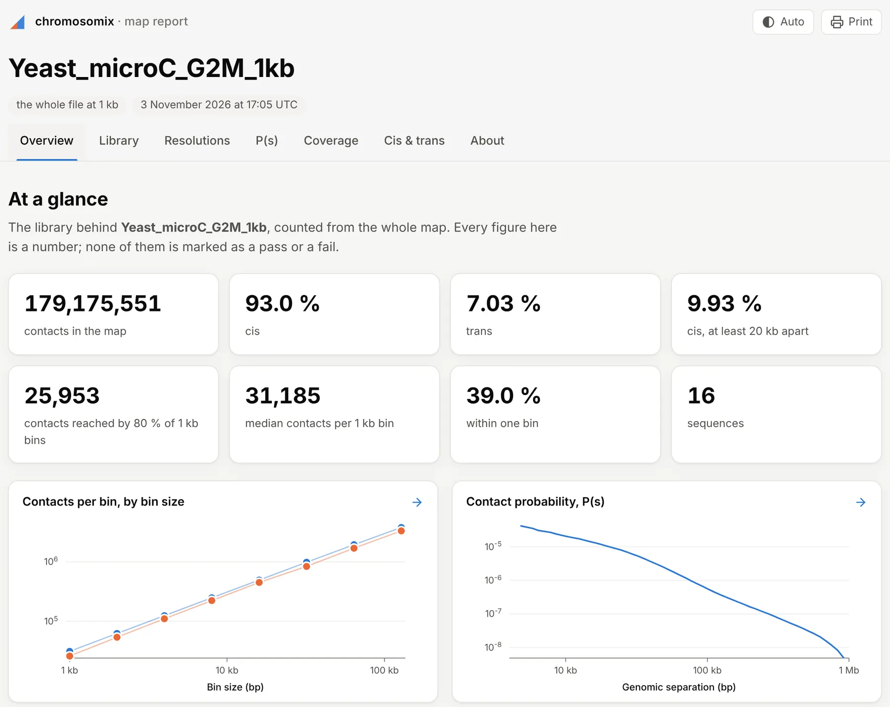

import TaskCommand from '@components/TaskCommand.astro'
import TaskOutputs from '@components/TaskOutputs.astro'
import TaskParameters from '@components/TaskParameters.astro'
import TaskSummary from '@components/TaskSummary.astro'

<TaskSummary id="mapreport" />

A new library's QC in one run, on one page: how many contacts it holds and how many are cis, how they decay, how evenly they cover the genome, which sequences keep to themselves, and down to which bin size most bins still have contacts.

## Running it

Open the map, choose **Map report** in the **2D tasks** card of the **Analysis** panel, and press **run**. It runs [P(s)](/analyses/expected/) over the whole genome, balanced where the file has weights, and [Coverage and marginals](/analyses/coverage/) and [Cis and trans per sequence](/analyses/cistrans/) on the raw counts, reusing a run already in hand with the same settings. The drawer shows the tables and figures; **HTML report**, beside **copy provenance**, saves the whole run as one page.



The same run from a shell, which also writes the MultiQC sections:

<TaskCommand id="mapreport" />

For a batch, run it once per file into one folder and point MultiQC at it, for one report with a row per library:

```sh
chromosomix mapreport rep1.mcool::/resolutions/1000 rep2.mcool::/resolutions/1000 --out qc/
multiqc qc/
```

## Parameters

**ladder from** sets the resolution the library's totals and the ladder are counted at: **the file's finest resolution**, the default, whatever is on screen, or **this map's resolution**. A map binned from a `.pairs` is its own finest. The other three tasks run on the map as it is open.

<TaskParameters id="mapreport" />

## What it writes

<TaskOutputs id="mapreport" />

MultiQC's general statistics are the contacts, the cis, trans and cis ≥ 10 kb shares, and the finest bin's median and 80 % count.

## Reading the result

### The library

**The library** gives every contact, the cis and trans shares, the share within one bin, the cis contacts between bins at least 1, 2, 4, 10, 20 and 40 kb apart (pairtools' separations, between bin starts, so coarse at bins over 1 kb), and the pixels with a count. A map binned from a `.pairs` adds `pairtools stats`' own counts: pairs, mapped, duplicates, unique, cis, trans, and cis at the same separations.

### The resolutions

The ladder runs from the coarsest bin size to the finest: every stored multiple of the base, and the base doubled until it passes a tenth of the longest sequence. At each size it gives the bins, the mean and median contacts per bin, **Reached by 80 % of bins** (the largest count four bins in five hold), and the shares of bins that are empty and that hold under a tenth of the median. **Contacts per bin, by bin size** draws the median and the 80 % count against the bin size.

For the map resolution of Rao et al. (2014), the finest bin size at which 80 % of bins hold at least 1,000 contacts, read down **Reached by 80 % of bins** to the last size at 1,000 or more. The report marks no pass or fail: the cut is yours.

A contact counts at both its ends, as in Juicer's `calculate_map_resolution.sh`, so a coarser bin is the sum of its finer ones, and a contact within one bin counts twice where the coverage task counts it once.

### The rest of the page

- **P(s)** and its slope, and **Cis and trans per sequence**, are those tasks' own.
- **Coverage along the genome** is the total coverage, sequence after sequence in the file's order, averaged over a few bins on a large genome. **Spread of coverage** shows how many bins hold how much, with the empty bins counted in the notes.

### The HTML report

One file that fetches nothing, so it opens anywhere, with a tab per question: **Overview**, with headline tiles and thumbnails of the ladder and P(s); **Library**; **Resolutions**; **P(s)**; **Coverage**; **Cis & trans**; and **About**, with the run's notes and provenance. Figures save as SVG or TSV, tables sort by a click and save as TSV, and each tab prints on a page of its own.
