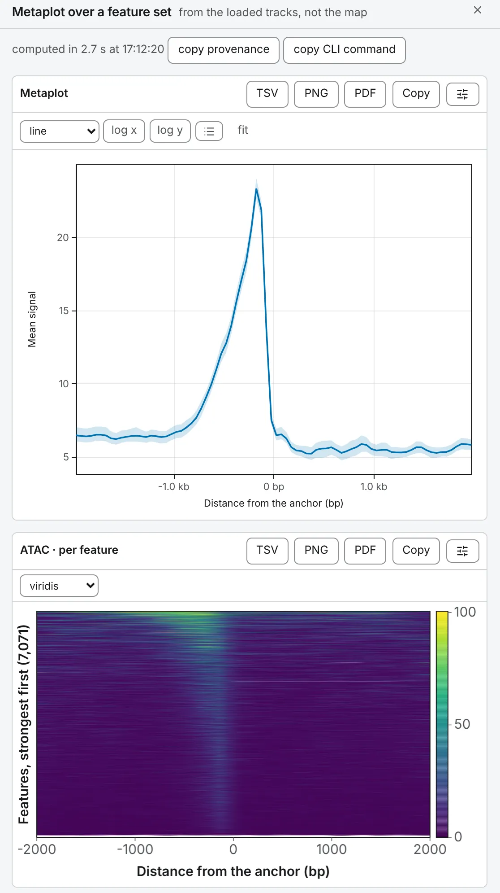

import TaskCommand from '@components/TaskCommand.astro'
import TaskOutputs from '@components/TaskOutputs.astro'
import TaskParameters from '@components/TaskParameters.astro'
import TaskSummary from '@components/TaskSummary.astro'

<TaskSummary id="metaplot" />

**Metaplot over a feature set** averages one or more tracks in a window about every feature of a set, such as ATAC-seq about every transcription start site, into a profile with a band, over a heatmap of every feature.

## Running it

Load one or more tracks and a feature set, such as a BED, narrowPeak or GTF ([Tracks and features](/files/tracks/)). Open **Metaplot over a feature set** on the **1D tasks** card of the **Analysis** panel, tick the **tracks** and choose the **features**; no map is needed. The drawer shows a line per track, and per group when you rank the set into groups, each over its heatmap.

The same run from a shell:

<TaskCommand id="metaplot" />

## Parameters

**mode** chooses the window. **reference point** is a fixed **flank** either side of each feature's **start**, **centre** or **end**, under **anchor on**, in columns **resolution** base pairs wide. **scaled region** resamples every feature's body to **body columns** columns between its flanks, so features of every length share one axis. Leave **respect strand** on for anything stranded, or an asymmetric signal cancels itself out.

**rank by** sorts the features by a numeric column of the set, and **then** draws **one line**, the **top N**, the **bottom N**, or **K groups** of equal size: the check that the strongest features look like something and the weakest like nothing. **z-score tracks first** puts tracks in different units on one axis.

<TaskParameters id="metaplot" />

## What it writes

<TaskOutputs id="metaplot" />

## Reading the result

### The profile

Each column is the average, over the features that reach it, of the track's mean over the column's bases; a feature with no value there is left out of that column, never counted as zero. The x axis is the distance from the anchor in base pairs, or upstream, body and downstream in a scaled window.

The band is by default a 95 % bootstrap interval over the features: how sure the average is. **SD** draws the spread of the features instead, how alike they are. A **median** or a **trimmed** mean, of the middle 80 %, keeps a few extreme features from carrying the line.

### The heatmap

One row per feature, strongest first by its mean over every column of every track, in the same order in every heatmap of the run. Colours run from zero to the 99th percentile, symmetric about zero for a track that goes negative, so one extreme feature does not wash out the rest; a feature no track covers sits at the bottom.

Read it before the line: a line that averages a strong block of rows and an empty one describes neither, and ranking the set into groups shows both.

### What to watch for

- In a scaled window, a feature shorter than the number of body columns, or whose window is clipped away at a sequence end, is dropped; a note says how many.
- Near the end of a sequence a reference-point window is clipped: the columns past the end are empty.
- Every feature is a row, so a gene whose GTF transcripts share a start counts once per transcript.

## Compared with deepTools

The columns are `computeMatrix`'s: in [the validation](https://chromosomix.app/validation/#metaplot-deeptools), the profile and every heatmap row are deepTools', within the two tools' rounding. The one difference is where the rows no track covers go: last here, first in deepTools.
