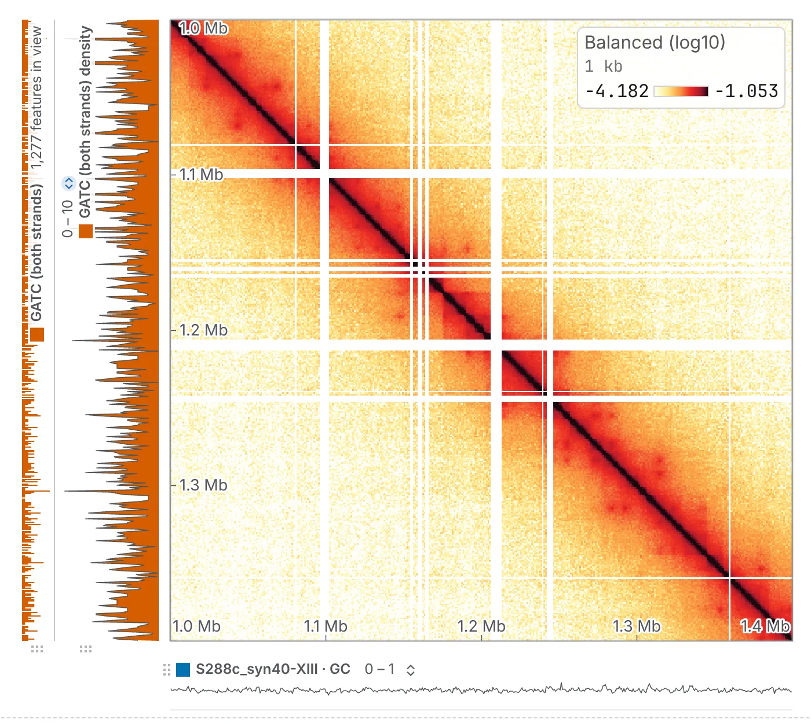

import TaskCommand from '@components/TaskCommand.astro'
import TaskOutputs from '@components/TaskOutputs.astro'
import TaskParameters from '@components/TaskParameters.astro'
import TaskSummary from '@components/TaskSummary.astro'

<TaskSummary id="motif" />

**Find a motif** finds every match of a motif written in IUPAC letters, such as `GGTCANNNTGACC`, in a loaded reference, as a set of sites and as a count of sites per bin. Use it for a binding-site consensus, a repeat or a telomere sequence; for where an enzyme cuts, use [Restriction sites](/analyses/restriction/).

## Running it

Load the reference as a FASTA or a `.2bit` ([Reference sequences](/files/sequences/)), open **Find a motif** on the **1D tasks** card of the **Analysis** panel, choose the **reference**, type the **motif** and tick the **sequences**; no map is needed. A motif the search cannot read is refused, with the reason beside **run**.

The sites are a track on the **Tracks** card named after the search, such as `GATC (both strands)`, and the sites per bin a second, the same name followed by `density`. With no map open there are no bins, so only the sites are made.

The same run from a shell:

<TaskCommand id="motif" />

## Parameters

Case and spaces in the motif are ignored, so `GGTCA NNN TGACC` copied from a paper works as it is, and every overlapping match is counted. **both strands** is on, since a motif occurs on both strands of the molecule; a palindrome is still reported once. **mismatches** is for a consensus with variants; leave it at 0 for an exact string such as a telomere repeat. An `N` in the motif is always free.

<TaskParameters id="motif" />

## What it writes

<TaskOutputs id="motif" />

## Reading the result

The sites are one interval per match, as long as the motif, named by the pattern and the strand; a palindrome searched on both strands is one site with no strand. With mismatches allowed, the score column holds how many positions each site differs by: filter on it to keep the exact matches.

The density is the number of sites in each bin, and a bin with no site is a zero, not a gap. Read the density at the scale of a chromosome, and the sites at a few kilobases.

### What to watch for

- An `N` in the reference never matches a base the motif names, so an assembly gap is not a run of matches.
- One run reports at most 500,000 sites; a search that reaches the limit stops and says so. Narrow the motif, or tick fewer sequences.
- Each search is its own pair of tracks: another motif adds rows, and the same search run again updates its own.

## Compared with seqkit

In [the validation](https://chromosomix.app/validation/#motif-search-seqkit), the sites and strands are those of `seqkit locate`, except that seqkit reports a palindrome twice, once per strand.
