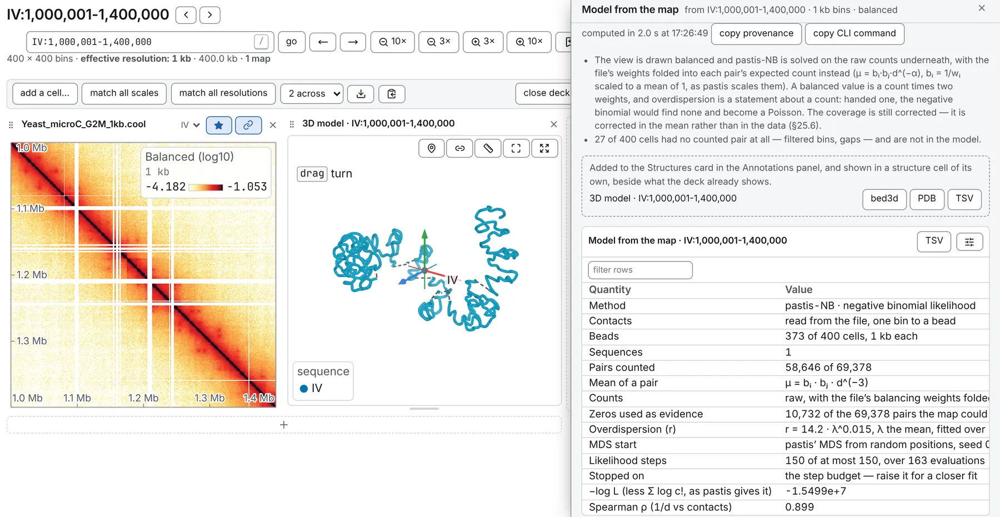

import TaskCommand from '@components/TaskCommand.astro'
import TaskOutputs from '@components/TaskOutputs.astro'
import TaskParameters from '@components/TaskParameters.astro'
import TaskSummary from '@components/TaskSummary.astro'

<TaskSummary id="reconstruct3d" />

**Model from the map** builds a 3D model of the open map: a chain of beads, one per bin, placed so that their distances explain the counts. Look at it beside the map, colour it by a track, or hold it against the map with [Model versus map](/analyses/structuremap/). A model is one reading of the map: the map fixes it only up to a mirror image, and two starts can settle in two optima.

## Running it

Open a contact map, then **Model from the map**, first on the **3D tasks** card of the **Analysis** panel. It needs no model loaded, and on a deck it models the starred map.

**sequences** starts on what the map shows and takes a locus or comma-separated sequences; empty is the whole file. Each bin at the resolution the map's row names is one bead, so for a coarser model pick a coarser resolution. Time and memory grow with the square of the beads, with no ceiling: the line beside **run** gives the beads, the time per hundred refinement steps and the memory, and a browser that cannot give that much says so.

The model becomes a row of the **Structures** card in the **Annotations** panel, named after what was modelled, such as `3D model · chrIV`, and opens in a structure cell of its own ([3D models beside the map](/browse/structures/)). A second run never replaces the first: it is numbered `(2)`, then `(3)`.

The same run from a shell:

<TaskCommand id="reconstruct3d" />

The shell writes a bed3d and a PDB beside the TSV files. pastis-NB's fit runs on one thread unless you give `--threads`; the model is the same on any number.

## Parameters

**method** changes the model, not just the speed. **pastis-NB · a count is a count**, the default, finds the model that makes the counts most probable under a negative binomial whose mean falls with distance: a zero count is weak evidence that two beads are far apart, not a distance to invent. **ShRec3D · a count is a distance** turns each count into a distance, `d = c^(−1/α)`, fills in the pairs the map never counted, and refines a classical multidimensional scaling by SMACOF, weighted as **weight pairs by** says; it is faster. **exponent α**, 3 by default, is the fractal-globule value, the one Model versus map assumes; neither method fits it.

<TaskParameters id="reconstruct3d" />

## What it writes

<TaskOutputs id="reconstruct3d" />

The model saves as a bed3d (`chrom start end x y z`, the [3D models](/files/structures/) format, which opens here again) and as a PDB for PyMOL and other molecular viewers, from the **bed3d** and **PDB** buttons of its row, the drawer or the shell. A PDB holds at most 99,999 beads, 9,999 to a chain; past that the **PDB** button is disabled and the shell writes the bed3d alone. A saved session keeps the recipe, not the coordinates: after a reload the row comes back detached, with **recompute**. Export the bed3d to keep the coordinates.

## Reading the result

### The model

The model has no unit: it is centred and scaled to a root-mean-square radius of 1, so a distance read from it, in the cell or by the [spatial tracks](/analyses/spatialtracks/), is in model units, comparable within one model.

Two runs can come out as mirror images, which no rotation brings together: flip one with the mirror toggles on the **frame** row of the **3D structure** card. **compare with** lays another model over this one and gives the beads matched and the RMSD; colouring by displacement shows where they differ. Under pastis-NB, run two or three values of **seed**: what every seed agrees on is what the map pins down. The same settings on the same map always give the same model.

### The table

- **Contacts**, **Beads** and **Pairs counted**: where the counts came from, how many beads were placed of the bins read, and how many pairs the map counted. A bin with no counts, filtered or a gap, is left out, and a note says how many.
- Under pastis-NB: the law of a pair's mean, whether balancing weights were folded into it, and how many zeros were used; the overdispersion `r` against the mean, near the diagonal and at the farthest separation (a smaller `r` is more overdispersed; *none* means the counts were Poisson and the fit is pastis-PM2); the MDS start and its seed; the steps; **Stopped on**; and `−log L`, pastis' own objective.
- Under ShRec3D: the distance law, the weighting, the steps taken and the final weighted stress.
- **Spearman ρ (1/d vs contacts)**: how well the model's distances rank the pairs the map counted; 1 orders every pair as the map does.

Check **Stopped on** first: *the step budget — raise it for a closer fit* means the fit was still improving when **refinement steps** ran out, so run it again with more. For the agreement sequence by sequence, run [Model versus map](/analyses/structuremap/) on the new model.

### A balanced map

pastis-NB always reads the raw counts. Balancing weights go into each pair's expected count, as in pastis, rather than being divided out, and a bin the balancer rejected is left out. The coverage is still corrected; a note says how. So on a balanced view it reads its counts from the file, not the block on screen, and the line beside **run** says so.

## Compared with pastis

The default method is pastis-NB as pastis runs it (Varoquaux, Noble & Vert 2023; GitHub `6888ac2`, α = 3, zeros used), function for function: seed `s` places every bead where pastis' `random_state=s` does. In [the validation](https://chromosomix.app/validation/#d-model-pastis-nb), on a yeast Micro-C map at 12.8 kb, the two give the same model from the same seed. One departure: a separation whose counts are not overdispersed beyond sampling noise is left out of the dispersion's fit, and with fewer than three left the counts are read as Poisson; a real map clears that floor. There are no restarts: one model per seed, as in pastis.

ShRec3D (Lesne et al. 2014) departs from its paper in three ways: an uncounted pair takes the mean observed distance at its separation on its sequence, not a shortest path; the classical solution is refined by SMACOF; and that refinement is weighted by the counts.
