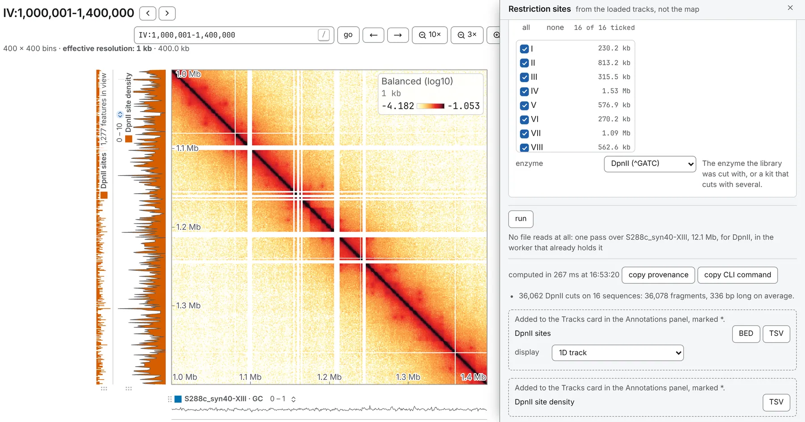

import TaskCommand from '@components/TaskCommand.astro'
import TaskOutputs from '@components/TaskOutputs.astro'
import TaskParameters from '@components/TaskParameters.astro'
import TaskSummary from '@components/TaskSummary.astro'

<TaskSummary id="restriction" />

A Hi-C library is the trace of a digest: its fragments run from one cut to the next, and its pairs are read against them. **Restriction sites** digests the loaded reference with the enzyme or kit the library was made with, and lays out every cut as a point, with the number of cuts in each bin of the map beside it. It is also the digest [Pairs QC](/analyses/pairsqc/) runs first and cuts its fragments with. A Micro-C or Omni-C library was cut with a nuclease, not an enzyme, and has no use for it.

It is not [Find a motif](/analyses/motif/) with `GATC` typed in, because a site is not where an enzyme cuts: DpnII cuts before the `G` of `GATC`, NlaIII after the `G` of `CATG`, AluI in the middle of `AGCT`, and a fragment boundary is the cut, to the base.

## Running it

Load the reference as a FASTA or a `.2bit`, then open **Restriction sites** on the **1D tasks** card of the **Analysis** panel. Choose the **reference** and the **enzyme**, and tick the **sequences** to cut. The enzyme starts on `none`, which leaves nothing to cut, so the form waits for your choice.

No contact map is needed for the cuts. The count per bin needs the bins of an open map: without one, only the cuts are made, and the run says so. As with Find a motif, a reference held in memory is cut without a single read, and a large FASTA opened with its index, or a `.2bit`, is read 16 megabases at a time, which the line beside **run** prices.

When it has run, the cuts are a track on the **Tracks** card named after the digest — `DpnII sites` for DpnII — and the count per bin a second track, `DpnII site density`. A note gives the number of cuts, the fragments they make and their mean length.

The same run from a shell:

<TaskCommand id="restriction" />

## Parameters

**enzyme** offers the enzymes Hi-C libraries are made with, each shown with its site and where it cuts — DpnII `^GATC`, which MboI and Sau3AI share, HindIII `A^AGCTT`, NlaIII `CATG^` and the rest — and the Arima kit, which cuts with DpnII and HinfI at once. **custom** opens **sites**: enzyme names, aliases such as MboI included, or sites typed in IUPAC letters with a `^` where the top strand is cut, separated by commas, such as `G^ANTC, HindIII`. A site typed without its `^` is refused with a sentence saying where the cut is needed, and so is a site looser than a four-base cutter.

<TaskParameters id="restriction" />

## What it writes

<TaskOutputs id="restriction" />

## Reading the result

Each cut is a one-base point at the first base after the top strand's cut — where the fragment to its right begins — named by the enzyme that made it, so the two enzymes of a kit can be told apart in the track and in the BED. Every sequence read is part of the digest, cut or not: a sequence with no site is one fragment, end to end.

The density is the cuts in each bin, and a bin with none is a zero. It is the count Pairs QC sets a library's coverage against bin by bin, and beside the map it shows where the enzyme cut often and where it left long fragments.

## Compared with bioframe

The cuts are `bioframe.digest`'s, and `cooler digest`'s, less two bases. Biopython's search already gives the 1-based position of the first base after the cut, and both add one to it, so every fragment boundary they write is 2 bp late — and a fragment BED from either, handed to `pairtools restrict`, places ends 2 bp off. In [the validation](https://chromosomix.app/validation/#restriction-sites-bioframe), every DpnII boundary bioframe finds on the yeast reference R64-1-1 is a chromosomix cut plus 2, and the cuts per 5 kb bin are the same. Bear the 2 bp in mind when you set these cuts beside a fragment file from cooler or bioframe.
