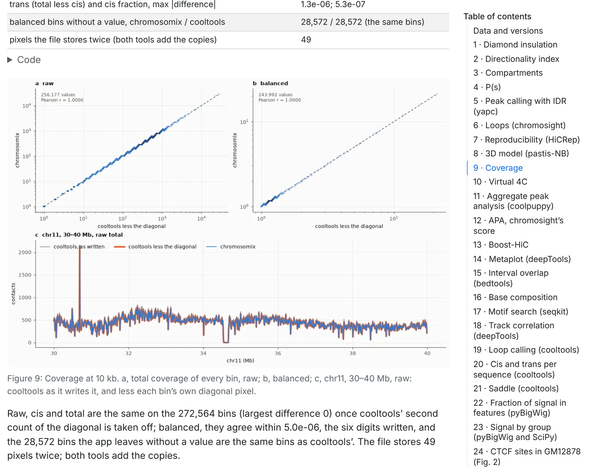

The tasks that re-implement a published method are run on public data by chromosomix and by the package
each reproduces, and compared number for number; the three not compared yet say so. Five notebooks hold
chromosomix to:

| Notebook | What it holds chromosomix to | Published at |
| --- | --- | --- |
| Validation | the package each task reproduces, on public data | <https://chromosomix.app/validation/> |
| Timings | the same packages, in time and memory | <https://chromosomix.app/timings/> |
| Viewers | juicebox.js and HiGlass, in the time to a picture, on the same files | <https://chromosomix.app/viewers/> |
| Parity | its own command line: the same run in the app, in three browsers, and in a shell, file for file | <https://chromosomix.app/parity/> |
| Laptop | a genome-wide run on a laptop, on the command line and in three browsers, and six analyses over a deep human map against cooltools and coolpuppy | <https://chromosomix.app/laptop/> |

In the app, **About this viewer**, in the header or the command palette, lists the five under
**Notebooks**, with what each found and when it was rendered.

## The validation

Each analysis runs on the same public file by `chromosomix`, the command-line form of the **Analysis**
panel, and by the reference package, called as its authors intend. The outputs are matched bin by bin, or
call by call.

| Reference | Tasks |
| --- | --- |
| cooltools | diamond insulation, compartments and their saddle, P(s), coverage, virtual 4C, cis and trans per sequence, loop calling |
| coolpuppy | aggregate peak analysis |
| chromosight | pattern detection |
| domaincaller | directionality index |
| Juicer Tools' Arrowhead | TAD annotation |
| yapc with IDR | peak calling |
| hicrep | reproducibility |
| pastis | the 3D model |
| deepTools | metaplot, track correlation |
| bedtools | interval set overlap |
| bioframe and Biopython | base composition, restriction sites |
| seqkit | motif search |
| pairtools | Pairs QC |
| cooler | map report |
| pyBigWig, NumPy and SciPy: the arithmetic itself | fraction of signal in features, signal by group |

Every file is public and named by its accession. Where a reference draws at random, the app is compared
with the reference's own spread from seed to seed.

Each section says what both sides ran with, how they compare, and why they differ where they do. Beside
the page: **`commands.json`**, every command of both sides; **`summary.tsv`**, every verdict; and
**`validation.txt`**, every number the figures draw, so any figure can be redrawn from it.



## What the badge on a task's page means

The top of each task's page gives its verdict, as the `?` on its row of the Analysis panel does:

- **Identical**, in green: the numbers are the reference's, to the float32 the app computes in or to every
  digit it writes.
- **Equivalent**, in green: the same answer where two correct implementations need not agree digit for
  digit, such as an eigenvector from another solver or a 3D model from a random start. The section says
  how far apart the two are, and why.
- **Not yet compared with its reference** (*Not yet validated* in the [list of tasks](/analyses/)), in the
  text's colour: the scalogram, the HiC score and per-cell contact QC.
- **No badge**: no published method to compare with, as for inter-arm alignment, origin and terminus,
  model versus map and spatial tracks.

A green badge links to the task's section of the notebook. Badges are read from the app when this site is
built, so they describe the version these pages document.

## The timings

The timings run **every command of the validation again**, on the machine that has just run the
validation and on its files, setting each chromosomix command's CPU time, wall-clock time and peak memory
beside its reference's. The command line uses one core unless told otherwise; a reference that takes a
number of processes gets one per core, at most four. Cis and trans per sequence, the saddle, the fraction
of signal in features, signal by group and Pairs QC are not timed. Beside the page: **`timings.tsv`**.

## The viewers

The viewers notebook measures **the time to a picture**: chromosomix, juicebox.js and HiGlass each drawing
the same contact map with one track beside it, at the same resolution, from disk and from the bucket the
files are published in. chromosomix is timed on the `.mcool` and the `.hic`, juicebox.js on the `.hic`
and HiGlass on the `.mcool`, so each is set beside chromosomix on a file both read. Yeast, chicken and
mouse maps are each seen whole, one chromosome, a region and a locus, four times, the viewers taking turns
to go first; no viewer chooses the resolution, and a picture drawn at another one, or in part, is kept as
what it was. Beside the page: **`viewers.tsv`**.

## The parity

Ten tasks are run in the app, as you would run them, in headless Chromium, Firefox and WebKit (Safari's
engine), and every file the app offers is saved. The console's line for each run is then run in a shell
with only `--out` added, and each pair of files is compared:

- **identical**: a bigWig byte for byte, a text file line for line, once the `#` lines saying when, by
  which build and from which file are set aside;
- **data differs**: a line of data, or a byte of a bigWig, differs;
- **browser only** or **command line only**: one side wrote a file the other did not.

The ten are insulation, compartments, P(s), coverage, virtual 4C, loop calling, a motif search and
aggregate peak analysis on a yeast Micro-C map, and peak calling and a metaplot on yeast ATAC-seq. Beside
the page: **`summary.tsv`**, every file compared in each browser and its verdict.

## The laptop

The laptop notebook measures how long a genome-wide analysis takes, and how much memory it needs, on a
machine like yours: 23 analyses on public data, from Hi-C maps of 69 million to 1.08 billion contacts to
ATAC-seq over the whole mouse genome, on the command line and in Chromium, Firefox and WebKit.

It ends on **six analyses in a row over a deep map**, 4DN's in situ Hi-C of IMR-90 with 1.08 billion
contacts: over the whole genome, loop calling and diamond insulation at 10 kb, compartments at 250 kb
phased by GC content, aggregate peak analysis over every loop called and P(s) at 10 kb; on chromosome 8,
a virtual 4C at 10 kb from *MYC*'s promoter. chromosomix runs them as six commands, the reference as one
Python script running cooltools and coolpuppy; each step's time and memory are measured on both sides and
their outputs compared. The page carries **`pipeline.tsv`** and **`pipeline-memory.tsv`**.

The page at <https://chromosomix.app/laptop/> is rendered by hand, on the laptop its opening block names.
To measure your own, render it from the root of a clone of
[the repository](https://github.com/js2264/chromosomix), on a laptop that is plugged in and otherwise idle.
It needs Node 22.12 or later and Playwright's browsers, which the repository installs, and an environment
with Quarto, Jupyter, pandas, matplotlib, numpy and pyfaidx, and for its last part cooler, cooltools,
coolpuppy and bioframe: `notebooks/environment-laptop.yml` makes one, named `open2c`, for micromamba,
mamba or conda. The page checks the environment before it downloads anything, and names the versions it
found. It downloads about 16.9 GB and takes about twenty minutes on the command line, as long again in
Chromium (Firefox and WebKit as the results give), and a quarter of an hour more for the deep map.

```sh
npm ci && npm run build && npm run build:cli
npm ci --prefix notebooks/viewers && npx --prefix notebooks/viewers playwright install chromium firefox webkit
micromamba create -f notebooks/environment-laptop.yml
micromamba run -n open2c quarto render notebooks/laptop.qmd
```

## When they are published

The validation, the timings, the viewers and the parity are rendered for every release, and on demand,
each on a fresh GitHub runner of its own and all at once — the timings after the validation, on its
runner, since they run its commands on its files — and published together only if all four rendered;
each release keeps its own copies among its files. Every page opens on when, from which version and on what machine it was rendered.

## Checking a result yourself

- **Keep the provenance.** Every TSV, bedGraph and BED a task writes opens with `#` lines naming the
  build, the task and its version, the file, the framing and every parameter; **copy provenance** in the
  drawer copies them. That is what a methods section needs.
- **Run it again from a shell.** **copy CLI command** copies a run's line from the
  [console](/browse/console/). Pin the command to the version the provenance names, with
  `npm install -g chromosomix@<version>` or `npx chromosomix@<version>` (`chromosomix --version` prints
  yours): the same line on the same file gives the same numbers. See
  [From the app to a script](/cli/from-the-app/).
- **Keep the session.** An exported session holds every task's settings, so opening it and pressing
  **run** repeats the analysis ([Sessions, workspaces and links](/browse/sessions-and-links/)).
- **Seeds are fixed.** A task that draws at random, such as a pileup's controls, takes a seed with a stable
  default; the same seed and settings give the same output.
- **Run the reference beside it.** The validation prints both sides' commands: run both on a section's
  data, or on your own file, and compare them as the section does. Each notebook's opening section says
  how to render it; the validation needs, among other things, the reference packages pinned in
  `notebooks/requirements.txt`, environments of their own for yapc and pairtools, and 9.8 GB of data.
