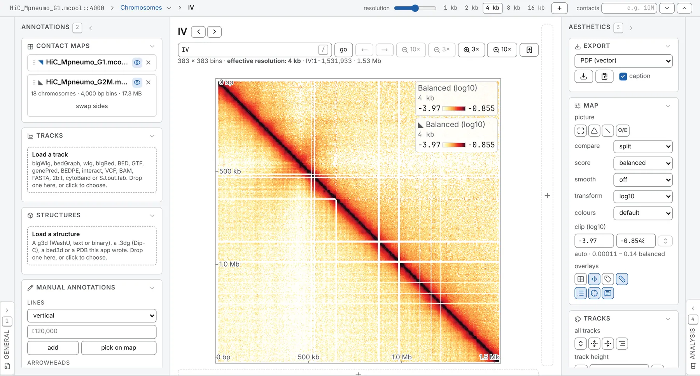
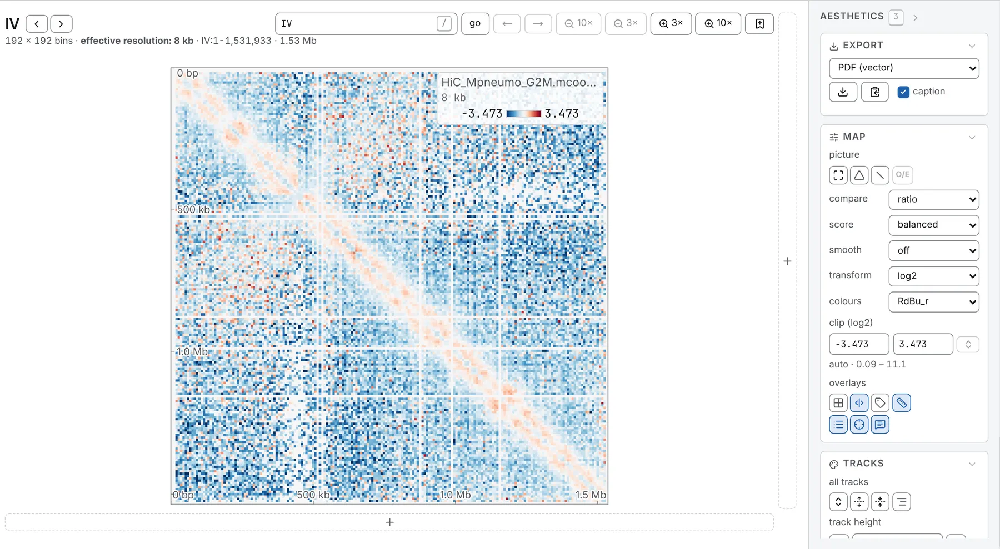
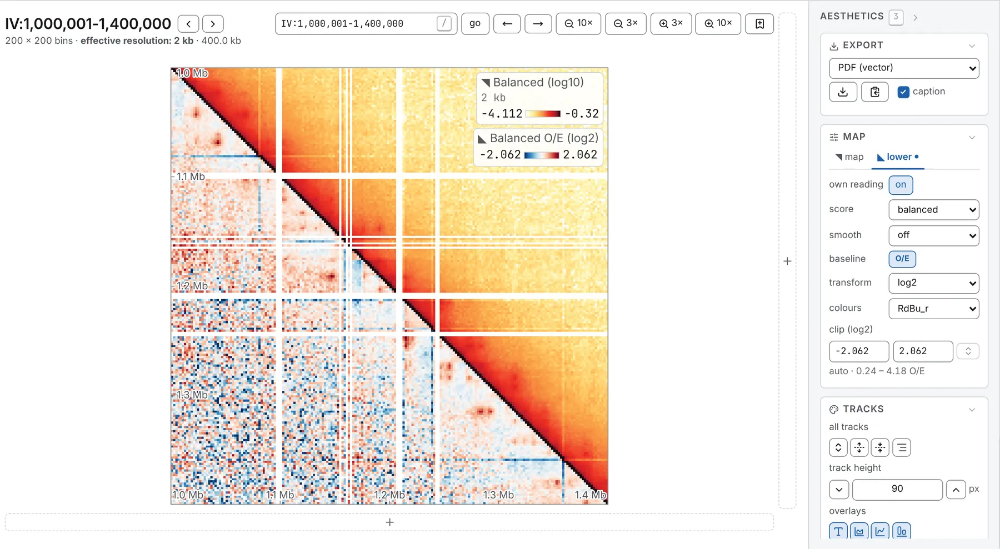

A contact map is symmetric, so its lower half can show something else: a second file, or the same
file read another way.

## Two files in one square

1. Open the first map.
2. On the **Contact maps** card, in the **Annotations** panel, use **Load a map into the lower
   triangle**: drop a map file on it, drag a row onto it from the **Files** panel, or click it.

The first file is drawn above the diagonal, the second below; the diagonal itself is the first
file's.

- Each file has a row on the card, `◥` upper and `◣` lower. The lower row's eye hides the lower
  triangle and keeps the file open; its **×** closes it. Closing the first file leaves the second as
  an ordinary map.
- **swap sides** puts the other file above the diagonal.
- A name typed on a row is used wherever the map is named.
- Hovering a cell gives both files' counts.
- The link carries the second file as `uri2`. On a change of resolution it follows at the same bin
  size, or the card says it has none.
- A link or a workspace that names both opens them at once: the upper triangle is drawn as soon as
  the first file has its block, and the lower one joins it when the second file has its own.

### What the two files must share

The card refuses a pair that does not share one grid, and says why:

- **The same bin size**: open the matching resolution of the second file.
- **The same sequences, in the same order, at the same lengths.** `chr1` and `1`, or `chrM` and
  `MT`, count as one name, and the second file may have extra sequences after the first file's last.
  One name at two lengths, as in hg19 and hg38, is a difference.

### One scale for both

Both triangles share one colour scale, so libraries of different depth differ everywhere by depth
alone: draw both to one total first, with the chevrons after the **contacts** box
([Drawing maps to one total](/browse/contact-maps/#drawing-maps-to-one-total)).

Balanced values keep each file's own unit. A cooler balanced by `cooler balance` has rows that sum
to one; a `.hic` balanced by Juicer's KR or SCALE has rows that sum to the library's depth per bin,
and saturates beside the cooler. Compare such a pair by their O/E.

## Ratio and difference

Once a second file is open, **compare**, on the **Map** card under the **picture** row, reduces the
pair to what differs:

| compare | Draws |
|---|---|
| **split** | each file in its own triangle, in its own counts |
| **ratio** | the first file divided by the second, over the whole square |
| **difference** | the first file minus the second, over the whole square |

A ratio opens on `log2` and a difference on a linear scale, both on a diverging ramp centred where
the files agree (1 or 0), so only the disagreement shows. **split** gives the map its own scale
back. The link carries the choice as `op`.

- **A ratio needs contacts in both files.** A cell empty in either is drawn in the ramp's middle
  colour, and the readout says there is no value. A difference keeps its zeros.
- **Depth shows as a flat wash**: a ratio of raw counts is roughly the ratio of the depths
  everywhere. Draw both to one total, or compare balanced values.
- **A ratio is not divided by the expected**: the second map is the baseline, so **O/E** is greyed
  while a ratio is drawn. It applies again under **split** and **difference**.

Each file is smoothed before the two are combined. Zoomed out, cells are pooled by how far they
depart from no change, so neither direction fades.

## Two readings of one file

To draw, say, balanced counts above the diagonal and their O/E below:

1. On the **Map** card, open the **◣ lower** tab, beside **◥ map**.
2. Switch **own reading** on. The lower reading starts as a copy of the upper one.
3. Set its **score**, **smooth**, **O/E**, **transform**, **colours** and **clip**.

While it is on, a dot marks the **◣ lower** tab. Switched off, the triangle mirrors again and keeps
its settings for next time.

Each reading has its own colour scale and key, `◥` or `◣`. The readout names the reading under the
pointer, and a saved figure carries both keys and a second caption line. The window, resolution,
turn, overlays and tracks stay the map's.

It is offered on a map of one file, not beside a second file nor in a deck. A link carries it as
`lower=true` with `score2`, `oe2`, `smooth2`, `transform2`, `colormap2`, `vmin2` and `vmax2`
([Link keys](/reference/links/)).

## One square or side by side

Maps at different bin sizes or with different sequence lists, more than two maps, or maps each on
its own colour scale go [side by side](/browse/deck/) instead; only one square draws a ratio or a
difference. A tab can do both: a deck whose first map has a second file in its lower triangle.

To compare two tracks, tick both on the **Tracks** card, choose **combine…**, then **ratio** or
**difference** ([The genome browser](/browse/genome-browser/)).
