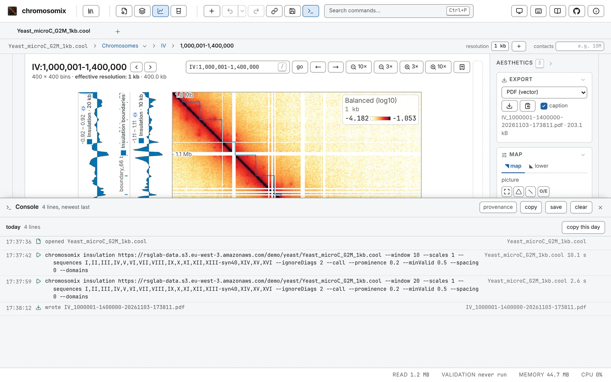

The console, along the bottom of the window, logs what this window has done. Every analysis you run
is written there, as it starts, as the `chromosomix` command that repeats it: tune a run on screen,
then take its line to a shell or a methods section.



## Opening it

Press the terminal button in the header, after the share and save buttons, or
<kbd>Ctrl</kbd>+<kbd>backtick</kbd>: Control, on a Mac too, and the key left of <kbd>1</kbd>
(<kbd>Ctrl</kbd>+<kbd>²</kbd> on a French PC). The command palette lists it as **Console**.

Drag its top edge to resize it; its height, and whether it is open, are remembered. Escape or its ×
closes it, and it goes on recording. Every shortcut, and the Analysis drawer, keep working beside it.

## What it records

- **An analysis run**, one line per job (**run on all maps** over six maps is six lines, a task that
  reads tracks rather than a map one), written when the job starts, so a run that fails or is
  cancelled keeps its line, with the error under it. A **run** that could not start leaves a sentence
  saying why.
- **A file opened**, as `opened` and its name.
- **A track loaded**, as `loaded` and its name; tracks brought back after a reload are not listed
  again.
- **A file written**, as `wrote` and the name you gave it: every export, figure, table and workspace.

Moving around is not recorded. Each row shows the time, a mark for its kind, whose tooltip gives its
state (*running*, *done*, *failed*, *cancelled* or *interrupted*), the line, its file and how long it
took. **Copy this line**, at the row's end, copies that row.

## The command on a line

A run's line, the command **copy CLI command** gives under a finished result, repeats the run
exactly:

- it names every parameter, defaults included;
- it gives the window as the screen does, 1-based with digits grouped:
  `--window IV:1,000,001-1,400,000`;
- it adds, only where they differ from the default, what the view set without being a parameter: the
  score (`--value`), circular sequences and their origins (`--circular`, `--origin`), an `.scool`'s
  cells (`--cell`), the total the map is drawn to (`--contacts`) and an added resolution
  (`--coarsen`). A run on raw counts says `--no-balance`;
- a file from an address is named by it, and read by range.

What a shell command cannot say, such as a window across several sequences or off the diagonal, or a
map drawn balanced but read raw, is written as a `#` note above it. See
[From the app to a script](/cli/from-the-app/), and the
[command line reference](/reference/command-line/) for every flag.

## Copying and saving

Copy one row with its button, a day with **copy this day** on the day's separator, or everything with
**copy** in the header. **save** writes the same text as `chromosomix-console-<stamp>.sh`.

What you copy is a shell script that runs in the order it ran: everything but the commands is a `#`
comment, a failure as `# failed:` and its message. A saved file opens with:

```sh
#!/bin/sh
# chromosomix console, saved 2026-11-03T14:52:33.000Z
# Commands are bare; everything else is a comment.
```

**provenance**, a switch in the header, off by default, shows each row's full record above it (the
build, the task and its version, the view and every parameter), and copying and saving then take it
too; the `#` notes stay either way. **clear** forgets every line but stops nothing. With nothing
recorded, **copy**, **save** and **clear** are greyed.

## How long it is kept

The console keeps at most 500 lines and seven days, in this browser, and sends nothing anywhere. Two
windows share one log, so **clear** empties both. A run still going when its window closed comes back
*interrupted*. A view embedded in another page has no console.

It is listed as **Console** under **What this browser is remembering** in the command palette, where
**forget everything** drops it
([Sessions, workspaces and links](/browse/sessions-and-links/#making-it-forget)).
