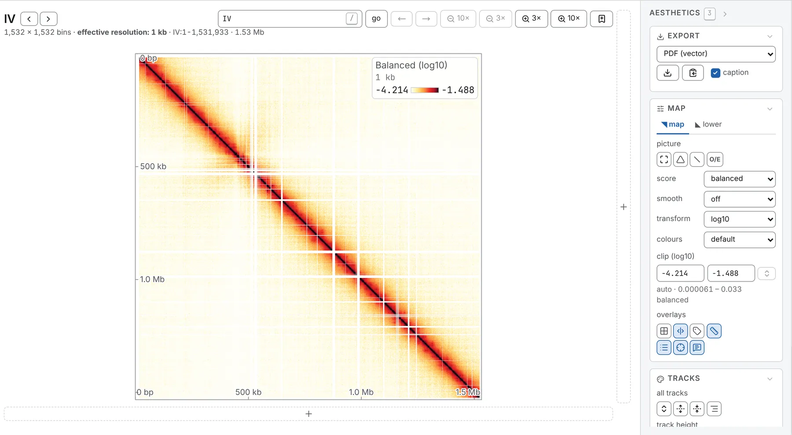

The line under a map's heading gives the block's size and what one cell is worth:
`1,532 × 1,532 bins · effective resolution: 1 kb`.

The **Map** card, in the **Aesthetics** panel, sets how the map is drawn, from top to bottom:
**picture** (undo every pan and zoom, the [45° turn](/browse/turn/), the
[diagonal lock](/browse/navigating/#stay-on-the-diagonal), **O/E**), **compare** with a
[second file](/browse/comparing/), **score**, **smooth**, **transform**, **colours**, **clip** and
**overlays**. All but the overlays and the diagonal lock are in the link.

## Resolution

**resolution**, at the far end of the bar above the map, lists the bin sizes the file stores as
stops under a slider; <kbd>-</kbd> and <kbd>+</kbd> step one coarser or finer. A file opens a third
of the way up from its finest resolution.

The `+` after the stops opens **Add a resolution**: a whole multiple of one of the file's bin sizes,
such as 3 kb on 1 kb bins, summed from the stored bins. It shows as `3 kb*`, its `×` removes it, and
a file takes up to twelve. Counts are exact, but balanced values are an estimate, since
`cooler zoomify --balance` balances each resolution on its own. A task run while it is drawn reads
the map at that resolution.

A wide window may be drawn coarser, as the summary line says
([Resolution and the zoom](/browse/navigating/#resolution-and-the-zoom)). On the whole genome,
**level**, at the head of the **Sequences** card (**General** panel), switches between `bin × bin`
and `chromosome × chromosome`.

## What the cells hold

**score** sets what the cells hold:

| Score | Each cell holds |
|---|---|
| **counts** | the contacts stored for that pair of bins |
| **balanced** | the counts with each bin's bias divided out by the file's weights, when it has them |
| **VC**, **VC √**, **ICE** | a normalisation computed from the block on screen |
| **expected** | what the cell's distance from the diagonal predicts: the baseline of an O/E |
| **arm decay** | that baseline along both arms of a circular sequence |
| **correlation** | the correlation between rows of the balanced O/E, on a file with weights |
| a column's name | another column of the file's own pixel table |

A file with weights opens **balanced** on `log10`; one without, **counts** on `log1p`.

### Balanced or raw counts

For **balanced**, a cooler's weights are those `cooler balance` wrote, applied as cooler applies
them; a `.hic` brings its own normalisation (SCALE, else KR, else the coverage ones), which the
**normalisation** row of the **File** card (**General** panel) names. A bin the balancer dropped has
its row and column drawn as paper, not as zero.

**VC**, **VC √** and **ICE** normalise a file without weights, or another way; on a window they are
the window's normalisation, not the chromosome's. Each agrees with cooler and cooltools cell for
cell, to the map's precision ([How the results are checked](/analyses/validation/)). Juicer's KR is
not offered: it reaches the same weights as ICE.

### Expected and correlation

Far from the diagonal, **expected** averages few cells, so check it before trusting an O/E there.
**O/E** is greyed while it is drawn.

**correlation**, the picture compartments are read from, is drawn for square blocks of up to 4,096
bins a side. The [Compartments](/analyses/compartments/) task uses the same arithmetic.

## The colour scale

**transform** maps a value onto the ramp: `log1p` for counts, `log10` for balanced values, `log2`
for ratios (twice and half equally far from no change), or `none`, on which little but the diagonal
shows.

**clip** sets where the ramp starts and where it saturates, in the transform's units, as its label
says (**clip (log10)**); the line under it gives the range in the readout's units,
`auto · 0.000066 – 0.089 balanced`. Type a bound to fix it; ⇅, or a change of transform, puts it
back to automatic. The automatic range is measured on the block that was read, so the colours hold
still as you pan and zoom inside it: from 0 to the 99th percentile of the non-zero counts, or for
balanced values from the 1st to the 99th percentile of the cells that hold a contact.

The key, in the map's top-right corner, names the score and the transform, gives one cell's size and
shows the two bounds: click either to type it, and empty it for automatic. **legend**, under
**overlays**, hides it.

**colours** picks the ramp; a ✓ marks those safe with a colour-vision deficiency.

| Ramp | |
|---|---|
| `default` | white through yellow and red to black: what a map opens on |
| `afmhot_r`, `afmhot` | matplotlib's ramps of those names |
| `Reds` | white, then red to a dark maroon |
| `cividis` ✓, `viridis` ✓, `magma` ✓ | even in lightness |
| `RdBu_r` | diverging, red for more, blue for less: what a ratio or an O/E opens on |
| `BuWtRd` | diverging, with more contrast, white at its middle |
| `seismic` | diverging: chromosight's pileup ramp |

## Observed over expected

**O/E**, in the **picture** row, or <kbd>e</kbd>, divides each cell by the mean over every pair of
bins as far apart in this block, with one value for each pair of different sequences. It works on
any score, balanced counts most often.

It switches the map to `log2`, a range symmetric about 1 and `RdBu_r`: red for more contacts than
expected, blue for fewer. Switching it off restores your transform, colours and clip. A cell where
nothing was observed is drawn as paper, not as the strongest depletion.

On a sequence declared circular, or whose origin has been set, two buttons join **O/E**. **arms**
also divides out the decay along the secondary diagonal through the origin, leaving a bacterial
chromosome's compartments. **ori**, on a circle, frames the sequence with its origin in the middle
(press again for its first base). Declare circles and origins in the **Chromosomes** table
([Circular sequences](/browse/genome-browser/#circular-sequences)).

## Smoothing

**smooth** averages each cell with its neighbours: **3 × 3**, **5 × 5**, **7 × 7**, or **adaptive**,
whose window grows until it holds enough contacts (serpentine's criterion, as a sliding window). It
turns the O/E on. Smoothing comes before the O/E and the ratio of two files, so a zero cell among
contacts is no longer a hole. Past 16 million cells, **adaptive** falls back to 3 × 3, and the note
under the heading says so.

## Drawing maps to one total

A deeper library is brighter everywhere. The **contacts** box, after **resolution** at the far end
of the bar, draws every map in the tab to one total before it is shown or analysed: type `10M`,
`23,000,000`, `2.5e7` or `500k` and press <kbd>Enter</kbd>, or empty it to read the files as stored.
Its tooltip gives each map's own total.

A deeper map is **subsampled** to exactly that total, as `cooltools random-sample --count N --exact`
does; a shallower one is **oversampled** through Boost-HiC, with new contacts drawn from a
probability map built from it. An oversample is an inference, and wherever the map is named it says
which was done.

The draw has a fixed seed, so one total is one map in every view, after a reload and on the [command
line](/cli/running/) (`--contacts`). Balanced values are rescaled with it, so a subsampled map is
not drawn fainter. Every task reads the drawn map, and a saved figure's caption says so.

With two maps or more (a [deck](/browse/deck/), or a second file in the lower triangle), two
chevrons after the box type the shallowest or the deepest map's total. The link carries the total as
`contacts=`, and it stays with the file across sequences.

:::caution
Some maps cannot be drawn to a total, and say why, with **read as stored** to go back: counts that
are not whole numbers, a file storing every contact twice, an `.scool`, a value column other than
counts and, to oversample, a sequence over 3,000 bins (use a coarser resolution).
:::

## What is drawn over the map

**overlays** switches **dividers** between sequences (<kbd>d</kbd>), **breaks**, the same boundaries
as ticks outside the plot (<kbd>m</kbd>), block **labels** (<kbd>l</kbd>), base-pair **ticks**
(<kbd>k</kbd>), the **legend**, the **crosshair** (<kbd>x</kbd>) and the **tooltip** card
(<kbd>p</kbd>). This browser keeps them; a link does not.

## Hovering a cell

Point at a cell and a card reads its positions, counted from 1, their distance and its value. On an
O/E map it adds the count the ratio was read from, which says whether to believe it; with a second
file, both files' counts. The status line at the foot of the window keeps the reading; **tooltip**
(<kbd>p</kbd>) hides the card. <kbd>Shift</kbd> snaps the reading onto the diagonal.

Right-click a cell for:

- **Copy this**: the cells alone, as a PNG with no axis, key or frame;
- **Mark this point**: a **Vertical line**, **Horizontal line**, **Crosshair** or **Arrowhead** at
  the cell, added to the **Manual annotations** card;
- **Copy coordinates**: the cell's two positions, counted from 1, without separators.
