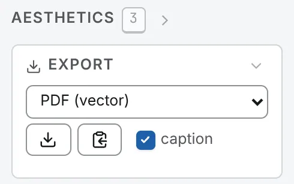

A map, the 1D browser, a deck, a 3D model or an analysis figure can each be saved as a figure,
redrawn for the file rather than captured from the screen, and on white even in the dark theme.

## Saving a view

The **Export** card, first in the Aesthetics panel (<kbd>3</kbd>), has a resolution, a format, a save
button, a copy button and a **caption** switch.

- **PDF (vector)**, the default: the axes, labels, tracks, key and caption are paths and text, set in
  Helvetica, that you can restyle in a vector editor; a map's cells are one lossless image. The 1D
  browser's PDF is paths and text throughout.
- **PNG**: 96 (the screen), 150, 300 (the default, for print) or 600 dpi.

The figure is framed as the screen is; the map's **legend** switch removes the key. The **caption**
under it says what the figure shows, from the region and the file to the colour range and the date;
its switch holds for the map, the 1D browser and the deck at once.

From anywhere, <kbd>S</kbd> saves the figure as the card is set, and <kbd>Ctrl</kbd>+<kbd>C</kbd>
(<kbd>⌘</kbd><kbd>C</kbd> on a Mac) copies it as a PNG at the card's resolution, unless text is
selected or the caret is in a box. The copy button always copies a PNG.

A map is read at about the size of the screen and finer as you zoom
([Resolution and the zoom](/browse/navigating/#resolution-and-the-zoom)), so saving or copying first
reads the window you have framed at the resolution chosen in the bar, and the figure is drawn from
that: every bin the file has there, whatever the screen showed, with its colour range measured on it
unless you have set the range yourself. The card says *reading the map at its resolution for the
figure…* while it does, and the sharper map stays on screen until you next move it. With **Refine on
zoom** off, a map is still shown from a coarser resolution for a moment while its own is read; both
buttons and both keys wait for it, and the card says so.

The file is named after the region, such as `IV_1000001-1400000-<stamp>.pdf`. Chromium-based
browsers open your system's save dialog for it; Firefox and Safari download it. The
[console](/browse/console/) records every file written.

## Several maps as one figure

With [maps side by side](/browse/deck/), the deck's bar has a save button, **Save the whole deck as one
figure, laid out as it is on screen**, for a PNG at 300 dpi, and a copy button for the same picture;
<kbd>Ctrl</kbd>+<kbd>C</kbd> copies it too. Once a cell beside the first map has a picture of its own,
the **Export** card and <kbd>S</kbd> save the whole deck in the card's format and resolution. In its
PDF each cell keeps its own caption, key and frame.

## Copy this: one object alone

**Copy this**, in the right-click menu of the map, a lane or a 3D model, copies that object alone as a
PNG at the screen's resolution, on white, with no axis, key, mark, name or frame: a piece for a figure
you build elsewhere.

## A 3D model

The **3D structure** card has the same export row, and the model's coordinates leave as a bed3d or a
PDB from its row on the **Structures** card
([Exporting a model](/browse/structures/#exporting-a-model)).

## A task's figure

Every figure in the Analysis drawer is drawn from the task's numbers and your choice of style. Restyle
it freely: the numbers do not move, and the export draws what you see.

### The strip and the exports

A slim strip over the figure holds, over a curve, the **mark** (line, area, step, points, bars,
histogram, box or violin), the two log axes, the **legend** and **fit**, which puts both axes back to
the whole of the data; over a matrix, its colour map; over a table, a box that filters its rows.
Beside the title are the exports: **TSV** (and **bigWig** and **bedGraph** for a track), **PNG** at
300 dpi, **PDF**, a true vector page, and **Copy**, the PNG on the clipboard.

### Zooming the figure

The wheel zooms the horizontal axis (with Shift, the vertical) and a drag pans it. Hold <kbd>⌘</kbd>
(<kbd>Ctrl</kbd> elsewhere) and drag a box to zoom to it, or flick across or down to set one axis. A
double-click puts both axes back to the windows the controls last set. The PDF and the PNG draw what
you zoomed to.

### Customise this figure

**Customise this figure**, the sliders button beside the exports, opens the figure at the size of the
window, with a column of cards you can resize or hide:

- **chart**: the mark, line width, point size, smoothing, fill under the line, the band round each
  line where the task computed one, and a histogram's bins;
- **axes**: each axis's scale (linear or log), name, window and grid;
- **series**: an eye and a swatch for each series, **show all** and **reset colours**;
- **text**: a **title** printed on the figure, the **type size**, where the **legend** goes, and the
  **tooltip**;
- **colour**, for a matrix: its colour map and the values its scale runs between;
- **rows**, for a table: a filter, the column to sort by, the columns to show, and **plot**, which
  draws two of its columns as a chart.

**reset** goes back to the task's figure. Your choices are kept for that file, task and figure,
through a rerun, a reload and a saved workspace. On paper, a hidden series is left out of the legend.

## What an export carries

Every result keeps a record of its task and the task's version, every parameter, the view, the file,
the app's version and commit, and the time. **copy provenance** under a finished result copies it, and
**copy CLI command** the `chromosomix` command that repeats the run.

- Every task output offers **TSV**: the figure's numbers under that record, as `#` lines. A bedGraph
  opens with it too, and leaves out the bins with no value rather than writing them as 0; a bigWig has
  no room for the record, so save the TSV beside it.
- A called set's BED and a model's bed3d open with a `#` line naming what they hold, what it came
  from and when; a model's PDB has a TITLE saying the same.
- A map's or the 1D browser's figure carries its caption, if you leave it on, and every PDF names the
  chromosomix version in its document properties.

Tracks, called sets, marks, the file's own columns and 3D models also leave as bigWig, bedGraph, BED,
BEDPE, bed3d or PDB: [Annotations and bookmarks](/browse/annotations/) lists which, and where each
button is. The [map report](/analyses/mapreport/) also leaves as one **HTML report** of every figure
and table of its run, with its notes and provenance.
