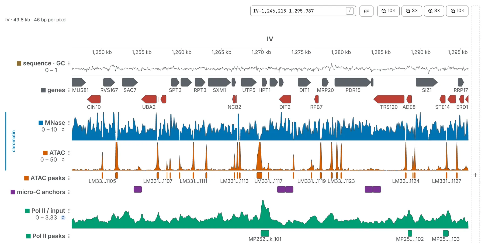

The genome browser draws a genome as one axis, every sequence laid end to end, with tracks stacked
along it: coverage, genes, peaks, reads, the sequence itself. It is not a separate application. The
same tracks, with the same settings, are drawn in lanes along the edges of a contact map, and the
browser is what a tab shows when it holds a genome but no map.

## Opening it

Open a `chrom.sizes`, a FASTA or `.2bit`, a bigWig, a bigBed, a BAM, a VCF, a cytoBand or a feature
file with no map open, and the tab becomes a browser over its genome ([Opening files](/files/opening/));
a 3D structure opens one too, with the model in a cell of its own. The sequences and their lengths
come from the file that names them. A feature file only says how far its last feature reaches, so
its lengths are a lower bound: the summary line under the bar then ends *lengths inferred (rounded
up)*, and dropping a `chrom.sizes` or a bigWig on the tab gives the real ones.

With a map open, the map and its tracks are one key apart. <kbd>v</kbd> goes from the map with its
tracks, to the tracks alone, to the map alone, and back. The eye on the map's row of the **Contact
maps** card hides the map and leaves the tracks, and the row's **×** closes the map and goes on
browsing its genome as tracks, with every track and mark still loaded. The other way round, drop a
`.cool` on the browser and it becomes the tab's map, tracks and all.

A link opens the browser with `view=browser`, at the window named by `locus=`
([Link keys](/reference/links/)).

## Moving along the genome

The bar above the tracks holds a box, **go** and the four zoom steps, `10×` and `3×` out and `3×` and
`10×` in. The box takes:

- a window, `IV:1,000-20,000`, counted from 1 with both ends included;
- a single position, `IV:450000`, which opens a window around it;
- a sequence's name, as the file spells it or in another common spelling (`chr1` for `1`);
- `*` for the whole genome;
- a feature's name or accession, or a cytoBand's band, from the list that opens as you type. The
  feature set searched is the one starred on the **Tracks** card.

<kbd>Enter</kbd> goes to the text where it reads as a place, and to the first match where it does
not; the box then keeps the place it went to. <kbd>/</kbd> puts the caret in it.

The gestures are the map's:

- **drag** to pan, **scroll** to zoom about the pointer, **scroll sideways** to slide along;
- <kbd>⌥ Option</kbd>-drag or <kbd>Shift</kbd>-drag to select a stretch and zoom to it, or drag along
  the **ruler** with no key held;
- **click** a sequence's name on the ruler to go to it, and **double-click** for the whole genome;
- <kbd>&lt;</kbd> and <kbd>&gt;</kbd> for the sequence before or after this one.

Once you have clicked the tracks, the arrow keys pan, <kbd>-</kbd> and <kbd>+</kbd> zoom out and in
like the `3×` buttons, and <kbd>0</kbd> shows the whole genome. A drag that framed a stretch also
copies it, counted from 1 and without separators (`chrIV:500001-510000`); one that crosses two
sequences zooms and copies nothing. While the pointer is over the tracks, a line under the ruler
reminds you: *⌥ + drag to zoom into a stretch, or drag along the ruler*.

The pointer names a position anywhere under the tracks, down to the foot of the panel, and the card
beside it reads every track there; the status line at the foot of the window keeps the reading. The
ruler gains digits as you zoom, so neighbouring ticks never read the same. The window is part of the
address, as `locus=`, so a link you copy opens where you are.

In the **General** panel, the **Sequences** card lists every sequence with its length. Click a name to
show the whole of it, or tick some to make the axis those sequences alone; **show the whole genome**
takes the ticks away. The **Genome minimap** above the list marks where you are
([Moving around](/browse/navigating/)).

## Lanes and tracks

A **track** is a file you loaded, or a result a task computed, with its settings; a **lane** is one
place where it is drawn. Every track is a row of the **Tracks** card in the **Annotations** panel: a
tick box, its colour, its name, an eye that hides it and keeps its settings, a chevron that opens its
settings, and a **×** that removes it. The row's grip reorders the stack.

Each lane carries its own controls on its label: the colour chip before the name, the name, the value
range under it, and at the end of the range the autoscale mark ⇅, lit while the axis follows the data
in view.

- Click the chip to change the colour, and the name to rename the track.
- Click either end of the range to type a bound; typing one turns autoscale off, and ⇅ turns it back
  on. <kbd>Tab</kbd> goes on to the next bound, then to the next track.
- Drag a lane's lower border to resize it, and its handle, in the margin before the axis, to move it
  up or down the stack.
- Drag across a lane to move its ceiling, or scroll over it with <kbd>⌘</kbd> held (<kbd>Alt</kbd>
  on Windows and Linux).
- Right-click a lane for **Copy this** (the lane alone, as a PNG), **Colour…**, the **Range**
  (**Auto**, or a fixed `0 – 10` and the like), **Hide**, **Remove** and **Duplicate**, a copy with
  every setting, ready to restyle. Right-clicked on a feature, the menu starts with the feature:
  **About it…**, **Zoom to it**, **Copy its name** and **Copy its position**.

A bar under the last lane makes every track taller or shorter together, each in proportion: drag it,
step it with the arrow keys, or double-click it to fill the window; <kbd>Esc</kbd> during a drag puts
the heights back. On the **Tracks** card of the **Aesthetics** panel, **all tracks** autoscales every
lane (<kbd>y</kbd>), stretches them to one height that fills the room (<kbd>h</kbd>) or shrinks them
to the shortest, and **track height** gives them all one height, from 12 to 400 pixels.

## How a track is drawn

A track of values — a bigWig, a bedGraph, a wig, a bedMethyl, a BAM's depth — is drawn in one of six
styles, chosen with **style** in its settings:

| Style | Draws |
|---|---|
| `area` | the value as a filled area |
| `line` | the value as a line |
| `bar` | a bar for each value |
| `points` | a dot for each value and nothing between: a Manhattan plot, for p-values or sparse scores |
| `heatmap` | the value as a colour, which costs no height; several in one lane stack rather than overlap, with their own **colours** |
| `ribbon` | the band between this track and the one below it in the same lane, so a set of quantiles reads as one shape |

**scale** draws the axis linear or `log₂`; a value at or below zero has no logarithm and leaves a
gap, so `log₂` suits a ratio. **limits** has three boxes: the value at the lane's foot, an optional
centre the bars grow from — set it to 1 and a ratio reads as above or below at a glance — and the
value at its head. A head typed below the foot turns the track upside down, as **flip** does.
Autoscale follows the values the file states in the window, whatever the lane's width, so two lanes
of one file agree.

A track of features — genes, peaks, a BED, a bigBed, a VCF — draws each feature by its own structure:
a plain block, or a transcript's exons on a thin line, its coding part thick and its untranslated ends
thin. **rows** chooses how the lane spends its height: **expanded**, the default, with room for a name
under each feature and the two strands in bands of their own; **squished**, thin rows and no names; or
**collapsed**, everything in one row. **colour by** colours features by strand — the track's colour
for forward, a turned hue for reverse, grey for a feature with no strand in a file that gives others
one — or by any column the file carries, such as a GTF's `biotype` or the name column, with a key
under the picker. **point strands** ends every stranded feature in a point at the end it runs
towards. Zoomed out past where the features can be told apart, the lane becomes a count of them.

## The Annotations panel

The **Annotations** panel lists what is drawn, card by card. Besides **Contact maps** at the top and
**Structures** for 3D models, three cards hold what is drawn along the sequence:

- **Tracks**: every track, loaded or computed, in the order of their lanes, under a **Load a track**
  zone that names the formats it reads; drop a file anywhere on the card ([Tracks and
  features](/files/tracks/)). Where the genome came with tracks published beside it, a button loads
  them all.
- **Manual annotations**: the lines, arrowheads and rectangles you draw. Beside the browser its
  buttons read **pick on track** and **draw on track**: a track has one axis, so what you place lands on
  the diagonal, and a map opened later shows it there ([Annotations and bookmarks](/browse/annotations/)).
- **Metadata annotations**, with a map open: the columns the map's own file carries about its
  sequences and bins — a cooler's balancing weight among them — drawn as tracks against the map's
  cells.

### Editing several tracks at once

Tick two or more rows of the **Tracks** card (<kbd>Shift</kbd>-click ticks every row in between) and a
box opens above the list: **hide** or **show**, **remove**, **clear**, and a row's settings — colour,
height, style, scale, flip, limits, group, location — written to every ticked track each one applies
to. Each control shows what the ticked tracks share, and *mixed* where they differ. With two ticked,
**combine…** makes a third track of their **ratio** or their **difference**, worked out on their own
intervals rather than on a grid, so a sharp edge in either stays sharp.

## Groups

A group is a set of tracks read against one scale: two strands of one experiment, replicates, a
treatment and its control. Tick two rows of the **Tracks** card and choose a group in the box above the
list, or set **group** in a track's settings, where **new group…** makes one. The **Groups** card in
the **Aesthetics** panel lists each group with its members and two toggles:

- one lane for all of them, drawn against one axis, or a lane each;
- one pair of limits for all of them, which is what makes them comparable, or each on its own.

Two more buttons give every member the height of the tallest or of the shortest. A group's eye hides
or shows all its members, and the **×** beside a member takes it out of the group.

## Reads from a BAM

A BAM opens as two rows of the **Tracks** card: the file's own row, its **depth** — mean coverage per
bin, a track like any other, drawn beside a map as readily as here — and `… · reads`, the reads
themselves, which only the browser draws, its axis being in bases. Each row is resized, hidden or
closed on its own; close the reads if the depth is all you want.

What counts as a read is set once for both rows: **min MAPQ** skips alignments below a mapping
quality, and **hide duplicates** leaves out reads marked as duplicates, which are kept until you
switch it on. Secondary and supplementary alignments are never counted, and a spliced read's intron is
not coverage: **junction arcs** draws the introns the reads skip over the depth, as a sashimi plot's
arcs.

How the reads are drawn is the reads row's own. **draw as** chooses **pairs** (the default: both ends
of a fragment on one row, joined by a dotted thread across the part nobody sequenced), **fragments**
(each fragment as one bar) or **reads** (every record on its own, for a single-end library). **colour
by** colours them by **strand**, **pair** (proper pairs against discordant ones), **insert** size,
**mate** (where the mate went), **mapq**, **base modification**, or **none**. **split reads** draws the
other pieces of a read split across a breakpoint, outlined, without ever counting them. Click a read
for a card with its flags in words, its CIGAR, clips, mate and insert size.

**base modification** reads the modification calls that nanopore and PacBio basecallers write on every
read (the `MM` and `ML` tags): red where a call is modified, blue where it is not, fainter the less
sure the caller was. Under the picker, choose which modification and how sure a call must be. On the
depth row, **% modified** draws the percentage of calls that are modified at each base or bin, from
the same reads.

Mismatches with the reference are marked in the reads, and with a FASTA of the same genome open, on
the depth row too, as the share of each bin that disagrees once it passes a fifth.

:::note[How much a BAM can show at once]
A BAM has no zoomed-out summary, so a wide window means reading every read in it. Past what it can
afford, a lane draws nothing and says how much there is, *12.4 MB of reads — zoom in*, before reading
any of it, and the reads row says *too wide to draw reads* until the window is narrow enough. A BAM
with no index is still read, by searching the sorted file, more slowly and one window at a time; one
not sorted by position is refused, and the refusal says what to open or run instead. For a whole
chromosome's coverage, a bigWig made from the BAM is the faster file.
:::

## The sequence lane

A FASTA or a `.2bit` is both the genome — every sequence and its length — and a lane. Zoomed out, the
lane is the GC content per bin; once each base has a pixel of its own, it is the bases themselves.
Beside a map it is always the GC content.

- **reading frames**, in the lane's settings, adds the six frames under the bases, `+1` to `+3` over
  `−1` to `−3`. Close in, every codon is a box with its amino acid, starts green and stops red; further
  out, the starts and stops alone. Beside the switch, the genetic code is any of NCBI's translation
  tables — table 4 for a Mycoplasma.
- **Copy sequence**, on the lane's right-click menu, copies the bases in view as plain text, keeping
  the file's upper and lower case.
- Drag across the letters to select a stretch, to the base, and <kbd>⌘ C</kbd> (<kbd>Ctrl C</kbd>)
  copies it; a selection on a frame copies its protein.

A FASTA larger than 64 MB is read through its `.fai` index where it has one, a window at a time, so a
large genome is on screen at once; its GC content is then drawn only in windows under 4 Mb
([Reference sequences](/files/sequences/)).

## Tracks beside a map

Beside a contact map the same tracks are drawn in stacks on the map's four edges. A track's
**location**, in its settings, is four marks — a square with one edge drawn solid — one for each edge,
lit where the track is drawn, and a track may be on several edges at once. Drag a file over the map and
a strip lights along each edge, with a rectangle in the middle, *on this map*: let go on a strip to
draw the track on that edge. A lane dragged by its handle moves to another edge.

Lanes above and below the map grow up the page, as in every genome browser. The stacks down the two
sides are those turned over the diagonal: the left one grows away from the map and the right one
towards it. **Grow away from the map** (or **Grow towards the map**), on a lane's right-click menu,
turns a lane over, and **Draw it** on the same menu moves it to another edge. A file
of pairs — a BEDPE, interact or longrange file — and called loops are drawn on the map itself, as
circles, and can be drawn as arcs along an edge instead.

A track's name is written over the start of its lane. **name column** (<kbd>u</kbd>) moves the names
beside the lanes: into a column before the tracks in the browser, into the map's corners beside a map.
In a [deck](/browse/deck/) each map has lanes of its own, and every map keeps room for the deepest
stack so the maps stay aligned.

A lane beside a map shares the map's axis, so the map's gestures work on it: drag along a lane to pan
the map, scroll to zoom it. <kbd>Shift</kbd>-drag along a lane names a stretch, draws the band across
the map as you go, zooms the map to it on the diagonal and copies its coordinates. A form that asks for
a place, such as the [4C profile](/analyses/fourc/)'s anchor, has a **pick on map** button: press it,
and your next drag on a map names that place for the form.

## Circular sequences

Nothing in a `.cool` or a FASTA says that a sequence joins its own ends, so you say it. Open the
**Chromosomes** table (the crumb after the file's name, or <kbd>c</kbd>). Its **circular** column has
a tick box for each sequence: tick a plasmid, a mitochondrion, a bacterial chromosome. Its **origin**
column holds where replication starts, counted from 1: the first base, until you or the
[Origin and terminus](/analyses/oriter/) task set another. Type a position into it to move the origin,
and empty it to go back to the first base. A sequence you have declared wears a `↻` in the
**Sequences** card.

The first time a contact map is opened, chromosomix measures its longest sequences for the contacts
that join their two ends, ticks the ones that look circular and says so in a banner. It only ever adds
a tick, once for each file, and leaves your own choices alone. A genome opened as tracks has no
contacts to measure, so tick its circles yourself; a map opened on it later takes them.

A tick changes what the tasks compute: [P(s)](/analyses/expected/),
[insulation](/analyses/insulation/), the directionality index, the HiC score, the scalogram,
[compartments](/analyses/compartments/) and the tasks read from the origin measure separation the
short way round the circle. [Chromosight](/analyses/chromosight/) and the map's own O/E, unless
**arms** is on, do not: near the junction their baseline is the far end of the decay curve, a seam
at the junction rather than a feature of the data.

A tick changes the map too: a window may be typed across the origin (`chrom:2,900,000-100,000` on a
3 Mb circle), and **ori** on the **Map** card frames the whole circle with the origin in the middle.
The declarations are kept with the file and carried in a saved workspace, not in a link.
