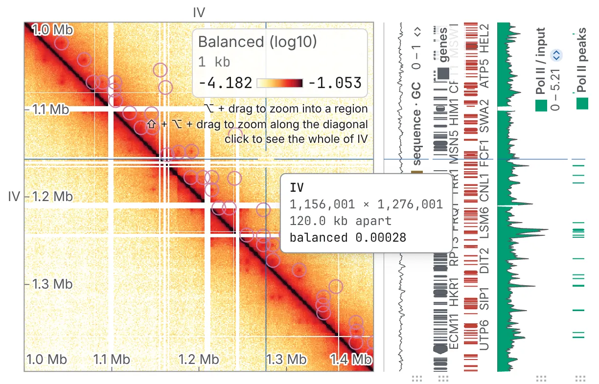
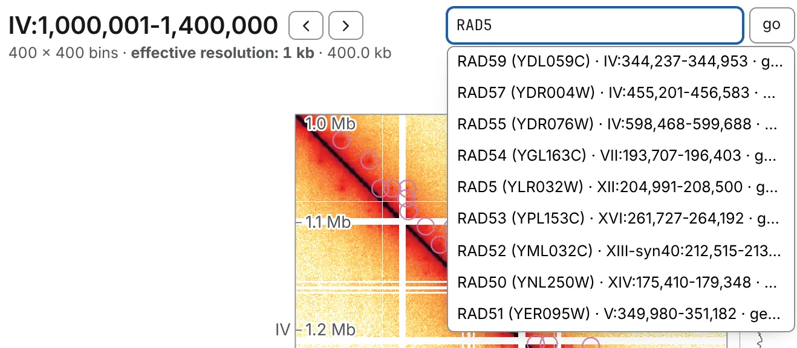
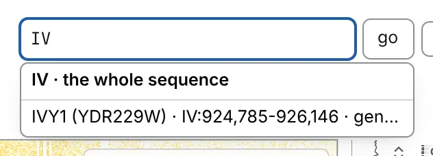

Dragging and scrolling move the **picture** of the block already read, and leave the address alone.
The locus box, the zoom steps, the crumbs and the sequence keys change the **range**: they read a
new block, the address follows, and the back button undoes them.

## Pan and zoom

- **Drag**, or one finger on a touch screen, to pan; a tap opens what it lands on.
- **Scroll** up or down, or pinch, to zoom about the pointer.
- **Scroll sideways** to slide along the map's columns. On a Mac, hold <kbd>⌘</kbd> and two fingers
  move it in any direction.
- **Double-click** (a double tap), <kbd>0</kbd>, or the first button of the **picture** row on the
  **Map** card (in the **Aesthetics** panel) undoes every pan and zoom.

Panning and zooming stop at the edges of the block that was read; to see past them, change the
range.

## Zoom into a region

- <kbd>⌥ Option</kbd>-drag (<kbd>Alt</kbd> on Windows and Linux) a box: on the diagonal it opens as
  a window, off it as the block between its two stretches. Add <kbd>Shift</kbd> to keep it square on
  the diagonal.
- <kbd>Shift</kbd>-drag along either axis to zoom the picture to that stretch, on the diagonal.
  While <kbd>Shift</kbd> is down, the readout and the crosshair snap to the diagonal.
- Both copy what they framed, counted from 1 without separators: `chrIV:500001-510000`, or
  `chrI:1-10000|chrII:40001-50000` for a box, rows then columns.
- A click on a window of one sequence opens all of it. On the whole genome, a click opens the
  chromosome under the pointer or, off the diagonal, the block between two.

## Stay on the diagonal

<kbd>Space</kbd>, or the diagonal button in the **picture** row, slides the view onto the diagonal
and keeps every drag, scroll, arrow key and <kbd>⌥ Option</kbd>-drag box on it until you press
again. The lock holds from one sequence to the next and on every map of a [deck](/browse/deck/), and
this browser remembers it. It is greyed on a block the diagonal does not cross, and on a [turned
map](/browse/turn/).

## Type a place

The box beside the heading shows the window as IGV, UCSC and papers print it,
`IV:1,000,001-1,400,000`: counted from 1, both ends included, so a coordinate copied from another
browser lands on the same bases. Type a place and press <kbd>Enter</kbd> or **go**; <kbd>/</kbd>
puts the caret in the box.

| Type | To open |
|---|---|
| `IV` | the whole sequence |
| `IV:1,000,001-1,400,000` | that window; commas optional, and `IV:1.2Mb-1.4Mb`, an en dash and Ensembl's `IV:1000001..1400000` are read too |
| `I:1-200,000 × II:1-200,000` | the block between two windows, rows then columns |
| a gene's name or accession | that gene, from the starred feature set (below) |
| a band, such as `Xq28` | that band, from a cytoBand you have loaded |

Between two windows, an `x` with a space either side, a `|`, or a space before the second name works
as well as `×`. A sequence may be spelt as another tool spells it (`chr1` for a file that says `1`);
a name the file does not have is refused, with the names it has.

### Go to a gene

Load a gene model, or any named features, and the box searches it as you type, by name or accession:
up to ten matches, an exact name first. Picking one frames the gene with a quarter of its length
either side. The box searches the set whose star is filled on the **Tracks** card; press another
row's star to switch.

A sequence's name still opens the sequence: it heads the list, above the genes that begin with it,
and <kbd>Enter</kbd> opens it.

## Go to another sequence

- <kbd>&gt;</kbd> and <kbd>&lt;</kbd> (<kbd>.</kbd> and <kbd>,</kbd> on a QWERTY keyboard), or the
  `‹ ›` buttons beside the title, open the next and the previous sequence in the file's order.
- In the **Chromosomes** table, from the crumb after the file's name or <kbd>c</kbd>, click a row.
- On the **Sequences** card, in the **General** panel, click a name for the whole sequence, or tick
  several to draw them against each other; **show the whole genome** clears the ticks.
- In the **Whole genome**, from the arrow beside the **Chromosomes** crumb or <kbd>w</kbd>, click a
  cell. Where it is a large read, it waits for a button that says what it will read.
- The **Genome minimap**, in the **General** panel, marks the view on every sequence laid end to
  end: click a sequence's band to open it, or drag across the strip for a window.

## Zoom and step by range

The buttons beside the box, `10×` and `3×` out and `3×` and `10×` in, scale the window about its
centre and read it again, from one bin up to the whole sequence. The two arrows after **go** move
the window half its width upstream or downstream. On a block between two sequences they are all
greyed.

## Resolution and the zoom

Scrolling does not change the resolution chosen in the bar
([Resolution](/browse/contact-maps/#resolution)): zooming in magnifies the cells of the block
already read. A wide window may be read coarser, its bins summed, and the line under the heading
says what one cell is worth: `4,033 × 4,033 bins · effective resolution: 3 kb`.

To see finer data, narrow the window, down to the resolution chosen. Or turn on **Refine on zoom**
in the command palette (<kbd>⌘ P</kbd> or <kbd>Ctrl P</kbd>): zooming in past what the block can
show then reads it again, finer; <kbd>Esc</kbd> calls it off. It applies to every map, and this
browser remembers it.

## Crumbs, back and forward

Click a crumb in the trail above the view to go back to it: the file's name (which opens another
file), the **Chromosomes** table (its arrow switches to the **Whole genome**), the sequence, the
window. The far end of the bar holds the map's **resolution** and **contacts**
([Reading a contact map](/browse/contact-maps/)).

**Go back** and **Go forward**, in the window's header, are the browser's back and forward; the
chevron beside **Go back** lists up to twenty earlier steps, nearest first, to jump to one.

A step is a crumb, a typed locus, a zoom or pan button, or a change of sequence; a drag, a scroll or
a pinch is not. So a link you copy opens the window you opened, not wherever you panned. In the
genome browser, the address (`locus=`) follows every move without adding steps.

## From the keyboard

Besides the keys above, <kbd>-</kbd> and <kbd>+</kbd> step one resolution coarser or finer,
<kbd>b</kbd> bookmarks the view, and <kbd>?</kbd> lists every shortcut. Once you have clicked the
map, the arrow keys pan, <kbd>Page Up</kbd> and <kbd>Page Down</kbd> zoom about the centre, and
<kbd>Home</kbd> refits. Once you have clicked the genome browser's tracks, the arrow keys pan,
<kbd>-</kbd> and <kbd>+</kbd> zoom by three like the `3×` buttons, and <kbd>0</kbd> shows the whole
genome. The full list is in [Keyboard and command palette](/browse/keyboard/).
