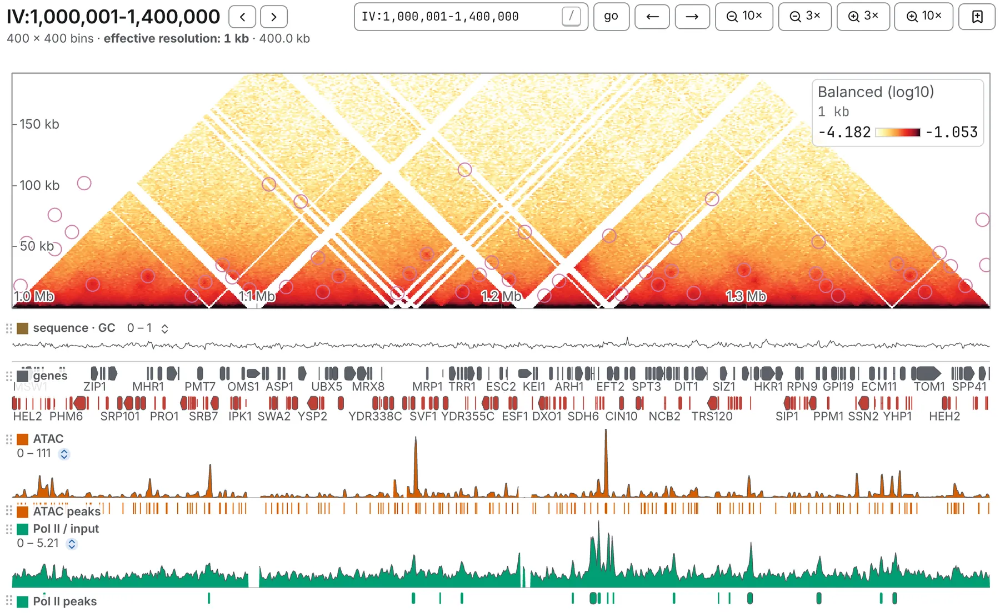

Turned by 45°, a map lays its diagonal along the bottom, with distance from it up the side, and the
tracks underneath line up with the picture. A domain becomes a triangle standing on the axis, a loop
a dot at the height of its span.

## Turning a map

Press the turn button in the **picture** row of the **Map** card, in the **Aesthetics** panel. Its
icon is the shape a press gives: a triangle, or a square once turned. A link asks for it with
`flip=true`.

- It is offered only on one sequence against itself, at bin level: a chromosome or a window of one.
  A circular sequence framed across its origin with **ori** turns like any other.
- A map opens square unless its link says otherwise, and once turned stays turned as you move around
  the same file.
- In a [deck](/browse/deck/) it turns every map, and every band reaches as far from the diagonal as
  the first map's.

## Reading a turned map

- A cell sits above the midpoint of its two bins, at half their separation. Nothing is stretched: a
  domain's two edges meet at a right angle.
- The ruler up the side reads **separation**: a contact between two places 100 kb apart reads 100
  kb.
- The two top corners are blank, not zero: their contacts reach outside the window that was read.
- Turning does not change the colours.
- Pointing at the map draws an X through the contact, the two lines along which one of its ends
  stays put (a V near the axis), and a hairline down the tracks under each end. Pointing at a track
  draws a V above it: every contact that place takes part in, either side.

## The size of the band

Drag the bar along the top to make the band taller or shorter, and either end to make it wider or
narrower; it stays centred and the tracks follow. Double-click a handle for all the room there is.
It opens as wide as the panel allows and a quarter as tall.

Zooming changes what the band holds, not its size, and there is no panning up or down. This browser
keeps the size for every tab and after a reload, and every map of a deck shares it.

## Two maps in one turned square

A square of two files, or of two readings of one ([Comparing two maps](/browse/comparing/)), turns
into two bands mirrored about one axis, each half the height: the first file grows up, the second
down, each named on its own side. The ruler counts outwards both ways, and a pointer in the lower
band reads the lower file. A ratio or a difference stays one band.

## Tracks and marks

Every track is drawn under the band, whichever edge of the square map it was on, and a track on two
edges appears once. Turn the map back and each track is where you put it.

Marks follow the places they name:

- a **line** becomes a V standing on the axis, carried straight down through the tracks;
- a **domain**, or a rectangle on the diagonal, becomes a triangle, its apex at the height of its
  span;
- a **loop** becomes a dot at the height of its span, and an **arrowhead** stands above the dot it
  names, pointing down at it;
- a **rectangle** off the diagonal becomes a parallelogram leaning at 45°.

A call further from the diagonal than the band reaches is not drawn.

## What a drag means

On a turned map, every drag works along the bottom axis:

- a plain **drag** pans along the axis;
- <kbd>⌥ Option</kbd>-drag (<kbd>Alt</kbd> on Windows and Linux) selects a full-height band and
  opens that stretch as a window; the map's corner says *⌥ + drag to zoom into a stretch*;
- <kbd>Shift</kbd>-drag, in either direction, zooms to the stretch and copies its coordinates.

**draw on map**, on the **Manual annotations** card, is the exception: it reads both ends of the
drag in the square, so press over one contact and let go over another to draw the rectangle they
span. Hold <kbd>Shift</kbd> for the square on the diagonal through the two places.

The diagonal lock is greyed while the map is turned.
