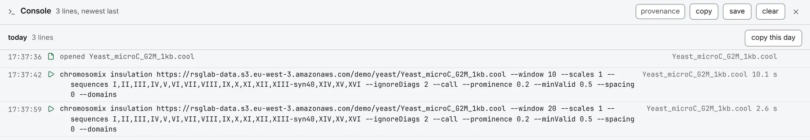

Tune a run on screen, then repeat it in a shell over one file or two hundred.

## The command beside a result

Under a finished result in the analysis drawer, **copy CLI command** copies the `chromosomix` line that repeats the run, and **copy provenance** the provenance header every export opens with. After **run on all maps** on a deck, the **all maps** tab copies one command per map, each under a `#` line naming its map.

## The console

The console writes every analysis run as the command that repeats it, and every file opened, track loaded or file written as a `#` comment. Open it with the console button in the header, after the save button, or <kbd>Ctrl</kbd>+<kbd>&#96;</kbd> (the key left of <kbd>1</kbd>; <kbd>Ctrl</kbd> on a Mac too, not <kbd>⌘</kbd>).



A line is written when a run starts, so changed, batched and failed runs (`# failed: …`) all have one. A day pasted into a file is a shell script, run in the order it first ran.

- The copy button at the end of a row copies that line, **copy this day** on a day's heading copies the day, and **copy** every line. **save** writes them as a `.sh` file.
- **provenance**, off by default, adds each entry's full provenance above it, also in what you copy or save.
- **clear** forgets every line.

It keeps a week, or 500 lines, in this browser, and sends nothing. An embedded viewer has none. More in [The console](/browse/console/).

## What the line holds

```sh
chromosomix insulation https://example.org/sample.mcool::/resolutions/10000 --window 10 --scales 1 --ignoreDiags 2 --call --prominence 0.2 --minValid 0.5 --spacing 0 --domains
```

- **Every parameter the run had**, defaults included, so a later release's defaults do not change it.
- **How the map was read**: `--no-balance`, `--contacts`, `--coarsen`, `--circular`, `--origin`, `--cell`, `--value`, a `.pairs`'s `--bin-size`, and `--window` for the part of the map on screen, unless the task has a `--window` of its own, like insulation.
- **The files**: one opened from an address by that address, one from your disk by its file name alone: run the line in its folder, or add the path. Tracks, feature sets and references go by file name, wherever they came from.
- **No `--out`.** Add `--out <dir>` to write elsewhere than the current folder.

`#` lines above the command, copied with it, say what a shell cannot be told: a set the app computed with no file behind it (export it, and name the file); the maps a [Reproducibility](/analyses/hicrep/) run compared against (add `--against <file>` for each); the cells an `.scool` was summed from (add `--cell <name>` for each); a map drawn balanced and read raw, or the reverse (the line follows what the task read, so the numbers match).

## A saved workspace, over other files

`chromosomix replay` reruns every analysis a workspace recorded, with its parameters, over other files.

1. Run the tasks you want in the app, on one map, until each is right.
2. Save the window with the header's save button, **Save every tab as a file** (<kbd>Ctrl</kbd>+<kbd>S</kbd>, or <kbd>⌘</kbd>+<kbd>S</kbd> on a Mac). The app writes a file such as `workspace-20261103-101244.chromosomix.json`.
3. Replay it over the other maps:

```sh
chromosomix replay workspace.chromosomix.json --over data/*.hic --out results/
```

Results are named as for a [task's run](/cli/running/).

| Flag | What it does |
| --- | --- |
| `--over <file> …` | the files to run over; files named after the workspace are run too. With none, the map the tab itself names |
| `--tab <n>` | which tab to replay, counting from 1. By default, the one in front when you saved |
| `--track <file>` | the file behind a recorded track, matched by file name. Repeat it for each track |
| `--against <file>` | the other maps a recorded [Reproducibility](/analyses/hicrep/) run compared against |
| `--out <dir>` | where to write, as for any task |

A recorded locus is read as the form showed it. A workspace with no recorded analysis, or a value this release cannot run, is refused with exit status 2 before any file is opened. A task this release does not have, or a Reproducibility run with no `--against`, is skipped with a line saying so.
