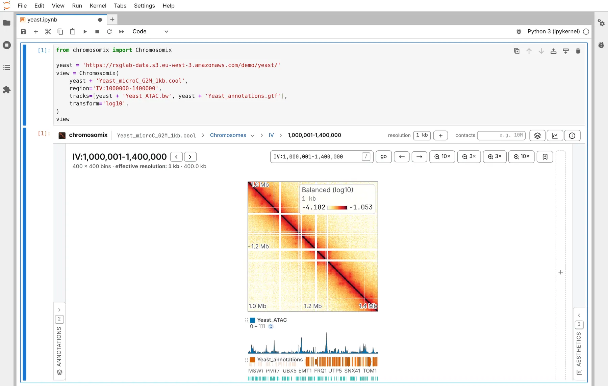

The `chromosomix` Python package puts the app in a notebook cell, moved from Python. It works wherever [anywidget](https://anywidget.dev/) does: JupyterLab, Jupyter Notebook 7, VS Code, Google Colab and marimo.

## Install

```sh
pip install chromosomix
```

From a clone, `pip install -e widgets/python`. It needs Python 3.10 or later. Behind JupyterHub, see [below](#jupyterhub-colab-and-other-proxies).

## A map and its tracks

```python
from chromosomix import Chromosomix

yeast = 'https://rsglab-data.s3.eu-west-3.amazonaws.com/demo/yeast/'
view = Chromosomix(
    yeast + 'Yeast_microC_G2M_1kb.cool',
    region='IV:1000000-1400000',
    tracks=[yeast + 'Yeast_ATAC.bw', yeast + 'Yeast_annotations.gtf'],
    transform='log10',
)
view
```



| Argument | What it is |
| --- | --- |
| `map` | the contact map, a path or an address. `::` names a group inside it: `'sample.mcool::/resolutions/5000'`. Leave it out for a 1D browser of the tracks |
| `tracks` | files added once the view is drawn, in order, as the header's **+** adds them: tracks, maps, 3D models, workspaces |
| `region` | where the map is framed: `'IV:1000000-1400000'`, counted from 0 as cooler counts, or `('IV', 1_000_000, 1_400_000)` |
| `locus` | where a 1D browser is placed: `'IV:400,001-460,000'`, 1-based |
| `height` | the cell's height in pixels; 600 by default |
| `viewer` | the build of the viewer in the frame ([below](#which-viewer)) |
| any other keyword | a key of the view from [Link keys](/reference/links/): `transform`, `colormap`, `balance`, `vmin`, `vmax`, `oe`, `smooth`, `view`… |

A key takes one value, as a link writes it: `maps='a.cool|b.cool'`, not a list. A path under `uri`, `uri2` or `maps` is served from the kernel like the map.

## Moving it from Python

```python
view.goto('IV:1150000-1300000')                 # a region of the map, or a locus in the 1D browser
view.navigate(transform='log2', oe=True)        # any key a link carries; None removes one
view.add(yeast + 'Yeast_structure.g3d.gz')      # the header's +: a track, a map, a 3D model
```

- `goto` frames a square on the diagonal, dropping any off-diagonal block or zoom, or moves the 1D browser's locus. It takes a string or a `(sequence, start, end)` tuple.
- `navigate` changes only the keys you give.
- `add` puts more files in the cell; a 3D model opens in a cell of its own beside the map.
- `load(map, tracks=…, region=…)` opens another map in a new frame, after checking every file: a missing one raises and leaves the cell as it was.

Requests are kept, so a notebook run before its frame is drawn, or opened again, ends where Python last put the view.

## Where the reader is

| | |
| --- | --- |
| `view.state` | where the view is now: a dict of the keys a link carries (`uri`, `view`, `region`, `locus`…), or `None` on the landing page. It follows the reader's pans and zooms |
| `view.rendered` | the report of the last finished picture: what is drawn, at which resolution |
| `view.version` | the viewer's version, once its frame is up |
| `view.notice` | what the frame could not do — a viewer too old to take files — or `''` |
| `view.viewer` | the address of the build in the frame |

`state` is a traitlet, so a cell can watch it:

```python
view.observe(lambda change: print((change['new'] or {}).get('region')), names='state')
```

## A 1D browser

With no map, the first file becomes the cell's: a bigWig opens a genome browser over its assembly, with the rest as its tracks. `locus=` then places the browser, and `region=` frames a map the first file opens.

```python
browser = Chromosomix(
    tracks=[yeast + 'Yeast_ATAC.bw', yeast + 'Yeast_ChIP_Pol2-vs-input.bw', yeast + 'Yeast_annotations.gtf'],
    height=540,
)
browser
```

```python
browser.goto('IV:400,001-460,000')
```

## Files on the kernel's disk

The kernel serves a path to the viewer by byte range, from `127.0.0.1`. Nothing leaves its machine.

```python
from pathlib import Path

data = Path('~/data/yeast').expanduser()
Chromosomix(data / 'Yeast_microC_G2M_1kb.cool', region='IV:1000000-1400000', tracks=[data / 'Yeast_ATAC.bw'])
```

- The file's folder is served, so sidecars beside it (`.bai`, `.fai`, `.tbi`, `.px2`) are found. Nothing outside it is served, nor any name starting with a dot: naming one raises.
- A link is followed, with its sidecars looked for beside the link, as DataLad and git-annex files need.
- `chromosomix.serve(path)` returns the address the viewer reads a local file at; `chromosomix.address(file)` keeps an address and serves a path.

## Which viewer

| `viewer=` | The build |
| --- | --- |
| nothing | `CHROMOSOMIX_VIEWER` if it is set, else a build fetched by `install_viewer()`, else https://chromosomix.app/ |
| a version, `'0.17.0'` | that release, kept for good at `https://chromosomix.app/v/v0.17.0/`: what a notebook that must draw the same picture next year names |
| an address | any build, a lab's own copy of the viewer among them |
| a folder | a built `dist/` on this machine, served beside the data |

**Tracks need a viewer from 0.17.0 on.** An older build draws the map but nothing the widget adds, and says so above the frame and in `view.notice`; naming an older release warns at once.

**With files on the kernel's disk, prefer a build served beside them.** `chromosomix.install_viewer()` fetches the viewer from npm once, checks npm's integrity hash, and caches it in `~/.cache/chromosomix/` (or `CHROMOSOMIX_CACHE`), so the notebook works offline; `install_viewer('0.19.0')` fetches a given release. Otherwise Chrome asks the reader once to let the site reach this machine.

## JupyterHub, Colab and other proxies

- **Behind JupyterHub**, install [jupyter-server-proxy](https://jupyter-server-proxy.readthedocs.io/) in the environment `jupyter lab` runs from, not only the kernel's. There, **local files are read only by a viewer the kernel serves**: run `chromosomix.install_viewer()` once, or set `CHROMOSOMIX_VIEWER` or `viewer=` to a built `dist/`. The proxy refuses answers over 100 MB, which matters only for a file read whole, such as an annotation file with no tabix index: bgzip and index it.
- **In Colab**, there is nothing to set.
- **Any other way in**: set `CHROMOSOMIX_PUBLIC_URL` to the address the browser reaches the server at, with `{port}` where the port goes.

## In marimo

marimo reruns every cell that names a `mo.ui.anywidget` wrapper on every move, so name the wrapper only where you read where the reader is, and drive the widget itself:

```python
import marimo as mo
from chromosomix import Chromosomix

view = Chromosomix(MAP, region='IV:1000000-1400000', tracks=[ATAC])   # MAP and ATAC: a map and a track
live = mo.ui.anywidget(view)
live
```

```python
view.goto('IV:1150000-1300000')   # names `view`: runs once
```

```python
(live.state or {}).get('region')  # names `live`: runs again wherever the reader goes
```

`live.goto(…)` would pull the view back on every move, and `live.add(…)` add the file again on every report. `marimo edit` cuts a cell's output at 610 px; `marimo run` shows the whole `height`.

## The demo notebooks

[`demo.ipynb`](https://github.com/js2264/chromosomix/blob/main/widgets/python/demo.ipynb) and [`demo_marimo.py`](https://github.com/js2264/chromosomix/blob/main/widgets/python/demo_marimo.py) walk through all of this on the yeast demo. The widget is an embed, which keeps and drops what [an embedded view](/embed/web-page/) does; the package's notes are in [its README](https://github.com/js2264/chromosomix/blob/main/widgets/python/README.md).
