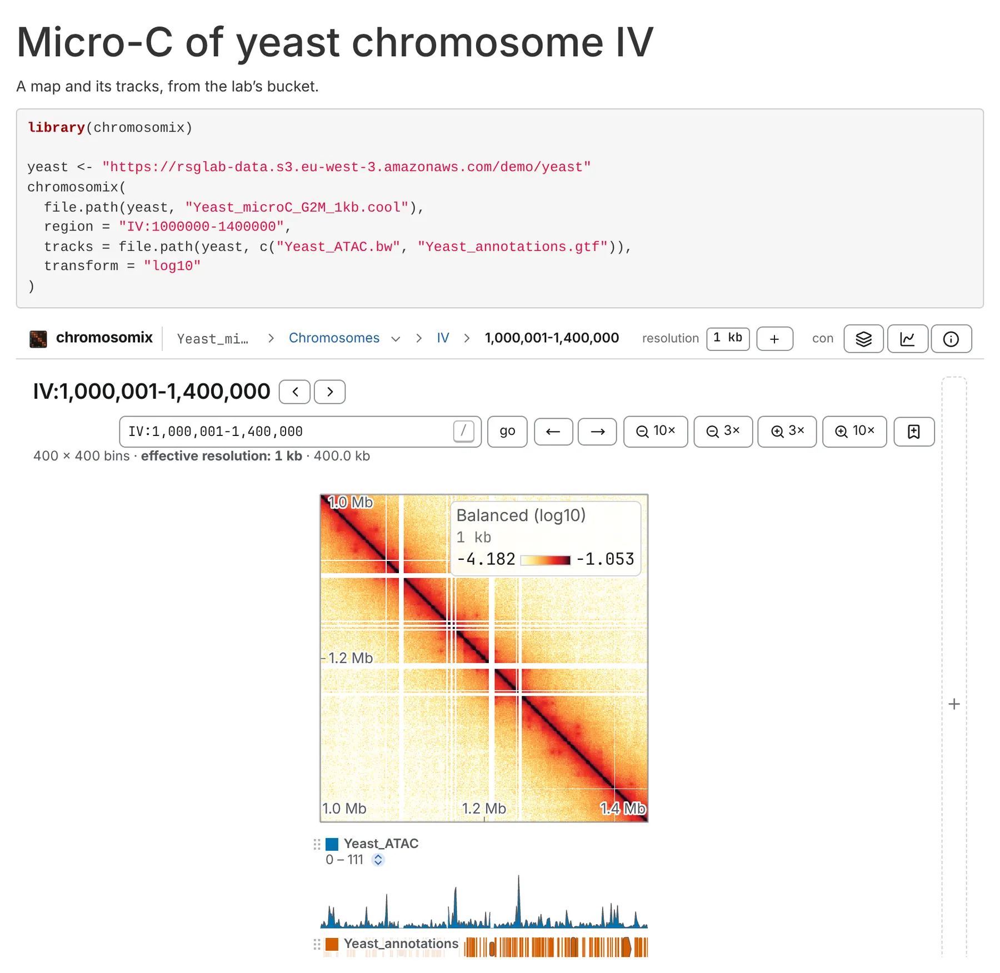
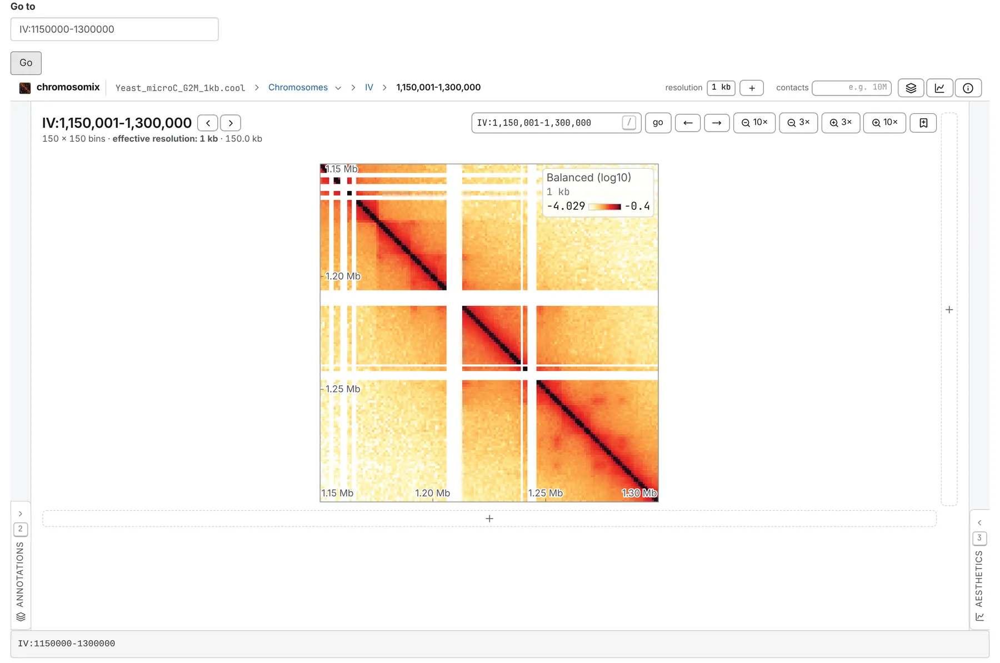

The `chromosomix` R package is the viewer as an htmlwidget: the app itself — the map, its tracks, its side panels and its gestures — on an R Markdown or Quarto page, in the RStudio viewer or in a Shiny app. R moves it, and in Shiny the viewer tells R where the reader has taken it.

## Install

```r
remotes::install_github("js2264/chromosomix", subdir = "widgets/r")
```

Or, from a clone of the repository:

```r
install.packages("widgets/r", repos = NULL, type = "source")
```

It needs R 4.1 or later, with htmlwidgets, httpuv and jsonlite. An app also needs the shiny package; the openssl package lets it check a viewer it downloads, and rstudioapi is used behind RStudio Server.

## A map and its tracks

```r
library(chromosomix)

yeast <- "https://rsglab-data.s3.eu-west-3.amazonaws.com/demo/yeast"
chromosomix(
  file.path(yeast, "Yeast_microC_G2M_1kb.cool"),
  region = "IV:1000000-1400000",
  tracks = file.path(yeast, c("Yeast_ATAC.bw", "Yeast_annotations.gtf")),
  transform = "log10"
)
```

At the console it opens in the RStudio viewer; in a chunk of an R Markdown or Quarto document, it is drawn on the rendered HTML page.



| Argument | What it is |
| --- | --- |
| `map` | the contact map, an address or a path. A `::` names a group inside it, as in the app: `"sample.mcool::/resolutions/5000"`. `NULL` for a 1D browser of the tracks alone |
| `tracks` | files put in the view once it is drawn, in order, as the header's **+** puts them: a track beside the map, another map beside it, a 3D model, a workspace |
| `region` | where the map is framed, as a link writes a region: `"IV:1000000-1400000"`, counted from 0 as cooler counts, or a sequence, a start and an end |
| `locus` | where a 1D browser is placed, as the browser shows a locus: `"IV:400,001-460,000"`, 1-based |
| `...` | any other key of the view, named: `transform` (`"log10"`, `"log2"`, `"log1p"`, `"none"`), `colormap`, `balance`, `vmin`, `vmax`, `oe`, `smooth`, `view`… |
| `viewer` | which build of the viewer is in the frame ([below](#which-viewer)) |
| `title` | the frame's title, for a screen reader |
| `width`, `height` | the widget's size, in CSS units or pixels; `"100%"` and 600 by default |
| `elementId` | an id for the widget's element |

Every key and the values it takes are on [Link keys](/reference/links/). A key takes one value, written as a link writes it — `maps = "a.cool|b.cool"`, not a vector — and a vector is refused by name. Numbers are written with a `.` whatever `OutDec` says. A file under `uri`, `uri2` or `maps` is served like the map, when it is a path.

## Moving it before it is drawn

A static page has no R behind it once it is rendered, so it moves its views by laying requests on a widget before it is drawn:

```r
chromosomix(file.path(yeast, "Yeast_microC_G2M_1kb.cool"), region = "IV:1000000-1400000") |>
  chromosomix_goto("IV:1150000-1300000") |>
  chromosomix_navigate(transform = "log2", oe = TRUE) |>
  chromosomix_add(file.path(yeast, "Yeast_structure.g3d.gz"))
```

- `chromosomix_goto()` frames a square on the diagonal, and takes away an off-diagonal block or a zoom the reader left — or, when the view is the 1D browser, moves its locus. It takes a string, or a sequence, a start and an end.
- `chromosomix_navigate()` lays a patch over the view: only the keys you give change, and a key given `NULL` is removed.
- `chromosomix_add()` puts more files in the view, as the header's **+** does. A 3D model opens in a cell of its own beside the map, panned and zoomed with it.

The frame makes the requests in order, each once the one before it is done, so a locus asked for after tracks were added is the locus on those tracks. It makes them all again when it reloads. Moves in a row are laid on as one; additions never are.

## A 1D browser

With no map, the first file becomes the view's: a bigWig opens a genome browser over the assembly it declares, and the rest are its tracks.

```r
chromosomix(
  tracks = file.path(yeast, c("Yeast_ATAC.bw", "Yeast_ChIP_Pol2-vs-input.bw", "Yeast_annotations.gtf")),
  height = 540
) |>
  chromosomix_goto("IV:400,001-460,000")
```

Given with no map, `locus` (or `region`) and the other keys are laid on once the tracks are in.

## In Shiny

```r
library(shiny)
library(chromosomix)

map <- "https://rsglab-data.s3.eu-west-3.amazonaws.com/demo/yeast/Yeast_microC_G2M_1kb.cool"

ui <- fluidPage(
  textInput("where", "Go to", "IV:1150000-1300000"),
  actionButton("go", "Go"),
  chromosomixOutput("view", height = "800px"),
  verbatimTextOutput("region")
)

server <- function(input, output, session) {
  output$view <- renderChromosomix(chromosomix(map, region = "IV:1000000-1400000"))
  observeEvent(input$go, chromosomix_goto(chromosomixProxy("view"), input$where))
  output$region <- renderText(input$view_state$region)
}

shinyApp(ui, server)
```



- `chromosomixOutput()` places the widget (`"100%"` wide and `"600px"` high by default) and `renderChromosomix()` draws it. Drawn again, it is a new frame, and only the new widget's requests are made in it.
- `chromosomixProxy("view")` drives the widget on screen without drawing it again: `chromosomix_goto()`, `chromosomix_navigate()` and `chromosomix_add()` take it in place of a widget. A request through a proxy is sent once the outputs of the same flush are, and one that reaches the page before its widget is drawn waits for it.
- What the viewer says comes back as inputs named after the output, here `view`:

| Input | What it is |
| --- | --- |
| `input$view_state` | where the view is: a list of the keys a link carries (`uri`, `view`, `region`, `locus`…), `NULL` on the landing page. It changes as the reader pans, zooms and changes the scale |
| `input$view_rendered` | the report of the last finished picture: what is drawn, at which resolution |
| `input$view_version` | the viewer's version, once its frame is up |
| `input$view_notice` | what the frame could not do — a viewer too old to take files |

The package carries a fuller app — a region box, the scale, observed over expected and the 3D model, all through a proxy, with the controls following the reader: `shiny::runApp(system.file("examples", "app.R", package = "chromosomix"))`.

## Files on this machine

A path is served to the viewer by this R session, by byte range, from a small server on `127.0.0.1`. Nothing is uploaded.

- What is served is the folder the file is in, under a random token, so the file's sidecars — `.bai`, `.fai`, `.tbi`, `.px2` — are read from beside it. Nothing outside that folder is served but what a link in it points to, and no name that starts with a dot (`.git`, `.ssh`).
- A link is served by its own name and followed wherever it points, so a DataLad or git-annex file has its index read from beside the link.
- `serve(file)` returns the address the viewer reads a local file at, and `address(file)` keeps an address as it is and serves a path.

The server answers while R is idle — at the console, in RStudio, under Shiny.

:::caution[A rendered page draws local files only while R runs]
A page that names local files draws them only while the R session that rendered it is running, and a Knit or a `quarto render` ends as soon as the page is written. So a page for other people names its files by address: `https://`, `s3://`, `gs://`, a Dropbox or Google Drive share. Knitting, the first local file served says so in a warning.
:::

Behind RStudio Server the server is reached through RStudio's own proxy, with rstudioapi installed, and only a viewer this session serves — `install_viewer()`'s, or a built `dist/` — reads local files: RStudio's proxy asks for its login, which the public site's requests do not carry. `CHROMOSOMIX_PUBLIC_URL`, with `{port}` where the port goes, names any other way in.

## Which viewer

`viewer =`, or the option `chromosomix.viewer`, names the build of the viewer in the frame:

| `viewer =` | The build |
| --- | --- |
| nothing | `CHROMOSOMIX_VIEWER` if it is set, else a build fetched by `install_viewer()`, else https://chromosomix.app/ |
| a version, `"0.17.0"` | that release, kept for good at `https://chromosomix.app/v/v0.17.0/`: what a page that must draw the same picture next year names |
| an address | any build, a lab's own copy of the viewer among them |
| a folder | a built `dist/` on this machine, served beside the data |

**Tracks need a viewer from 0.17.0 on.** The frame takes the files a widget adds — its `tracks`, and `chromosomix_add()` — through a message the viewer learned in 0.17.0. An older build draws the map and nothing it adds, and says so above the frame (and in Shiny as `input$<id>_notice`); naming an older release warns when the widget is made.

**With files on this machine, prefer a build served beside them.** `install_viewer()` fetches the viewer from the npm package once and keeps it in R's user cache directory (or under `CHROMOSOMIX_CACHE`); every widget after uses it, so the app and the data are one origin and the page works offline. The download is checked against npm's sha512 where openssl is installed, and put in place whole or not at all. `install_viewer("0.19.0")` fetches a given release rather than the latest. While a page is knitted, a build `install_viewer()` fetched is named by its release's permanent address on the site, since the session that would serve it ends with the render. The site in the frame reading `127.0.0.1` works too, but Chrome asks the reader once to let the page reach this machine.

## The examples

`system.file("examples", "demo.Rmd", package = "chromosomix")` is an R Markdown page of the yeast demo, read from its bucket — a map with its tracks, the same map moved before it is drawn, and a 1D browser — and `app.R` beside it is the fuller Shiny app.

The widget is the viewer's own embed, in an `<iframe>`, driven over its message channel: [Embedding in a web page](/embed/web-page/) says what an embed keeps and drops. The package's own notes are in [its README](https://github.com/js2264/chromosomix/blob/main/widgets/r/README.md).
