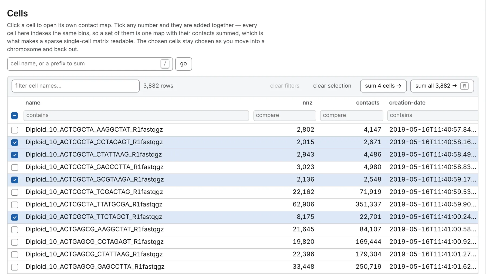
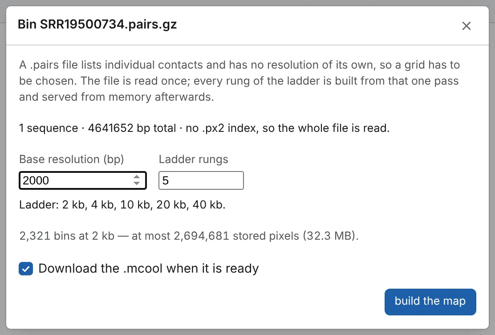

Every format below opens as a contact map ([Opening files](/files/opening/)), on its **Chromosomes**
table, where you open a chromosome, a region or the whole genome
([Reading a contact map](/browse/contact-maps/)).

| Format | What it is | How it is read |
| --- | --- | --- |
| `.cool` (or `.h5`, `.hdf5`) | one cooler: a matrix at one bin size | by range, a block per view |
| `.mcool` | a cooler at each resolution of a ladder | by range, at the resolution you pick |
| `.hic` | Juicer's format, versions 7, 8 and 9 | by range, at the resolution you pick |
| `.scool` | one cooler per cell, on shared bins | the cells you tick, summed |
| HiC-Pro | a `.matrix` and the `_abs.bed` beside it | whole, once, then held in memory |
| `.pairs`, `.pairs.gz` | a list of contacts | binned once, at a bin size you choose |

Only maps whose bins are one fixed size are read ([What is not opened](#what-is-not-opened)).

## Multi-resolution files (.mcool, .hic)

An `.mcool` opens a third of the way up its ladder from the finest, and zooming in never goes finer
than the rung you are on: pick the finest in the breadcrumb's **resolution** picker when you want
it.

- Open one rung by its address: `sample.mcool::/resolutions/5000`.
- The whole genome and a chromosome's first picture are read from a coarser rung.
- The **+** beside the picker sums a stored rung's bins into a resolution the file does not store.

A `.hic` of version 7, 8 or 9 opens the same way (`sample.hic::/resolutions/5000`); its own
expected-value vectors and `All` chromosome are not read. An older `.hic` is refused: convert it
with `hic2cool`, or run Juicer Tools `pre` again.

## Single-cell coolers (.scool)

An `.scool` — in `cooler.create_scool`'s layout, or the older one of HiCMatrix and scHiCExplorer —
opens on its **Cells** table instead.



- Click a cell to open its own map, or open it by address: `file.scool::/cells/<name>`.
- Tick cells and press **sum N cells →** to sum them into one map, never side by side;
  **sum all N →** is the pseudo-bulk. The choice stays as you move in and out, and travels in a link.

From a server, an `.scool` first asks **How should this single-cell file be read?**:
**download all … once**, or **read it in small pieces**, far fewer bytes but minutes rather than
seconds. [Per-cell contact QC](/analyses/cellqc/) measures each cell.

## HiC-Pro matrices

A HiC-Pro map is two files from one run and resolution, gzipped or not: `<prefix>_<res>_abs.bed`,
its bins, and `<prefix>_<res>.matrix` (or `_iced.matrix`), its non-zero pixels, in any layout
(`upper`, `lower`, `complete`, `asis`). Open the two together, or the matrix is refused:

- drop or choose both, or pick the matrix from a connected folder with the bed beside it;
- open the matrix by address: the bed is found beside it, or in `raw/` for a matrix in `iced/`;
- or name the bed: `<address of the matrix>#bins=<address of the bed>`.

The matrix is read at about 100 MB a second; over 200 MB, **read all …** shows the cost first, and
the read can be cancelled. About 100 million pixels is comfortable, and past about 250 million too
much for a browser tab: any small genome at any resolution, human down to about 250 kb. For a finer
map, convert the two files to a `.cool` once (HiC-Pro numbers its bins from 1):

```sh
cooler load -f coo --one-based sample_10000_abs.bed sample_10000.matrix sample_10000.cool
```

The `.biases` file is not read.

## Pairs files (.pairs)

A 4DN `.pairs` file, plain, gzipped or bgzipped, has no bin size: the first open asks how to bin it,
in the **Bin** dialog.



- **Base resolution (bp)** opens on a value suggested from the file, and snaps to a 1-2-5 series.
- **Ladder rungs** is how many resolutions to build, the base among them: five at first, up to
  thirteen. The lines under it price them, and warn when most bins would hold a single contact.
- **Download the .mcool when it is ready**, ticked at first, saves the result to open next time.
- **build the map** reads the file in one pass, with a progress bar and a cancel.

The first analysis you run reads the records once more.

- **The header** must start `## pairs format` and give each sequence's length in a `#chromsize:` (or
  `#samheader: @SQ`) line, or the file is refused with the fix,
  `pairtools header generate --chroms-path <chrom.sizes>`. Columns follow the `#columns:` line, or
  the specification's order. Positions are 1-based.
- **Nothing is filtered**: duplicates (`DD`) are counted as such and still binned, and mapping
  quality is not read. Filter with `pairtools select` or `pairtools dedup` and import the result.
- **An incomplete file**, bgzipped and cut off part-way, is drawn from the records that arrived and
  flagged **Incomplete file**, naming the sequences with nothing on their diagonal.
- **A slow import** can be a `.pairs.gz` written in very small blocks, which inflates several times
  more slowly than one in `bgzip`'s own 64 KiB blocks. Re-block it once:

```sh
bgzip -d < sample.pairs.gz | bgzip > sample.reblocked.pairs.gz
```

### Pairs statistics and the .stats file

The import also counts what `pairtools stats` counts, on the General panel's **Pairs statistics**
card: **records**, **mapped**, **one side**, **unmapped**, **duplicates** (only with a `pair_type`
column), **cis**, **trans**, **library size** and **strands meet**, where the four read orientations
converge — each as a count and the share pairtools and MultiQC give it, with charts. **save .stats**
writes them in pairtools' format, for MultiQC or `pairtools stats --merge`. The command line writes
the same file:

```sh
chromosomix stats sample.pairs.gz --out qc/
```

[Pairs QC](/analyses/pairsqc/) reads the same records with restriction fragments added.

## Balancing weights

The **score** box of the Aesthetics panel's Map card sets what each cell holds: **counts** to begin
with, **balanced** where the file carries weights, or any extra column of a cooler's pixel table.
**VC**, **VC √** and **ICE**, computed from the counts on screen, are offered for every map.

**balanced** is each raw count times its two bins' weights, matching cooler's balanced matrix cell
for cell. A bin the balancer dropped has no weight: its row and column are transparent, absent
rather than empty. Without weights, **balanced** is not offered, and a link asking for it opens on
counts.

| File | Its weights |
| --- | --- |
| `.cool` | the `weight` column `cooler balance` writes into its bins table |
| `.mcool` | each rung's own; `cooler zoomify --balance` balances every rung |
| `.hic` | the best normalisation vector at the open resolution — `SCALE`, then `KR` with its `INTER_KR` and `GW_KR` variants, then the coverage ones — named on the **normalisation** row of the General panel's File card, or *none at this resolution* |
| `.scool` | the one weight column all its cells share, if any, applied to their sum |
| HiC-Pro | none: open the `iced/` matrix for normalised counts |

## What is not opened

- **Bins of different sizes**: a fragment-level cooler or HiC-Pro map (`GENOME_FRAGMENT`); a
  `.hic`'s fragment resolutions are not offered. Bin the contacts at a fixed size with
  `cooler cload pairs`.
- **A gzipped or zipped cooler**: decompress it first. A `.pairs.gz` or `.matrix.gz` is read
  compressed.
- **HDF5 that is not a cooler**, an `.mcool` or an `.scool`.
- **A BAM**: it is drawn as reads ([Tracks and features](/files/tracks/)), never as a map.

What to do about each refusal: [When a file will not open](/files/problems/).
