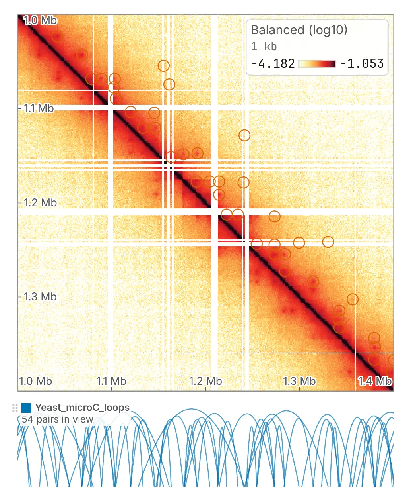

An interaction file lists pairs of places that touch: loop calls, ChIA-PET or HiChIP loops,
promoter–enhancer links. chromosomix draws them where they can be checked against the map — a ring
round each pair on the map itself — or as arcs along an edge of the map and in the 1D browser.

Load one as you would any track: drop it on the map, use the Tracks card's **Load a track**, or
pick it from a folder, a store or an address ([Opening files](/files/opening/)).

## The formats

| Format | On disk | Read as |
| --- | --- | --- |
| BEDPE | `chrom1 start1 end1 chrom2 start2 end2` and optional columns after them, 0-based | the six columns; also a table with a header row naming those six columns, such as a loop caller's `.tsv` |
| `interact` | UCSC's BED5+13: a span covering both ends, then each end's sequence, start, end, name and strand | ranked by its `value` |
| `bigInteract` | the same rows in a bigBed | recognised by its schema |
| `longrange`, `longTabix` | a BED3 and a fourth column, `chrom:start-end,score` | the score optional; mirrored lines folded into one |

Each is recognised by its columns, so a loop set saved as `.txt` or `.tsv` opens as pairs; an
`interact` or `longrange` file is told apart before anything tries to read it as a BED. A file named
`.interact`, `.bigInteract`, `.longrange` or `.longTabix` is held to looser tests, since its name
has already said what it is.

## How each is read

- **BEDPE.** Pairs whose two ends are on different sequences are kept, and drawn off the diagonal
  wherever a view shows the two sequences together.
- **interact.** The number that ranks a pair, reads out under the pointer and is exported is its
  `value` — what the pipeline computed — and not the 0–1000 `score` beside it, which is UCSC's
  shading for its own browser. The score is kept on the pair's card, where you can see the two
  disagree.
- **longrange.** The format writes every interaction twice, once under each end, so that a tabix
  query from either end finds it. Read naively that draws every loop twice, so the two mirrored
  lines — the same two ends and the same score — are folded into one, and the row's summary says
  how many were folded. A bgzipped `longTabix` with its `.tbi` is read like any indexed text file
  ([Tracks and features](/files/tracks/)).

Sequence names are matched to the map's as a track's are, so loops called on `chr1` land on a map
that calls it `1` ([Reference sequences](/files/sequences/)).

## On the map

A loaded set of pairs opens on the map, a ring round each pair. A ring is an outline round the
pixel it points at, never drawn over it, so the contacts it claims stay visible.

A set is drawn only on the maps it is placed on. Dropped on a map — on the rectangle in its middle
that reads **on this map** while you drag — it is drawn there and nowhere else. In a deck, its row
has a **maps** field, a mark for each map, with *every map*, *no map* and *on N of M* under them;
see [Maps side by side](/browse/deck/).

## As arcs

The row's **display** switches between **map overlay**, the rings, and **arcs (1D track)**: an arc
joining the two ends of every pair, drawn along any edge of the map, or along several. An arc's
height is the log of its span, so a 2 kb loop and a 2 Mb one are both visible in one view, and a
pair with one end off screen is still drawn: that arc is what says something here touches something
there. Flipping the lane hangs the arcs from its other side.

In the 1D browser a set of pairs is always arcs. The choice is kept with the row, so a reload keeps
it.

## Exporting the anchors

A loaded set of pairs has one export on its row: **anchors**, both ends of every pair as a BED, each
place once however many pairs share it — the file to hand a motif search or an overlap with peaks.

## In analyses and on the command line

The same files feed the analyses that pile up a set of pairs, such as
[Aggregate peak analysis](/analyses/apa/). The `chromosomix` command line reads all four formats
the same way under `--pairs` and `--features`, so a pileup run from a script is over the loops the
browser draws ([Running a task](/cli/running/)).

BEDPE is also how the Manual annotations card writes and reads its arrowheads and rectangles; see
[Annotations and bookmarks](/browse/annotations/).
