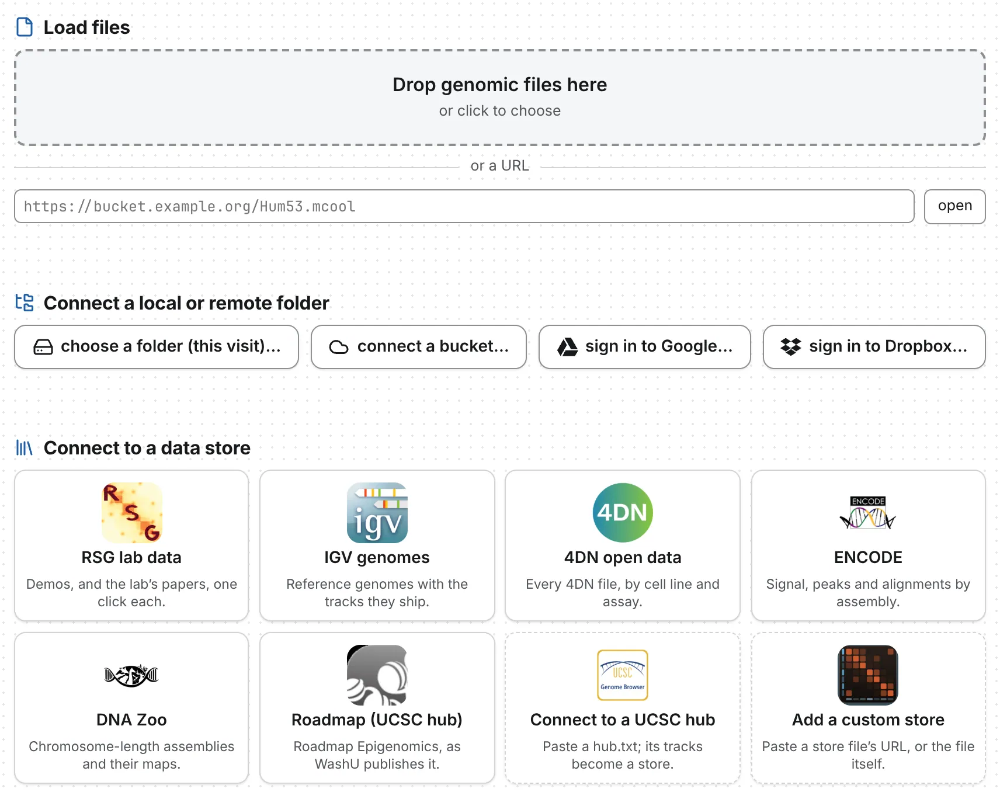
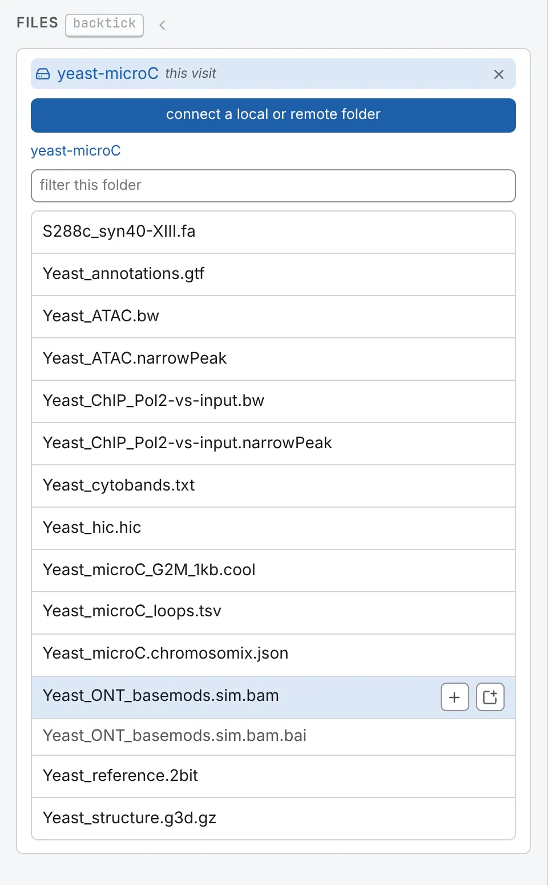

chromosomix reads your files where they are: a local file in place, a remote one by byte range from
its host. Nothing is uploaded, and nothing has to be converted first. Each format is on its own page:
[contact maps](/files/contact-maps/), [tracks](/files/tracks/),
[interactions](/files/interactions/), [sequences](/files/sequences/) and
[3D models](/files/structures/). What each copy of chromosomix can open is in
[Web, desktop or one file](/start/where-to-run/).

## Drop or choose files

On the landing page, drop files on **Drop genomic files here**, under **Load files**, or click it to
choose them. Several can go at once.

Once a tab is open, drop files anywhere on the window, or press **+** in the header, **Add a file to
this tab**. To replace what the tab holds, use **Open a file** (click the file's name at the start
of the breadcrumb), **Open a different file** in the command palette, or a **New tab**. In the
desktop app, **File → Open…** (<kbd>Ctrl</kbd> <kbd>O</kbd>, or <kbd>⌘</kbd> <kbd>O</kbd>) goes back
to the drop area. A `.txt` or `.tsv` in a format chromosomix reads opens too.

## Open a file by its address

Paste the address under **or a URL** and press **open**. The host must serve byte ranges and allow a
cross-origin read, as S3, Google Cloud Storage, Cloudflare R2, Azure and most static web servers do
once set up ([Hosting your data](/advanced/hosting/)). GEO and SRA download links do neither:
download the file and drop it.

Dropbox and Google Drive share links and `gs://` and `s3://` addresses can be pasted as they are; a
Dropbox link or a public Drive file needs no sign-in. A link copied from the address bar then opens
for a colleague who can reach the file.

End an address with `::/resolutions/<bin size>` to open one resolution of a multi-resolution file. A
link to the app can name a file and where to open it, `https://chromosomix.app/#uri=<address>`
([Link keys](/reference/links/)). A presigned link works until it expires: good for sharing today,
not for a paper.

## Connect a folder

To open file after file from one place, connect the place: the landing page's **Connect a local or
remote folder** row, or the same command in the palette.

It is listed in the **Files** panel, a level at a time, up to 1,000 entries: past that, open a
sub-folder, or open the file by its address. Click a file to open it, or use its row's marks: **+**
adds it to the tab in front, the window mark opens it in a tab of its own. Rows can also be dragged
onto the map ([below](#several-files-at-once)). Files chromosomix cannot open are dimmed, the reason
in the tooltip, and so are indexes: pick the `.bam` and its `.bai` comes with it.

### A folder on this machine

**choose a folder…** opens your system's folder picker. In the desktop app, and in Chrome or Edge
with chromosomix installed as an app or opened as the single HTML file, the folder stays connected
across restarts and a workspace saved there finds its files again; a lapsed permission shows
**reconnect**. In an ordinary tab the button reads **choose a folder (this visit)…**, and the folder
lasts until you close the page. Firefox and Safari have no folder picker: they hand over a snapshot
of the file list for this visit, which does not update.

### A bucket

**connect a bucket…** asks for a **name**, the **URL** of the prefix
(`https://bucket.s3.amazonaws.com/prefix/` or `s3://bucket/prefix/`) and, for a private bucket,
under **additional settings**, its **region**, **access key ID**, **secret key** and **session
token**; then press **connect this bucket**. S3, R2, MinIO and Google Cloud Storage's XML interface
(once the bucket has a CORS policy) all work.

Browsing a public bucket needs `s3:ListBucket` granted to everyone, which many published buckets
lack; their files still open by address. Give a key read access to its prefix alone: it is kept in
this browser, and **What this browser is remembering**, in the command palette, lists it and can
forget it.

## Google Drive and Dropbox

To browse your own Drive or Dropbox, sign in from the landing page's **sign in to Google…** or
**sign in to Dropbox…**:

- For Drive, press **sign in to Google**, give a **name** and a **folder link or id** (a folder's
  address in Drive, a shared drive included; empty for all of My Drive), and press **connect this
  folder**. Signing in also opens Drive files and Cloud Storage objects that are not public.
- For Dropbox, press **sign in to Dropbox**, paste the code Dropbox shows into **code**, press
  **finish**, then **browse my Dropbox**. Its files are read through four-hour temporary links,
  which the address bar carries.

A sign-in lasts as long as the tab, a Google one about an hour. Drive slows ranged reads, so keep
large maps elsewhere. The desktop app cannot sign in to Google, though public Drive links open
there.

## Data stores

Each tile under **Connect to a data store** — 4DN, ENCODE, a UCSC track hub and more — opens a
catalogue of somebody's files in a drawer on the left, its rows opened with the same two marks
([Data stores](/files/stores/)).

## Indexes and other companion files

A companion file makes some files faster to read, or readable at all. Drop the two together, or pick
the file from a folder that holds both: they are paired by name.

| Companion | For | Without it |
| --- | --- | --- |
| `.bai` or `.csi` | a BAM | the reads are found by searching the sorted file, a window of up to 4 Mb at a time |
| `.tbi` | bgzipped text — `.bed.gz`, `.gtf.gz`, `.vcf.gz`… | the whole file is read |
| `.fai` | a FASTA over 64 MB | read whole up to 300 MB, refused above |
| `.px2` | a `.pairs.gz` | the import counts its progress in bytes, not records |
| `<prefix>_<res>_abs.bed` | a HiC-Pro `.matrix` | no map; `#bins=<address>` names it ([Contact maps](/files/contact-maps/)) |

Both names `samtools index` writes, `reads.bam.bai` and `reads.bai`, are paired. On a server, an
index is looked for at the file's address plus its extension, `<address>.bai`; where it is
elsewhere, as for a presigned BAM, add `#index=<its address>` to the file's address. A `.gzi` is not
used.

## Several files at once

Drop several files together and chromosomix sorts them:

1. A saved workspace (`.chromosomix.json`) opens first, with the other files as the ones it names.
2. Otherwise a contact map takes the tab, and the other maps open beside it, in the order you
   selected them ([Maps side by side](/browse/deck/)).
3. With no map, the first track or sequence opens the [genome browser](/browse/genome-browser/) over
   its genome.
4. Everything else becomes a track on what opened; a 3D model gets a cell of its own.

Dropped on a tab that holds something, a file adds to it: a map beside the one there, anything else
as a track. To place it, drag it; the targets light up:

| Drop it on | And it becomes |
| --- | --- |
| **above the map**, **below the map**, **left of the map** or **beside the map** | a track in that stack |
| the middle of a map, **on this map** | an overlay on that map alone, or a track on its usual edge |
| the Tracks card | a track |
| the Structures card | a 3D model |
| the Contact maps card's **Load a map into the lower triangle** | the second map of one square ([Comparing two maps](/browse/comparing/)) |
| an empty cell, or an edge of the deck | a cell of its own |
| a file box in an analysis form | that run's input, without opening it |

## What is read, and when

Only what you look at is read, and it is kept, so going back costs nothing; the status bar's
**read** counts the requests and bytes. A HiC-Pro matrix, a bigBed, a FASTA under 64 MB, a text 3D
model and unindexed text are read whole, once, and a `.pairs` file as it is imported. A map is drawn
before its tracks are read.

## Opening the same files again

A link or a saved workspace can name a file on a server, not one on your disk. After a reload, a tab
that held a local file comes back to the drop area: where Chrome or Edge kept permission, press
**allow access to** the file (or to all the files it remembers); otherwise drop it again
([Sessions, workspaces and links](/browse/sessions-and-links/)).
