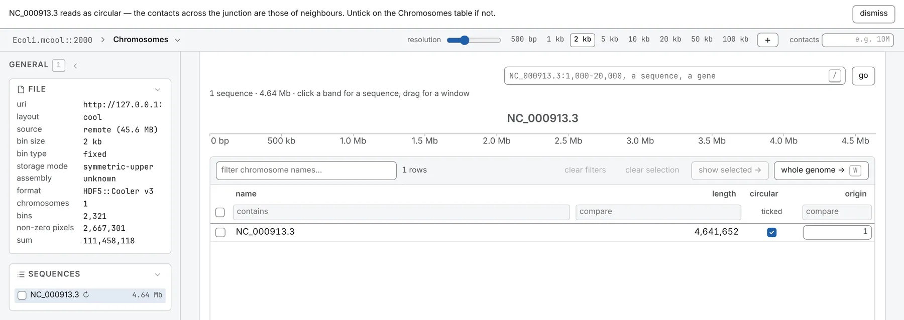

Beside a map, a FASTA or a `.2bit` draws a lane of GC content; in the 1D browser, the bases once
each has a pixel, and the six reading frames on request
([The genome browser](/browse/genome-browser/)). With no map, it opens the 1D browser over its
genome. It feeds the sequence tasks, such as [Find a motif](/analyses/motif/),
[Base composition](/analyses/composition/) and [Restriction sites](/analyses/restriction/), and
colours a BAM's mismatches.

## FASTA

A FASTA (`.fa`, `.fasta`, `.fna` or `.fas`) under 64 MB is read whole. A larger one needs its
`.fai`, beside it or named with `#index=<address>`, to be read by range; without one it is read
whole up to 300 MB, and refused above with the command that indexes it:

```sh
samtools faidx genome.fa
```

Read by range, a sequence's GC lane draws nothing over a window wider than 4 Mb (*GC under 4 Mb,
letters at base resolution — zoom in*), Origin and terminus declines it, and a BAM's mismatches are
coloured only over the stretch the sequence lane last drew.

A gzipped or bgzipped FASTA is always read whole, and refused past 300 MB, since its `.gzi` index is
not read: decompress and index it, or use a `.2bit`.

## .2bit

A `.2bit` is read by range, with an indexed FASTA's limits, and holds its own index: one file, a
quarter of the FASTA's size. Gaps are read as runs of `N`; soft-masking is not shown. Refused: a
version-1 `.2bit`, made for files over 4 GB (convert it with `twoBitToFa` and `faToTwoBit`); one
declaring more than 100,000 sequences; and a truncated one.

## One genome, many names

Wherever a name is asked for — a track, a second map, a 3D model, the locus box — the file's own
spelling is tried first, then these rules:

| Rule | Example |
| --- | --- |
| another case | `Chr1` = `chr1` |
| the same accession, undecorated | `ref\|NC_001133\|` = `NC_001133` |
| the `chr` prefix | `chr1` = `chrom1` = `chromosome_1` = `1` |
| leading zeros | `01` = `1` |
| Roman numerals | `chrXII` = `12` |
| an organelle spelled another way | `chrM` = `MT` = `MtDNA` = `NC_012920.1` |
| the accession | `NC_000001.11` = `chr1`; `chrUn_GL000220v1` = `GL000220.1` |
| another version of the accession | `NC_000001.10` ≈ `NC_000001.11` — offered, and flagged |

They never quietly match two different sequences:

- **The whole list decides.** `X` is chromosome ten in a list with `IX` and `XI` (budding yeast),
  and the sex chromosome where the numerals stop at `V` (*C. elegans*) or where chromosomes are
  numbered both ways (a host with a yeast spike-in). Bare numbers in a list longer than any genome's chromosomes, such as an
  assembler's contigs, match only as spelled.
- **Not equated:** an arm and its chromosome (`2L` is not `2`); a patch or one parent's copy and the
  chromosome (`_random`, `_alt`, `_fix`, `_hap1`, `_maternal`); a linkage group (`LG`) and a
  chromosome number. A name that follows no convention matches only exactly.
- **Lengths check the match.** Sequences matched across conventions with different lengths, as two
  assembly versions have, are flagged: *Matched across two naming conventions, but the sequences are
  different lengths…*.

A map in a deck notes under its heading how it read a name (*“chrIV” read as “IV”, by the chr
prefix*). On a track's row, *No sequence in this file matches the map (0 of 16)* means every
convention failed: the file is likely about another genome.

## Circular sequences

A bacterial chromosome, a plasmid or a mitochondrion arrives linear, the contacts joining its ends
in the map's far corner, until it is declared circular.



Tick it in the **circular** column of the **Chromosomes** table, or of a genome opened from a FASTA
or tracks. Its **origin**, beside the tick, is its first base until you type a 1-based position or
let [Origin and terminus](/analyses/oriter/) place it; the task never overwrites a position you
typed.

On a file's first open, its 50 longest sequences with at least 50 bins and no more than 20 Mb are
scored on their contacts across the two ends against the diagonal's at the same separation: about 1
for a circle, 0 for a line. At 0.2 or more a sequence is ticked, with a banner saying where to untick
it and its score in the tick's tooltip; an untick stays. A small circle at a coarse resolution may be
missed: tick it yourself. A sequence over 20 Mb is not scored, since no known circle is that long
(the longest bacterial chromosomes are about 16 Mb), so a human or mouse chromosome is never read for
it.

Once ticked:

- a window can cross the junction: `chrom:2,900,000-100,000` on a 3 Mb circle is the 200 kb across
  it;
- the map offers **ori**, the whole circle with its origin in the middle, and **arms**, observed
  over expected along both arms rather than the diagonal alone
  ([Reading a contact map](/browse/contact-maps/));
- the analyses measure separation the short way round: P(s), insulation, the directionality index,
  the HiC score, the scalogram, compartments and the tasks that read from the origin. Chromosight
  and the observed-over-expected map do not.

Declarations are kept with the file and in a saved workspace, not in a link. On the command line,
`chromosomix circular <map>` runs the same test, and `--circular <name>` and `--origin <name:pos>`
declare them for a run ([Command line](/reference/command-line/)).
