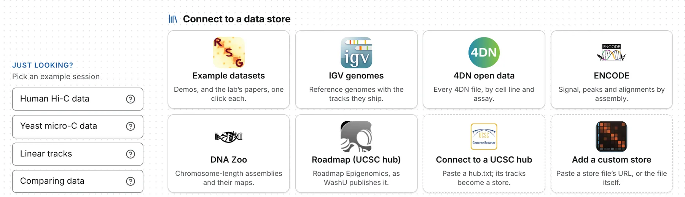

A data store is a catalogue of somebody's files, with enough about each — cell line, assay,
assembly, size — to choose it without opening it. Its files are read by range from where they are
published, and nothing is fetched until you open a store.

## The built-in stores

The landing page's **Connect to a data store** has a tile per store.

| Store | What it holds | Drawn as |
| --- | --- | --- |
| **RSG lab data** | the lab's demos of the viewer and the figures of its papers | a card per figure, under *Demo* and *Papers* |
| **IGV genomes** | IGV's reference genomes and the tracks it ships for each | a card per genome, opening it with its tracks in the 1D browser |
| **4DN open data** | every file on the 4DN open-data bucket | a faceted list, grouped by experiment set |
| **ENCODE** | ENCODE's released signal, peaks and alignments, by assembly | a faceted list, grouped by experiment |
| **DNA Zoo** | chromosome-length assemblies and the Hi-C maps behind them | a faceted list, grouped by species |
| **Roadmap (UCSC hub)** | the Roadmap Epigenomics integrative tracks, as WashU publishes them | a hub, grouped by assembly |

ENCODE's **Genome** and **Files** tick boxes, at the top of its facets, choose which assemblies and
kinds of file are read. 4DN and ENCODE leave out Hi-C alignment files, which are in read-pair order
and cannot be drawn as reads; the same experiments' `.pairs` files and contact maps are there.

Beside the tiles, **Just looking?** offers four example sessions — *Human Hi-C data*, *Yeast micro-C
data*, *Linear tracks* and *Comparing data* — and the `?` on each says what it holds.

## The store drawer

A store opens in a drawer down the left of the window, one per window. Its head has the store's
name, every tile (to switch stores), a link button, an arrow to the store's website — for a hub,
UCSC's list of public hubs — and a download of the catalogue as narrowed.

The stores button in the header, the <kbd>\\</kbd> key and **Stores** in the command palette open
and close it, on the store you were last on; <kbd>Esc</kbd> puts it away. A faceted store has:

- **facets**, one per column, each value counted by what ticking it would add: ticks in one facet
  are either-or, ticks in different facets must all hold;
- a search box, *search the names, notes and cells*, matching every word in any order;
- a list, or a matrix of two facets (**down** and **across**), each cell a count that ticks both its
  values when pressed;
- **clear filters**.

The list draws the first 1,000 rows: narrow it to see the rest. Rows are grouped by experiment, set
or species, and a group's **open with its tracks** opens its session. A row names the file as the
store does — *Hi-C on HFF cells, protocol variations*, not `4DNFI24F7GRY.mcool` — and the name stays
with it once open.

## Opening what you find

Each file's row has two marks: **+** adds it to the tab in front (a map beside the map there,
anything else as a track), and the window mark opens it in a tab of its own. A session's row opens
as tabs. Rows can also be dragged wherever a file can be dropped ([Opening files](/files/opening/)).

Tick several rows for a tray: **open together** opens the first map ticked and adds the rest, in
ticking order; **add to this tab** adds each to the tab in front; **clear** unticks them. Opening
folds the drawer away; adding keeps it up. A row never replaces what a tab holds. A map with tracks
published beside it offers **load the N tracks published with this map** on the Tracks card.

## Connecting a UCSC hub

Paste the address of a hub's `hub.txt` into the **Connect to a UCSC hub** tile and press **open**:
its genomes and the tracks chromosomix can draw become rows, grouped by assembly, its composite
tracks a facet.

- **The genome row** is an assembly hub's `.2bit`. A hub over an assembly UCSC hosts (`genome hg38`)
  takes it from the `chromSizes` it names, or its first bigWig or bigBed; a hub of nothing but BAMs
  has none.
- **open with its tracks**, on an assembly's heading, opens the genome with the tracks the hub turns
  on by default. The rest keep rows of their own, and the store's description says how many are on:
  *440 tracks, 20 on by default*.
- **What is read**: `bigWig`, `bigBed`, `bigNarrowPeak`, `bigGenePred`, `bigPsl`, `bigChain`,
  `bigMaf`, `bigLolly`, `bigDbSnp`, `bigRmsk`, `bigBarChart`, `barChart`, `bigInteract`,
  `interact`, `bigMethyl`, `bedMethyl`, `longTabix`, `vcfTabix` and `bam` as tracks, and `hic` as a
  contact map. Anything else, such as `cram`, gets no row, and the store's description counts it.

If the hub's host allows no cross-origin read, paste its text under **or paste the hub** — one file,
or `hub.txt`, `genomes.txt` and `trackDb.txt` in turn — with the address its relative names hang
off, and press **open what is pasted**; **fill in an example** gives a working hub to start from.
Tracks on UCSC's own servers, `genome.ucsc.edu` and `hgdownload.soe.ucsc.edu`, will not open either
way: those servers allow no cross-origin reads.

What a hub needs to be readable is on [UCSC track hubs](/advanced/track-hubs/).

## Adding a custom store

A lab publishes a store as one JSON file beside its data
([Your own data store](/advanced/data-store/)). In the **Add a custom store** tile, paste its
address and press **open**, or paste the file under **or paste the store**. **remember this store**
keeps it as a tile in this browser; **forget this store**, on its page, takes it away. **What this
browser is remembering**, in the command palette, lists remembered stores and can forget them.

## Links to a store

The address bar holds the store as you have narrowed it, and the drawer's link button copies it.
`https://chromosomix.app/?store=4dn&q=HFF` opens 4DN searched for *HFF*: `?store=` takes a built-in
store's id (`rsg`, `igv`, `4dn`, `encode`, `dnazoo`, `roadmap`) or the address of a store file or a
`hub.txt`, `q=` the search, and `<column>=<value>` ticks a facet.

## Private files

A store's rows are read as the files they name would be: with a connected bucket's key, a Google or
Dropbox sign-in, or a presigned link that works until it expires ([Opening files](/files/opening/)).
A Google sign-in lasts about an hour; then the refusal offers **sign in again**. No server stands
between you and the data, so a host that will not answer a browser cannot be read: the Aiden Lab
bucket `hicfiles.s3.amazonaws.com`, for one, answers only IGV's own programs.

## When a store will not load

- *Nothing has been published for … yet* — a built-in store whose catalogue is not on this copy of
  the site; the sentence says what publishes it.
- *… could not be read* — the host does not allow a cross-origin read; paste the file's text
  instead.
- *… answered with a page, not a store file* — the address leads to a web page, often a sign-in
  page.
- *… is not there: the host answered 404* — check the address.

Other refusals are on [When a file will not open](/files/problems/).
