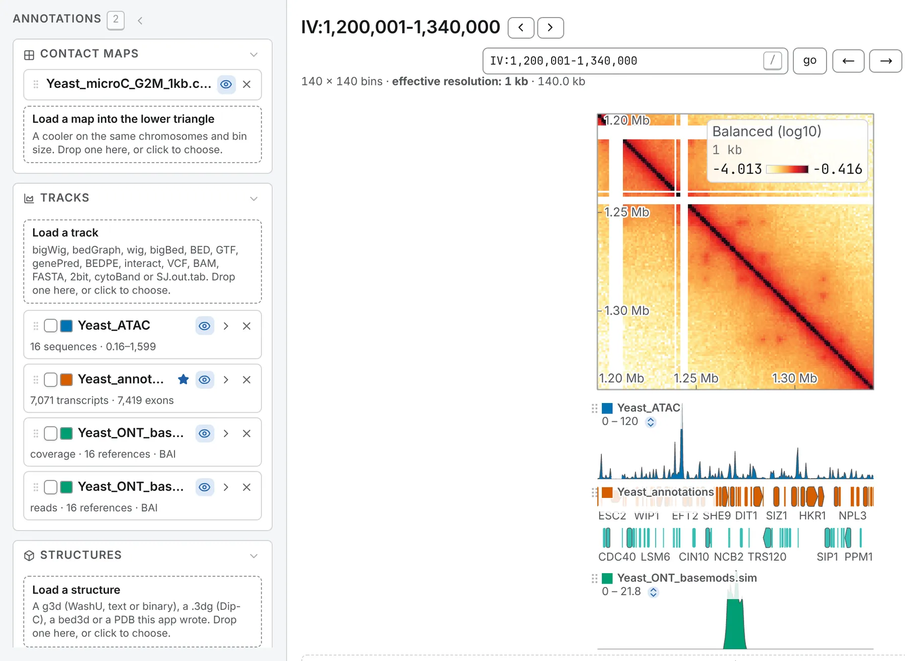
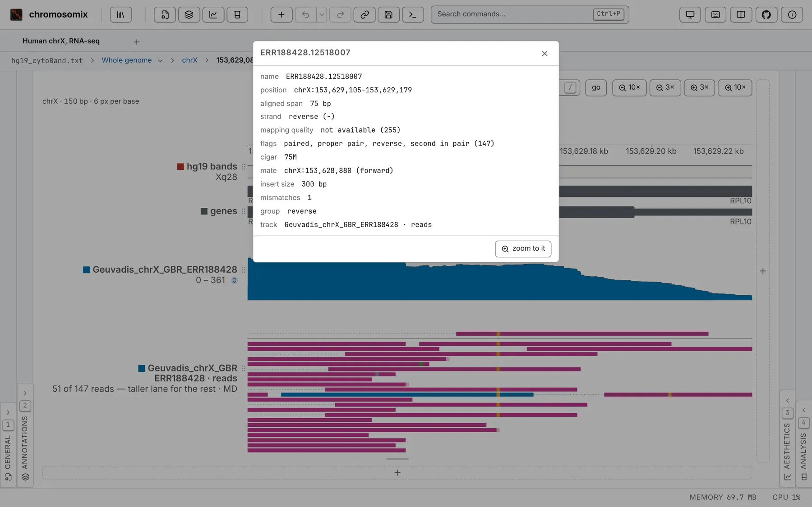

Dropped on a map, a track is drawn along any of the map's four edges; opened with no map, it opens
the 1D browser over its genome ([The genome browser](/browse/genome-browser/)). Each track is a row
of the Annotations panel's **Tracks** card, whose **Load a track** zone takes a drop or a click.



Sequence names are matched to the map's even when spelled differently (`chr1` against `1`), and the
row says when some do not match: *10 of 16 sequences matched; nothing is drawn on XI, XII, …*. Pairs
of loci are on [Interactions](/files/interactions/); FASTA and `.2bit` on
[Reference sequences](/files/sequences/).

## Signal: bigWig, bedGraph and wig

A **bigWig**, a **bedGraph** (exactly four columns, the fourth a number, or a `track type=` line) or
a **wig** (`fixedStep` or `variableStep` lines, 1-based) draws as a value track with its own limits, colour
and style, and can share an axis with others. A bedGraph or a wig is read whole.

## Intervals: BED and bigBed

A **BED** of 3, 4, 5, 6, 9 or 12 columns, a **narrowPeak**, **broadPeak** or **gappedPeak**, or a
headed table whose first three columns are a sequence, a start and an end opens as features beside
the map, never on it. A BED12's blocks are drawn as exons, its thick span thicker.

A **bigBed** is read whole, and cut off, with a note, past a million intervals. One whose schema
says bigGenePred, bigBarChart, bigMethyl or bigInteract is read as that.

## Gene models: GTF, GFF3 and genePred

**GTF** and **GFF3** are read as transcripts from their exon and CDS rows, the coding span thick and
the untranslated ends thin. A bacterial GFF3 from Prokka, Bakta or DFAST, whose rows name no parent,
is read a feature per row, under its `locus_tag` and gene symbol.

**genePred**, **genePredExt** and **refFlat** open as the same gene models, with or without a
leading `bin` column, and so does a **bigGenePred**. With several gene models loaded, the star on a
row marks the one the locus box searches for gene names.

## Called variants: VCF

A **VCF** opens as a lane of called variants: a substitution in the colour of the base it changes
to; an insertion, a deletion or a symbolic allele (`<DEL>`, `<DUP>`) in grey, as wide as it is, from
`INFO/END` or `INFO/SVLEN`. Click a variant for its card.

- With `##contig` lines in its header, it opens the 1D browser on its own chromosomes, at their
  exact lengths.
- Samples are counted, not drawn: *1,284 variants · 2,504 samples not drawn*.
- It is read into memory, so one human sample's whole-genome calls are too large; split by
  chromosome, they open. BCF is not read: `bcftools view` writes a VCF.

## Reads: BAM

A **BAM** opens as two rows:

- the depth row, under the file's name: mean depth, a deletion counted as covered and a skipped
  intron not, secondary and supplementary alignments left out, duplicates kept unless you switch on
  **hide duplicates**;
- the reads row, *name · reads*, in the 1D browser only: the pile of reads.



**min MAPQ** and **hide duplicates** apply to both rows; the colouring, the layout of pairs and
**split reads** to the pile. Mismatches are coloured from the reads' `MD` or `=`/`X` codes, or from
a FASTA open in the tab; base modifications from the `MM` and `ML` tags (**colour by** → *base
modification* on the pile, **% modified** on the depth row). A spliced library's skipped introns are
drawn as arcs over the depth (**junction arcs**, from two reads by default).

Without a `.bai` or `.csi`, the reads are found by searching the sorted file, a window of up to 4 Mb
at a time (*reads located by search*). A window too deep to read, or a pile over too wide a window,
draws nothing and says why: *12.4 MB of reads — zoom in*.

A BAM must be sorted by coordinate: one sorted by read name, or a Hi-C pipeline's alignment file,
is refused with the fix:

```sh
samtools sort -o sorted.bam reads.bam
samtools index sorted.bam
```

For Hi-C, open the `.pairs` or the contact map instead. CRAM is not read: convert it with
`samtools view -b`.

## Methylation: bedMethyl and bigMethyl

A **bedMethyl** (from `modkit pileup`, or ENCODE's older WGBS layout) or a **bigMethyl** opens as
percentage modified per base, on a 0 to 100 axis at first. Where several modifications cover the
same bases, the commonest is drawn, and the lane's summary lists every code (`m` 5mC, `h` 5hmC, `a`
6mA…) with its count of rows. A row with no reads is left out, not drawn as 0 %.

## Charts: barChart and bigBarChart

A **barChart** gives each feature a vector of values: a small bar chart where there is room,
otherwise one box in its top category's colour and height. Names and colours come from the `track`
line (`barChartBars`, `barChartColors`); a **bigBarChart** opened alone has none, so its categories
are numbered.

Charts on a lane share one ceiling, the file's `maxLimit` or its largest value. **scale each chart**
scales each to its own tallest bar; typed limits fix the axis, to compare two files. Click a feature
for its whole chart.

## Ideograms: cytoBand

A **cytoBand** or **cytoBandIdeo** draws each chromosome's Giemsa bands. The line under the lane
names the bands in view (`Xq27.3 – q28`), a click names one (`Xq28`), and the locus box finds bands
by name. A cytoBand that tiles every chromosome declares the genome: UCSC's `hg19_cytoBand.txt`
alone opens the browser over hg19.

## Splice junctions

Junctions are drawn as a sashimi plot's arcs, each labelled with its read count, from three files:

| File | Written by | Recognised by |
| --- | --- | --- |
| `SJ.out.tab` | STAR | its nine integer columns |
| a junctions BED12 | regtools, TopHat, Portcullis | `junc` or `sj` in its name, a TopHat `track` line, or `JUNC…` row names |
| `.junc` | leafcutter | its name |

Each junction's card shows the file's other columns, which can also colour the lane: colour by
*annotated* to see novel splicing. Junctions on both strands split the lane, forward above, reverse
below. The lane's lower limit filters, as a sashimi plot's minimum junction coverage does. A spliced
BAM draws its own arcs ([above](#reads-bam)).

## Lengths: chrom.sizes

A **chrom.sizes** (or a `.genome` file: a name and a length per line) declares a genome. Opened
alone, it starts the 1D browser on those sequences. Dropped on a browser whose lengths were guessed
from a feature file (*inferred (rounded up)* on the Genome card), it gives the real ones.

## Reading part of a large text file

Text formats are read whole, unless bgzipped and indexed with tabix: then only the sequences the map
holds are read.

```sh
sort -k1,1 -k2,2n peaks.bed | bgzip > peaks.bed.gz
tabix -p bed peaks.bed.gz
```

Keep the `.tbi` beside the file, drop the two together, or name it with `#index=<address>`. Without
a usable index, or where it would save less than a fifth of the file, the whole file is read. A
browser holds little more than half a gigabyte of text: index a larger file, or split it by
chromosome.

## The file's own columns

A feature lane is coloured by strand at first. Its **colour by** offers the file's other columns (a
GTF's `biotype`, a VCF's `QUAL`, a BED's name…) as categories, commonest first, or, for numbers, as
a colour ramp over the whole file's range. Names exactly `A` and `B` take the compartments' red and
blue.

The **Metadata annotations** card, folded at the foot of the Annotations panel, offers a cooler's
own columns, such as its balancing weight, where the view can show them. Pick one and press **add**
to draw it as a lane, numbers as bars and labels as runs of colour; its row exports it as a TSV.
