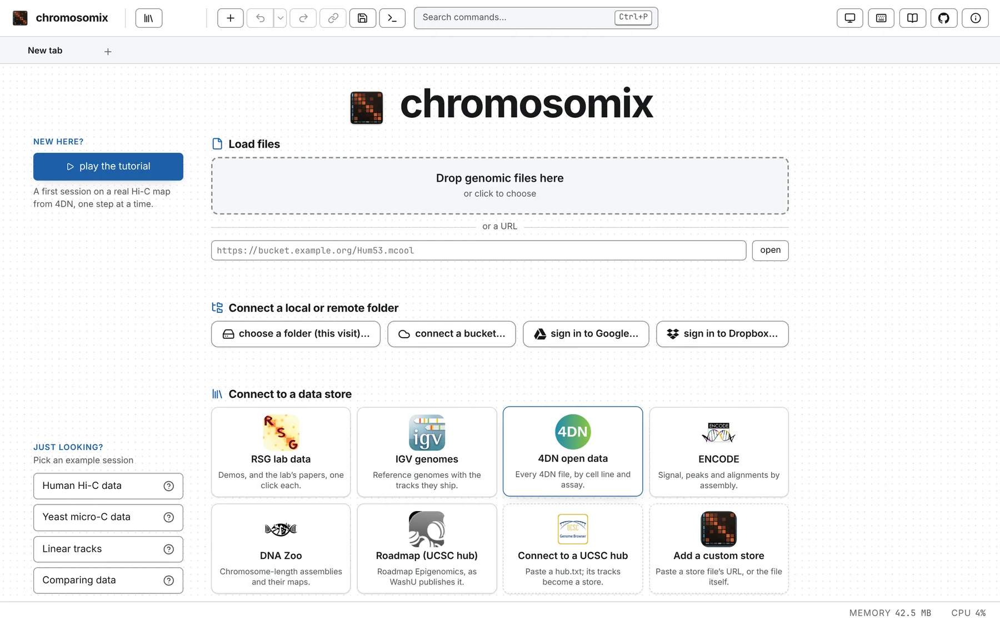
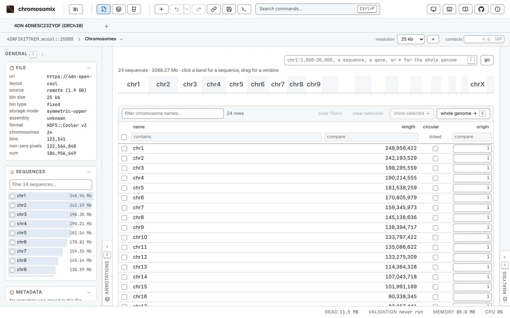
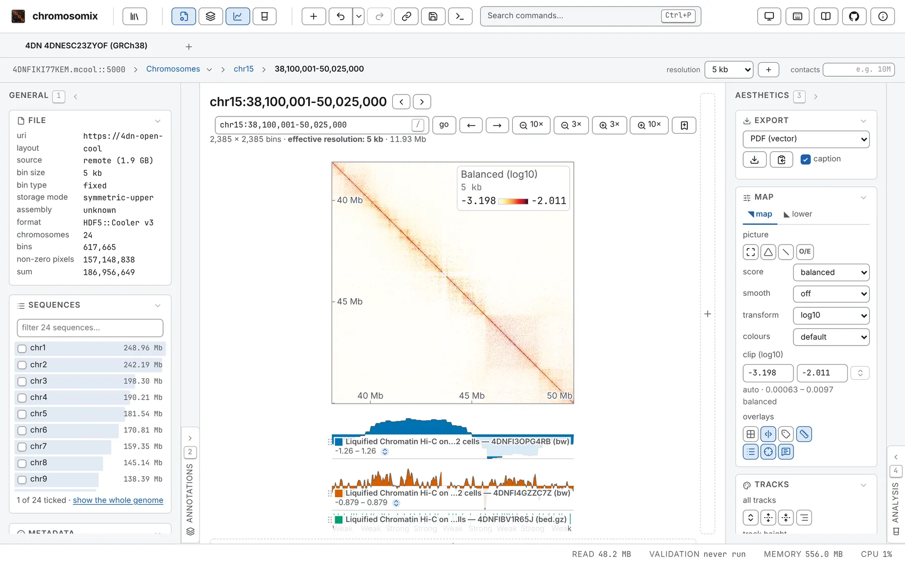

This page walks you through a first session on public data. You need a computer with a recent web
browser and a network connection. Nothing is installed, and nothing is uploaded.

The map is in situ Hi-C of K562 cells from the 4D Nucleome project (4DN), experiment set
`4DNESC23ZYOF` (Belaghzal et al. 2021): about 187 million contacts on GRCh38, in a 1.9 GB `.mcool`
that chromosomix reads where it is published, by range, without downloading it. It is also the map
the [guided tutorial](/start/tutorial/) uses, if you would rather be shown each control in the app.

:::tip[Just want to see something first?]
On the landing page, under *Just looking?*, press **Human Hi-C data**. One tab opens on 4DN's Hi-C of
K562 at the MYC locus, with IGV's hg38 genes above it, 4DN's insulation and compartments down its
left side, ENCODE's ChIP-seq, ATAC and DNase under it, and ENCODE's CTCF loops drawn on it. The `?`
beside each example says what it opens and where the data come from.
:::

## Open the app

Go to <https://chromosomix.app/>. The landing page offers three ways in:

- **Load files**: drop files on the box, or click it to choose them. Under it, behind *or a URL*, is
  a box for a file's address.
- **Connect a local or remote folder**: a folder on your disk, a bucket, Google Drive or Dropbox,
  listed in a column you can browse.
- **Connect to a data store**: catalogues of published data, one tile each.



## Open a map from the 4DN store

1. Under **Connect to a data store**, press **4DN open data**. The store drawer opens down the left
   of the window.
2. In its search box, type `4DNESC23ZYOF`. The files of that experiment set are listed together
   under a heading with the set's accession.
3. On that heading, press **open with its tracks**. The drawer folds away and the map opens with the
   tracks 4DN's own pipeline computed from it: the compartment eigenvector (E1), the insulation score
   and the boundaries called on it.

The map opens on its **Chromosomes** table, one row per chromosome. The **General** panel, left of
it, says what the file is: its bin size and its number of contacts under *File*, its chromosomes
under *Sequences*, and anything else it carries under *Metadata*.



## Pick a resolution and open a chromosome

An `.mcool` holds the same map at several resolutions, each a size of bin. The control is at the far
end of the bar above the table, after the word **resolution**: a dropdown on a file with many
resolutions, like this one, and a slider over labelled stops on a file with nine or fewer.

1. Choose **250 kb**, coarse enough to show a whole chromosome's compartments.
2. In the Chromosomes table, press **chr15**. Its map opens, with 4DN's tracks drawn under it.

Each pixel is how often two stretches of chr15 touch. The blank square at the start is the short arm,
where there is no unique sequence for reads to map to; the long arm carries broad compartments, the
checkerboard away from the diagonal.

## Move around

- **Drag** to pan. The **wheel**, or a pinch, zooms about the pointer. **Double-click** fits the
  picture back. Once you have clicked the map, the arrow keys pan it; <kbd>0</kbd> fits it from
  anywhere.
- The wheel enlarges the picture already read. To read a stretch on its own, hold
  <kbd>⌥ Option</kbd> (<kbd>Alt</kbd> on Windows and Linux) and drag a box across the map: that
  region opens. Hold <kbd>⇧ Shift</kbd> as well to keep the box on the diagonal. While the pointer is
  over the map, its corner reminds you of both.
- Or type a place in the box above the map and press **go**, or <kbd>Enter</kbd>:
  `chr15:30,000,001-60,000,000`. Coordinates are written as IGV and UCSC write them, counted from 1
  with both ends included, with or without the commas.
- Beside **go**, two arrows move the window half its width along the chromosome, and four steps zoom
  out (`10×`, `3×`) or in (`3×`, `10×`) about its centre.
- To go back up, use the trail above the map — the file, **Chromosomes**, chr15, the window — or the
  back button in the header, which steps back through every place you opened (a drag or a wheel is
  not a step). In a window of one chromosome, a click on the map opens the whole chromosome again.

[Moving around](/browse/navigating/) has every gesture and key.

## Change the resolution

Open chr15 from 30 to 60 Mb, with an <kbd>⌥ Option</kbd>-drag or by typing
`chr15:30,000,001-60,000,000`. Then choose **5 kb** in the resolution control. The place on screen
stays the same; only the bins are finer. Go closer, to `chr15:38,100,001-50,025,000`: the squares
along the diagonal are domains, most of them nested inside bigger ones, and the dots at their corners
are loops.

When a window holds more bins than the picture has room for, it is drawn coarser than the file's
bins, and the line under the title says so, as its *effective resolution*. <kbd>-</kbd> and
<kbd>+</kbd> step one resolution coarser or finer from the keyboard.



## Change the normalisation

The **Aesthetics** panel, right of the map, sets how the picture is drawn. On its **Map** card:

- **score** is what the cells are. This file carries balancing weights, so it opens **balanced**.
  Choose *counts* to see the raw counts, with each bin's coverage bias still in them, then
  *balanced* again. *VC*, *VC √* and *ICE* are normalisations computed in the page, *expected* draws
  the decay with distance alone, and *correlation* is the plaid compartments are called from.
- **O/E**, or <kbd>E</kbd>, divides each pixel by what its distance from the diagonal predicts: red
  where two stretches touch more than their distance predicts, blue where they touch less. Domains
  stand out from the decay.
- **smooth** averages each pixel with its neighbours. At 5 kb most pixels hold a handful of contacts,
  and *3 × 3* evens them out.
- **transform**, **colours** and the two clip boxes set the colour scale.

O/E and smoothing change the picture, not what an analysis reads.
[Reading a contact map](/browse/contact-maps/) explains each score.

## Add a track

Tracks are drawn beside the map, lined up with its bins. Add ENCODE's CTCF ChIP-seq of K562, which is
the same cells on the same assembly:

1. In the header, press **+**, *Add a file to this tab*.
2. Paste this address into the box under *or a URL*, and press **open**:

   ```text
   https://encode-public.s3.amazonaws.com/2020/09/26/85161a5a-d6b5-49d2-bc0a-db0b217ff0d5/ENCFF979PWH.bigWig
   ```

The signal is drawn under the map, read by range like the map itself. Its row is on the **Tracks**
card of the **Annotations** panel (<kbd>2</kbd>, left of the map), where you can recolour it, set its
height and its range, or move it to another edge.

A file on your own disk takes the same road: drop it on the window, on an edge of the map to draw it
there, or on the Tracks card's **Load a track**. [Tracks and features](/files/tracks/) lists what can
be drawn.

## Run an analysis: insulation

Insulation scores how much contact crosses each bin. Its dips are the boundaries between domains.

1. Open the **Analysis** panel, from its button in the header or with <kbd>4</kbd>. Its tasks are in
   three groups: **2D tasks** read the map, **3D tasks** model it, and **1D tasks** read tracks.
2. Under **2D tasks**, press **Diamond insulation**. Its drawer opens over the right of the window,
   with the task's settings.
3. The task runs on every chromosome to begin with. In its list of sequences, press **none**, then
   tick **chr15**.
4. Leave the rest at its defaults — a window of 10 bins, which is 50 kb at 5 kb — and press **run**.

The task's row says **running**, then **done**. The map stays live meanwhile, so you can keep
panning. Close the drawer with its × or <kbd>Esc</kbd>: the insulation score is drawn as a track left
of the map, the boundaries it called as a lane beside it, and the domains between them as corners
along the diagonal. Each is a row of the Tracks card like any other, and the score's row can be saved
as a bigWig that IGV and deepTools open.


Open the console, from its button in the header or with <kbd>Ctrl</kbd> and the key left of
<kbd>1</kbd> (<kbd>Ctrl</kbd>+<kbd>&#96;</kbd> on most keyboards, Control on a Mac too): the run is there
as the `chromosomix` command that repeats it, ready to paste into a terminal.
[Diamond insulation](/analyses/insulation/) explains every setting and how to read the result.

## Share a link

In the header, press the link button, *Share this tab as a link*. The **Share this tab** dialog
opens with the link already copied to your clipboard. It carries everything in the tab — the view,
the tracks and their colours, the marks and the bookmarks — inside the link itself, so no server
holds it and it cannot expire. Every file in this session is public, so anyone who opens the link
sees what you see.

A track you computed travels as the task and its settings rather than as numbers: in your
colleague's window its row comes back with a **recompute** button.

The dialog also offers to **shorten with is.gd**, a third-party service: that sends the link,
including the address of the file, to is.gd. To keep the whole window rather than one tab, use
*Save every tab as a file* (<kbd>Ctrl</kbd>+<kbd>S</kbd>, <kbd>⌘</kbd><kbd>S</kbd> on a Mac).
[Sessions, workspaces and links](/browse/sessions-and-links/) says what each one keeps.

## Next

- Open your own files: [Opening files](/files/opening/).
- Put several maps side by side: [Maps side by side](/browse/deck/).
- Find your way round the rest of the window: [A tour of the window](/start/window/).
- Browse the other tasks: [Analyses](/analyses/).
