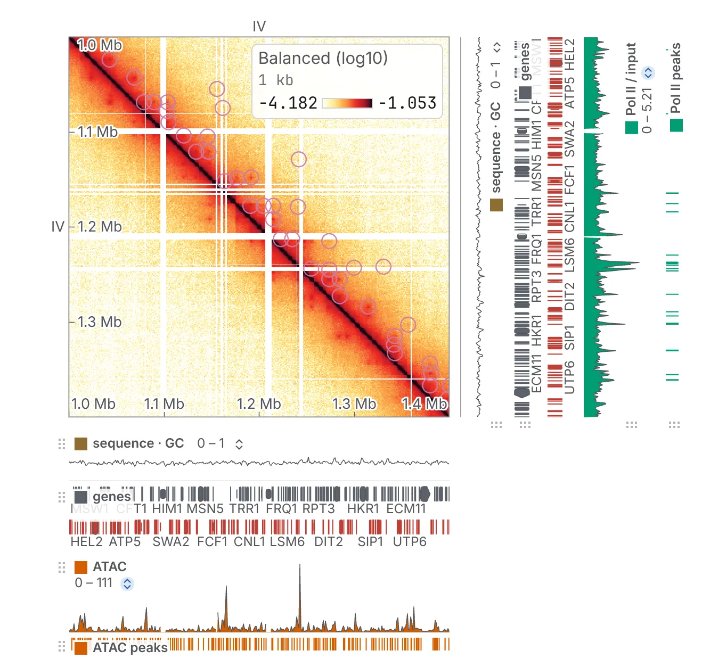

chromosomix shows chromatin contact maps, genome tracks and 3D models side by side, straight from
your files. It runs entirely in your web browser — at <https://chromosomix.app/>, as a desktop app,
or as a single HTML file — and nothing you open in it is uploaded anywhere. A `chromosomix` command
line runs the same analyses in a script or a pipeline.

## What you can do with it

- **Look at a contact map** at every resolution the file stores, from the whole genome down to a few
  bins, and move around it as you would a map: drag, scroll, type a locus. Draw it as raw counts,
  balanced, observed over expected or as a correlation, and set its colour scale.
  [Reading a contact map](/browse/contact-maps/) says how.
- **Read tracks against it.** A bigWig, a set of peaks, a gene model or a BAM is drawn beside the map,
  on any of its four edges, lined up with its bins; loops and domains are drawn on the map itself.
  With no map at all, the same tracks open in a [genome browser](/browse/genome-browser/) of their
  own.
- **Compare maps.** Put a second map in the other triangle of the same square, or draw the ratio of
  the two ([Comparing two maps](/browse/comparing/)); open several maps as a deck of cells that pan
  and zoom together ([Maps side by side](/browse/deck/)); turn a map 45° to read it along the
  diagonal ([The 45° view](/browse/turn/)).
- **See a 3D model beside the map.** Point at a bead and the map shows where it is; point at the map
  and the model lights the beads ([3D models beside the map](/browse/structures/)).
- **Run analyses in the page.** Over thirty tasks — P(s), insulation, compartments, loops, APA,
  virtual 4C, peak calling, metaplots, a 3D model built from the map and more — whose results arrive
  as tracks, figures and files. A task that reproduces a published method names it, and all but a
  few of them are checked against that method's own package — cooltools, coolpuppy, chromosight,
  deepTools, bedtools and others — on public data, in a notebook published with every release. See
  [Analyses](/analyses/) and [How the results are checked](/analyses/validation/).
- **Repeat them from the command line.** Every run is written to the [console](/browse/console/) as
  the `chromosomix` command that repeats it, with the same parameters and the same results
  ([From the app to a script](/cli/from-the-app/)).
- **Keep and share the work**: a figure as a vector PDF or a PNG ([Figures and export](/browse/figures/)),
  a link that carries the whole tab, and a file that holds every tab
  ([Sessions, workspaces and links](/browse/sessions-and-links/)).

## What it reads

Files open in the formats their pipelines write. There is nothing to convert first.

| What | Formats |
| --- | --- |
| Contact maps | `.cool`, `.mcool`, `.hic`, `.scool`, HiC-Pro, `.pairs` (binned as it opens, at a resolution you pick) |
| Tracks and features | bigWig, bedGraph, wig, bigBed, BED and narrowPeak, GTF and GFF3, genePred, VCF, BAM, bedMethyl, cytoBand, splice junctions and more |
| Interactions | BEDPE, `interact` and `bigInteract`, `longrange` |
| Sequences | FASTA, `.2bit`, `chrom.sizes` |
| 3D models | g3d, `.3dg`, bed3d, PDB |

The full list, with the index files each format reads beside it, is in
[Files, hosts and stores](/reference/files-and-stores/).

Those files can be on your own disk; on any web host that lets a browser on another site read byte
ranges of them — a public bucket on S3, Google Cloud Storage or Cloudflare R2, most static web
servers; behind a Dropbox or Google Drive link; in your own Drive, Dropbox or private bucket; or in
one of the data stores the app offers — 4DN, ENCODE, IGV's genomes, DNA Zoo, Roadmap and the lab's
own figures — and any UCSC track hub. [Opening files](/files/opening/) covers each road in.

## How it works, and why that matters to you

- **There is no server.** The app is a set of static files. Everything it does — reading a file,
  drawing it, every analysis — happens in your browser, on your machine. There is no account to make
  and nothing to install.
- **Nothing you open is uploaded.** A file on your disk is read in place, a few kilobytes at a time,
  by code running on your own computer. You can open unpublished data with the network cable out.
- **Files are read where they live.** A remote file is read with HTTP range requests, so opening one
  chromosome of a multi-gigabyte `.mcool` on a bucket costs a few requests rather than a download.
- **It works offline.** After one visit, the web app opens with no network at all, and your local
  files open in it. Only remote files and the stores need a connection.
- **Nothing reaches a third party until you ask.** A store's catalogue is read when you open it, and
  the part of a link after `#`, which holds the view, is never sent to the site serving the page.
- **The map stays live while a task runs.** Analyses run on a worker of their own, so you can keep
  panning while one works.

What the browser does keep — your settings, the console's log of the past week, the tabs to offer
back after a restart — is listed in the command palette under *What this browser is remembering*,
with a button that forgets all of it. [Privacy](/advanced/privacy/) has the whole account.

## Where it runs

- **The web app**, at <https://chromosomix.app/>, in any recent browser. It can be installed as an
  app and works offline.
- **The desktop app**, for macOS and Linux, for a machine that cannot reach the website.
- **One HTML file**, attached to every release, for a machine with no network at all.
- **In a notebook or a page**: a widget in [Jupyter](/embed/jupyter/), in
  [R, Quarto and Shiny](/embed/r/), or an `<iframe>` in [any web page](/embed/web-page/).
- **The command line**, `chromosomix`, on any machine with Node ([Installing it](/cli/install/)).

[Ways to use chromosomix](/start/ways/) shows them all side by side, and
[Web, desktop or one file](/start/where-to-run/) says what differs between the first three.

## Where to go next

- [Your first map](/start/first-map/) — open a public Hi-C map and use it, step by step.
- [A tour of the window](/start/window/) — what every part of the screen is for.
- [The guided tutorial](/start/tutorial/) — the same first session, played in the app itself.
- [Your files](/files/opening/) — every format and every place a file can come from, and
  [what to do when one will not open](/files/problems/).
- [Using the browser](/browse/navigating/) — moving around, reading and comparing maps, tracks,
  marks, figures and the console.
- [Analyses](/analyses/) — every task, what it answers and how to read its result.
- [Command line](/cli/install/) — the same tasks in a script or a pipeline.
- [Advanced](/advanced/hosting/) — hosting your own data, publishing a store, running your own copy.
- [Reference](/reference/files-and-stores/) and the [glossary](/glossary/).

chromosomix is free software, under the GNU General Public License, version 3 or later. Its source
is at <https://github.com/js2264/chromosomix>; [Source code and contributing](/contributing/) says
how to report a problem or take part.
