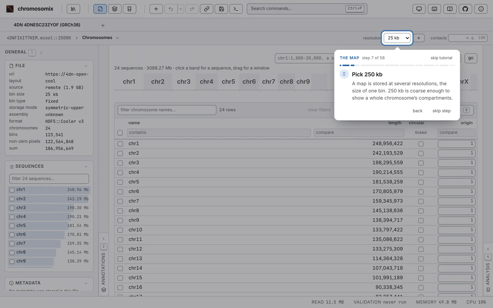

The guided tutorial is a first session in the live window, one step at a time: everything is greyed
but the control a step is about, and a card says what to do with it. You press every control
yourself, on real data, and the tutorial moves on once you have done what it asked.

You open a Hi-C map from the 4D Nucleome project (4DN), find its compartments, its domains and a loop,
save what you made, and set your results against 4DN's.

## Where to start it

- On the landing page, under *New here?*: **play the tutorial**.
- In *About this viewer*, at the right of the header, on its first tab.
- In the command palette: *Guided tutorial*, under Help.

It never opens by itself. The single HTML file and an embedded viewer have no data stores, where it
begins, and do not offer it. Started from the beginning over a tab that holds something, it opens a
tab of its own.

## What you need

- **A network connection**: the data are read from 4DN's public bucket.
- **A mouse or a trackpad** for two drags across the map, or their *zoom for me* buttons.
- **Somewhere to save a bigWig and a PDF**: those steps are done once the file is saved, so accept
  your browser's save dialog if it opens one.

## The data

**4DNESC23ZYOF**, in the 4DN store: in situ Hi-C (DpnII) of K562 cells on GRCh38 (Belaghzal et al.
2021), 186,956,649 contacts, in a 1.9 GB `4DNFIKI77KEM.mcool` read by range. 4DN's own compartment
eigenvector at 250 kb (`4DNFI3OPG4RB`), insulation score (`4DNFI4GZZC7Z`) and boundaries, from the
same map, are what your results are set against.

Every task runs on **chr15**, whose long arm has broad, clean compartments. In
`chr15:38,100,001-50,025,000`, the domain from 45.66 to 48.32 Mb is closed by a loop,
`chr15:45,662,501 × chr15:48,312,501`, and split into two subTADs by a weak border at
`chr15:47,215,001`: the two places you mark.

Tasks keep their defaults but two. You set insulation's **scales** to 4: a window of 10 bins (50 kb
at 5 kb), doubled three times to 100, 200 and 400 kb. And the tutorial sets the Compartments task's
gene model to none, so nothing decides the sign of E1: yours may match 4DN's upside down, at a
correlation of −1.

## The parts

Fifty-eight steps in twelve parts, each named on the card:

1. **Welcome**.
2. **The 4DN store**: open `4DNESC23ZYOF` with its tracks.
3. **The map**: the General panel, 250 kb, chr15, moving about, the Aesthetics panel.
4. **Compartments**: the *correlation* plaid, then the task on chr15, its saddle, and your E1 against
   4DN's.
5. **Zooming in**: a drag holding <kbd>⇧ Shift</kbd> and <kbd>⌥ Option</kbd> (<kbd>Shift</kbd> and
   <kbd>Alt</kbd> off a Mac), 5 kb, O/E and *3 × 3* smoothing.
6. **Insulation** at four scales, read as a hierarchy of borders.
7. **Marks** on the loop and the weak border.
8. **Tracks**: your insulation as a bigWig; the domains as a 1D track.
9. **The figure** as one vector PDF.
10. **Track correlation**: your tracks against 4DN's.
11. **The console**: every file opened and every run, as a command.
12. **Done**.

Some steps have a button that does them for you: *type it for me*, *set it for me*,
*mark it for me*, *tick them for me*.

## The card, and how a step moves on

The card shows the part, *step n of 58*, a bar of your progress and **skip tutorial**. At its foot,
**back** and **next**; **next** reads **skip step** while the step waits on you, and **finish** on the
last.

- **A step moves on once what it asks is done**, by the lit control, a key or the command palette;
  its icon turns into a tick.
- **A name to type** is coloured, often with a button that copies it; the accession blinks if what
  you type cannot become it.
- **A press on the grey** only pulses the ring round the control to press; inside the lit hole,
  everything works as usual.
- **A control off screen** is named on the card with what to do. If what a step needs has gone, the
  tutorial goes back to the step that brings it.
- **Steps already done** go by on their own going forward; going back shows them and waits.
- <kbd>←</kbd> and <kbd>→</kbd> go back and on wherever the keys are not a control's own;
  <kbd>→</kbd> never skips a step that is waiting on you.
- **A dialog** sets the tutorial aside until it closes.

With *reduce motion* on in your system, the card jumps rather than glides, and nothing pulses or
blinks.

## Leaving and coming back

**skip tutorial** leaves at any step. Your place is kept in this browser, and the landing page and
About then offer **resume at step n of 58** and **start over**.

A resume lands on the first step of the part you left, and steps whose state still holds go by on
their own. **start over** begins again, in a tab of its own. After **finish**, both places offer
**play the tutorial again**. The place kept is listed under *What this browser is remembering*.

[Your first map](/start/first-map/) is the same session at your own pace, without the card.
